# ARC NPU 调度子系统详细设计说明（目标架构）

> **文档定位**：本文定义昇腾 CI 的 ARC NPU 调度子系统目标架构（TO-BE），用于评审子系统功能机制、组件职责、接口、数据状态和 DFX 质量属性。只讨论目标状态，不以代码是否实现、GitOps 是否部署或实测是否完成来裁剪架构需求；不包含实施、迁移、PoC 或上线计划。
>
> **分阶段修订说明**：本次为整改任务 T1，仅替换第 1～2 章的目标与需求基线。第 3～7 章暂保留历史 AS-IS 设计分析作为后续 T2～T12 的修改输入，其中“当前代码”“尚未实现”“GAP”“AR 已实现”等表述**不是目标架构的要求或验收结论**。T12 将消除全部过渡文本和追踪矛盾。
>
> **技术参考，不构成目标边界**：[scheduler-plugins 历史源码基线](https://github.com/ascend-gha-runners/scheduler-plugins/tree/cc243f537e97ca4e34c6bd57030817a04ae204ec)、[ascend-ci-deployment 历史部署基线](https://github.com/opensourceways/ascend-ci-deployment/tree/3dd81ed95e0fe659d81b1cbf629fc62620bbfff8)。
>
> **追踪路径**：业务目标 BG → 功能要求 IR → 可验证场景 SR → 目标机制/架构决策 ADR → 质量属性 QA → 验收场景 TC。后续章节须写明设计机制及权衡，而不是仅记录风险。

## 1 文档说明与架构目标

### 1.1 业务目标

**BG-01：在 Runner 绑定前识别和控制 Workflow 的 NPU 资源等待。** ARC Container Mode 下 Runner Pod 可能不直接申请 NPU，而后续 Workflow Pod 才声明 NPU Request。调度子系统应依据未来 Workflow 的资源型号、数量、放置及拓扑约束判断准入条件：不满足时让 Runner 保持待调度；满足时按明确的跨组件契约推进。**聚合余量不等于可执行性，也不等于跨调度器的资源保证**。本子系统不控制 ARC Listener 领取 Job，亦不承诺 GitHub UI 的特定排队状态。

**BG-02：在竞争负载下实现可解释的公平等待与安全资源利用。** 对同一可比较资源范围内的任务定义稳定的先后关系和公平规则；防止大任务被持续插队；在不破坏已有预留承诺的前提下允许安全 Backfill。支持延迟敏感 PR 与吞吐敏感 Nightly 的分时优先级，明确优先级切换和防饥饿条件。公平、吞吐和等待时间的取舍须有架构决策，不把“严格 FIFO”本身当成目标。

### 1.2 设计范围与外部边界

| 范围 | 本子系统应承担的责任 | 外部系统及责任边界 |
|---|---|---|
| NPU 需求表达 | 读取并验证 Runner 所代表的未来 Workflow 资源需求；判定要求是否可信、有效 | ARC 创建 Runner；Workflow 定义最终实际 Requests |
| 准入与候选选择 | 建立授权且满足资源型号、容量、拓扑及放置约束的候选域；给出准入及拒绝原因 | Kubernetes Node/Pod、设备插件提供资源事实；Liqo 负责跨集群资源暴露 |
| 公平调度 | 定义本子系统能够执行的排序、优先级、资源预留与 Backfill；说明与外部调度的责任分界 | ARC Listener 负责领取 Job；其他调度器负责其接管的 Pod |
| 资源生命周期 | 管理逻辑预约、状态交接、释放及异常恢复；明确不可保证的物理资源语义 | Workflow 实际分配、绑定和执行由对应 Scheduler/Kubernetes 完成 |
| 运行支撑 | 定义事件订阅、数据一致性、故障处理、权限和可观测接口 | Kubernetes API、Liqo、Volcano 与平台观测系统提供外部能力 |

**明确非目标**：不设计 GitHub Actions/ARC 的 Job 分发策略；不替代 NPU 设备插件；不直接实现 Liqo 网络与跨集群控制面；不重写 Volcano 队列控制器；不承诺仅凭 Runner 的成功调度便能保证另一个 Scheduler 中的 Workflow 运行。与这些系统之间必须有可核对的数据、事件、授权与失败语义。

### 1.3 设计约束与不变量（T2～T6 细化机制）

1. **正确性先于资源利用率**：只允许使用有权限、资源类型匹配且符合最终工作负载可行性约束的容量参与准入；若只能进行机会性估算，必须明确其非保证语义及处理方式。
2. **跨阶段一致性**：Runner 准入、逻辑预约、Workflow 真正占用及释放不得长期重复计量或无依据地释放；并发、重启和观测延迟须有一致性边界。
3. **公平不等于单一排序**：定义队列比较范围、优先级变化、预留保护和 Backfill 安全条件；资源不可满足时避免永久阻塞可执行工作。
4. **失效必须可解释**：依赖缓存缺失、数据过期、API 不可用、调度器切换等情形必须定义接受/拒绝/降级/重试规则及可观测原因。
5. **租户隔离与最小权限**：不可信开源 PR 的 Pod 元数据不可自动视为资源授权，调度控制面不可依赖过大权限作为默认设计。

### 1.4 设计状态与后续章节的解释

本文以目标架构为唯一规范性口径。历史代码、Manifest、测试函数可用于发现边界条件与反例，但不能用于判定应否设计某项能力。第 3～7 章在 T1 后仍含反向工程表述；后续任务按照整改 DAG 逐项替换为目标决策、机制、DFX 与验收约束。

## 2 功能域概述与需求基线

### 2.1 功能域概述

本功能域以 Kubernetes Scheduler Framework 扩展能力为基础，提供 Runner 未来 NPU 需求准入、公平调度决策以及必要的逻辑预约与跨组件状态契约。输入包括 Runner NPU 需求、Kubernetes 资源事实、资源授权/拓扑信息及调度状态；输出包括准入结果、候选范围、排序/资源预留决策、结构化原因及诊断信号。是否引入新的持久化状态或外部协调能力由 T2～T6 的架构决策确定，不预设“只能使用现有内存 map”。

### 2.2 IR → SR 功能需求矩阵

| IR | 目标要求（应满足的行为） | 关联 BG | SR 场景与验收关注点 |
|---|---|---|---|
| **IR-01 NPU 需求与准入** | 识别可信且有效的未来需求，依据最终工作负载可行性和授权候选域判断可否准入 | BG-01 | **SR-01** 需求表达与校验；**SR-02** 物理/虚拟资源事实与占用计算；**SR-03** 容量、拓扑、放置约束一致的准入决策 |
| **IR-02 资源预约与交接** | 对通过准入的 NPU 需求建立有边界的预约；在失败、取消、重启和 Workflow 接管时保证可恢复的计量语义 | BG-01 | **SR-04** 预约状态、并发与回收；**SR-05** Runner/Workflow 唯一关联、实际占用交接及异常对账 |
| **IR-03 多池候选与放置** | 依据资源可见性、授权、真实可行性和配额得到一致的本地/远端候选，并与最终放置规则对齐 | BG-01 / BG-02 | **SR-06** Liqo 授权候选；**SR-07** 本地/远端同口径选择；**SR-08** Queue/配额约束及失效语义；**SR-09** Framework Filter/Score 的候选一致性 |
| **IR-04 公平调度** | 在定义的比较范围内保护等待顺序；支持 PR/Nightly 分时优先级、资源预留与安全 Backfill，避免无界插队 | BG-02 | **SR-10** 公平作用域、排序、优先级变化、预留保护及 Backfill 的组合场景 |
| **IR-05 运行与诊断支撑** | 调度事件和外部数据变化能够重新触发决策；服务具备必要的可用性、安全性、诊断和恢复机制 | BG-01 / BG-02 | **SR-11** 事件与缓存一致性；**SR-12** Scheduler 部署拓扑、权限、故障转移及诊断契约 |

上述 SR 是**目标行为要求**，不是对已实现函数的描述。T3～T6 将给出具体算法、职责及状态机；T11 更新完整追踪和验收用例。

### 2.3 主要系统关系与用例链

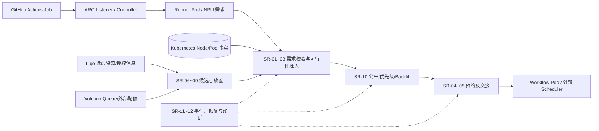

**关键约束**：Runner 提前准入只减少不可执行情况下的过早启动；跨调度器的“资源已保证”必须以额外一致性契约证明，不能由上述流程图的箭头推断。各模块的最终职责与权威来源在 T2 确定。

### 2.4 DFX 质量属性要求基线

| QA | 质量属性 | 可评审目标场景（后续任务补充机制、参数和验证） | 设计任务 |
|---|---|---|---|
| **QA-01** | 正确性/一致性 | 资源碎片、节点约束、本地/远端选择或并发预约下不得把不可执行组合误判为已保证；重启与交接不得造成无依据的资源重复准入 | T3、T4、T6 |
| **QA-02** | 公平性/活性 | 大小任务竞争及 PR/Nightly 优先级切换时，Backfill 不破坏预留承诺，满足可用性条件的旧任务不会因持续插队而永久等待 | T5 |
| **QA-03** | 性能/容量 | 随节点数、Pod 数、队列深度及并发增长，定义调度关键路径开销、吞吐容量、退化阈值及预算 | T7 |
| **QA-04** | 可靠性 | API/Informer 数据不一致、重复事件、Workflow 异常、实例重启时有明确的一致性、降级及对账规则 | T4、T8 |
| **QA-05** | 可用性 | 实例故障或切换、Liqo/Volcano 失效时明确故障域、调度恢复和隔离措施 | T8 |
| **QA-06** | 安全性 | 不可信租户和开源 PR 不能通过伪造标签、Queue 或 Node 选择约束获取未授权 NPU；组件采用最小权限 | T9 |
| **QA-07** | 可服务性 | 能将 Runner Pending、资源不满足、公平等待、预约状态及 Workflow Pending 的原因跨组件关联，并输出可行动的诊断信号 | T10 |

**质量目标口径**：本章定义必须覆盖的场景，不编造未经确定的 P95、吞吐率、故障恢复时间等数值。T7～T10 需明确量化目标、统计窗口或可判定阈值及设计依据，T11 将其与验收案例绑定。

### 2.5 T1 验收基线

- [x] 文档规范性定位改为 TO-BE；源码和部署只作为历史参考。
- [x] 将 BG-01（提前 NPU 准入）和 BG-02（公平等待与安全资源利用）定义为并列目标。
- [x] 明确 ARC Listener、Workflow Scheduler、Liqo、Volcano、NPU 设备插件的系统边界。
- [x] 建立 BG → IR → SR 与 QA 基线；尚未选型的实现机制留待 T2～T10，不伪装为既定技术决策。
- [ ] T2～T12：替换第 3～7 章旧 AS-IS 口径，完成目标机制、DFX、追踪及独立验收。

## 3 功能域总体方案（实际架构）

### 3.1 总体设计原则、设计模式及约束（由源码反推）

1. **复用 Scheduler Framework**：使用 `app.NewSchedulerCommand(app.WithPlugin(arcsync.Name, arcsync.New))` 注册插件；主配置启用 PreFilter/Filter/Score/Reserve，没有独立队列或独立 Scheduler 核心重写。
2. **标签表达未来需求**：Runner 真实容器可不声明 NPU Request；通过 `required-npu-count`、资源域、型号三个标签参与准入。没有校验其与未来 Workflow 申请的一致性。
3. **Node/Pod 快照估算**：本地物理占用按照容器 Requests 与 `npu-count` 标签最大值统计；虚拟节点按带标签的 Runner 数量估算；结果依赖 Scheduler 缓存时效。
4. **进程内软预约**：使用受 Mutex 保护的 `map[string]reservation`，只保证当前调度器进程内部的观测与核算；没有 API 持久化及跨多个 Scheduler 实例的共享状态。
5. **有条件访问外围 CRD**：通过 Kubernetes dynamic informer 获取 Liqo 和 Volcano；缺 CRD / 读取失败可能使附加规则缺席。没有单独的外部服务调用层。
6. **严格 FIFO**：以 Pod `CreationTimestamp`、UID 为排序依据，通过 `PreFilter` 拒绝较新的 Pod；没有实现 QueueSort 自定义堆排序，也没有回填。
7. **最低限度放置约束**：插件自定义检查 cordon、NoSchedule/NoExecute taints、`nodeSelector`、required nodeAffinity；其它 Kubernetes 默认 Filter 继续参与最终调度。

### 3.2 技术方案说明和选型的事实边界

| 设计关注点 | 当前实际采用 | 未采用或无法证实的替代方案 | 取证位置 |
|---|---|---|---|
| Scheduler 接入 | kube-scheduler Scheduling Framework + 插件扩展点 | 完全独立调度器、Webhook | `cmd/scheduler/main.go` |
| 需求传入 | Pod labels | 自定义 Demand CRD、外部 REST | `arcsync.go` 常量与 PreFilter |
| NPU 准入 | 集群总剩余 NPU 求和 | 单节点/单完整 Workflow 可行性检查 | `arcsync.go:419-446` |
| 资源计量 | Scheduler Snapshot + 进程内预约 | 实时设备 API、持久化配额账本 | `arcsync.go:278-377` |
| 远端管理 | Liqo virtual Node + NamespaceOffloading informer | 远端成员集群直连调度 | `liqo.go`、`applyLiqoComparison` |
| Queue 能力 | Volcano Queue CRD 的 `spec.capability` 读取 | 自实现跨租户 Queue Controller | `volcano.go` |
| 公平性 | `PreFilter` 内同池严格 FIFO 检查 | Backfill、DRF、权重调度、队列抢占 | `isOldestPendingRunner` |
| 高可用 | 单副本、关闭选主 | 多副本 Leader Election、跨实例预约账本 | D-BASE deployment/configmap |

未提供历史架构评审材料来证明**为何**选定上述路线，因此本节只陈述实际技术实现及其取舍结果，不虚构选型会议结论。

### 3.3 系统元素与周边系统关系

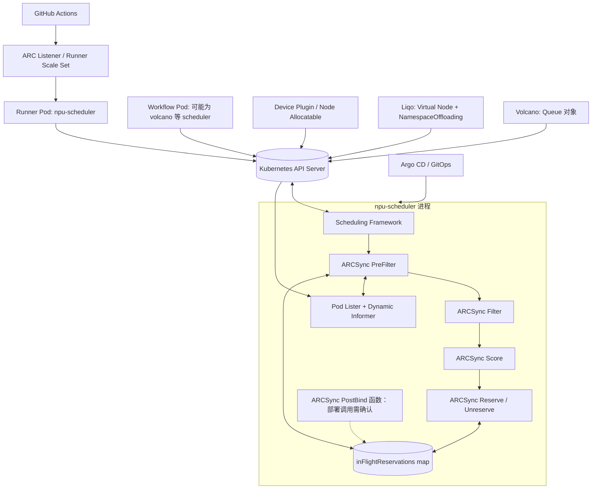

**实现职责边界**：`cmd/scheduler/main.go` 负责插件注册；`pkg/arcsync/arcsync.go` 负责主调度、FIFO、预约；`pkg/arcsync/liqo.go` 负责资源域、虚拟节点选择解析；`pkg/arcsync/volcano.go` 负责 Queue 额度读取；D-BASE 的 manifests 负责 Deployment、ConfigMap、ServiceAccount/RBAC。

#### 3.3.1 两项目标在 ARC Container Mode 中的生效位置

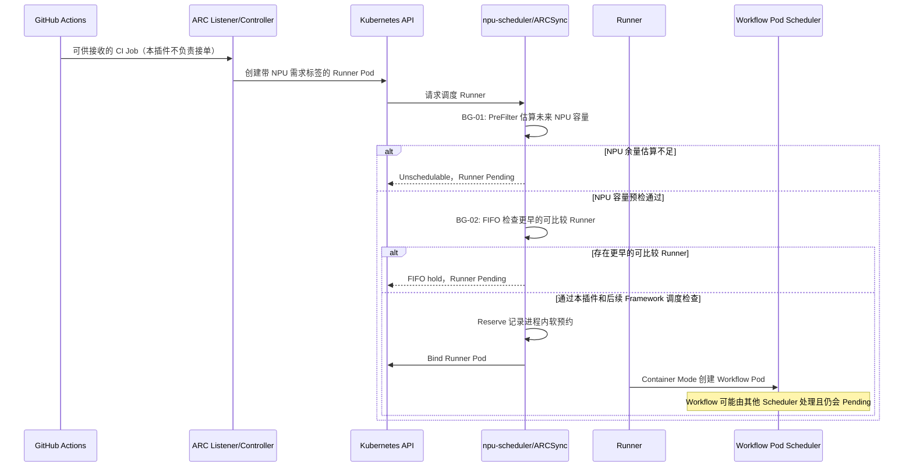

**控制边界**：ARCSync 在 **Runner Pod 调度阶段**执行，不会阻止 ARC Listener 领取 Job；插件通过的聚合 NPU 估算不是 Workflow 单节点可行性或硬件资源预留承诺。FIFO 在容量预检通过后执行，只降低同一比较范围内的插队风险；不能承诺全局公平、无饥饿或 GitHub UI 必然显示 Queued。

### 3.4 领域对象模型与关系

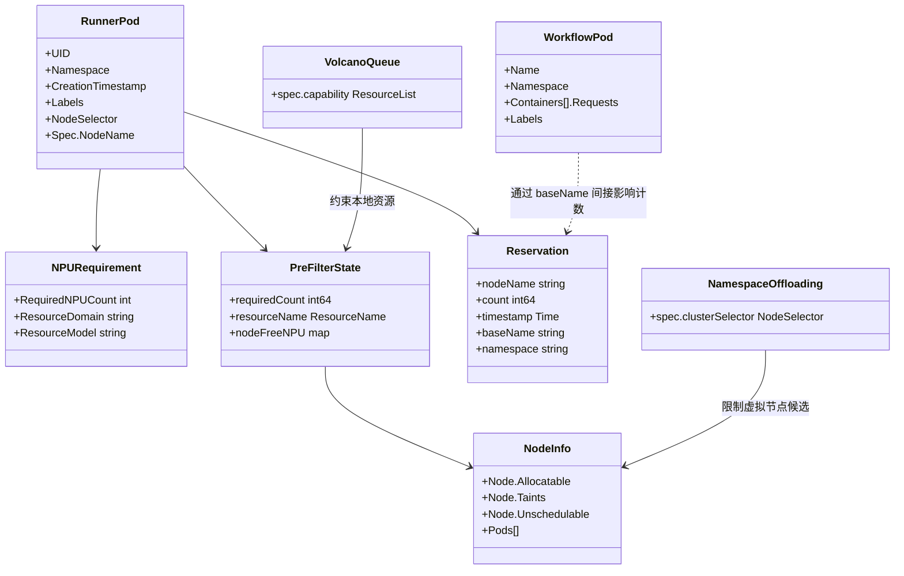

| 数据对象 | 实际存储与生命周期 | 来源与更新者 | 删除/销毁行为（现状） | 注意事项 |
|---|---|---|---|---|
| Runner Pod / Workflow Pod | Kubernetes Pod API 对象 | ARC / Workflow 创建；K8s API 保存 | Pod 自身遵循 Kubernetes 删除/GC，非插件销毁 | 插件只读取快照和元数据 |
| Node / NodeInfo | Kubernetes API + Framework Snapshot | 集群控制平面、Scheduler 缓存 | 随 Node 对象及缓存生命周期 | NPU `Allocatable` 依赖外部设备资源上报 |
| `preFilterState` | 单次调度 `CycleState` | `PreFilter` 写入 | 调度周期结束随状态结束 | `Clone` 返回同一指针，代码未实现深拷贝 |
| `reservation` | 进程内 `inFlightReservations` map | `Reserve`/`Unreserve`/`PostBind` | 反向调用删除；UID 不在快照且超过 10s 删除；进程退出丢失 | **不是持久化记录**，不保存 Token |
| `NamespaceOffloading` | 外部 CRD + informer 缓存 | Liqo | 按外部控制器与 API GC 管理 | 选择条件解析为 NodeSelectorTerms |
| Volcano `Queue` | 外部 CRD + informer 缓存 | Volcano | 外部管理；插件无删除操作 | Queue 名称来自 **Pod annotation** |
| 日志 | 容器 stdout / 集群日志后端（如配置） | klog | 插件未定义日志留存和销毁策略 | 记录 Pod、Node 名称，不在本进程保存凭据 |

本功能域**没有自行实现数据分级销毁操作或日志保留周期策略**，因此数据销毁规格限于现有 Kubernetes API GC、进程生命周期及外部日志系统；不得写成已实现的敏感数据销毁能力。

### 3.5 源码模块和函数定位

| 模块 | 主要符号 | 输入 | 输出/副作用 |
|---|---|---|---|
| 注册入口 | `main()`、`app.WithPlugin` | Scheduler CLI 和 YAML | 注册 `ARCSync` |
| 插件初始化 | `New()`、`crdExists()` | Framework Handle / KubeConfig | 创建 Pod Lister、预约 map、动态 informer |
| 调度准入 | `PreFilter()` | Pod、CycleState、Snapshot | 计算占用、可选 Liqo/Queue、聚合容量、FIFO、写 CycleState |
| FIFO | `isOldestPendingRunner()`、`npuFIFOPool()` | 当前 Pod、Pod Lister、offloading 标志 | 比较更早未绑定的同类 Pod |
| 本地/远端 | `applyLiqoComparison()`、`getEligibleVirtualNodes()` | NodeInfos、CR、可用量 | 删除不在获胜池的候选节点 |
| 调度放置 | `Filter()`、`Score()` | CycleState、NodeInfo | `Status`、0～100 Score |
| 预约 | `Reserve()`、`Unreserve()`、`PostBind()` | Pod、CycleState | 内存 map 增删 |
| 事件 | `EventsToRegister()` | Framework | Pod / Node 事件声明 |

## 4 功能域规格变更与设计（本轮只描述现有规格）

### 4.1 功能域规格变更

**N/A**。本轮既不调整现网规格，也不改变代码或接口。本文只是根据 S-BASE/D-BASE 将历史需求与实际代码重新对齐。下述 4.2～4.5 所称“规格”为**当前可观察规则**，不是拟新增规格。

### 4.2 NPU 容量与准入规格

#### 4.2.1 实现思路（现状）

插件读取 `ascend-ci.com/required-npu-count`，只有**存在**该标签才进行相关预检；`strconv.Atoi` 的错误返回被忽略。资源名直接拼接为 `ResourceDomain + "/" + ResourceModel`；没有在 PreFilter 中完成正整数和资源名合法性校验。

本地已占用（按每个 Pod）：`max(Σ containers[].resources.requests[resourceName], 匹配资源类型的 Pod 标签 npu-count)`；虚拟节点占用来自相同资源型号的 Runner 需求标签累加。

容量计算与准入判定为：

\[
TotalFree = \sum_{n\in EligibleLocal} (Allocatable_n - ObservedOccupied_n - InFlight_n) + \sum_{v\in EligibleVirtual} (Allocatable_v - ObservedOccupied_v)
\]

这里 `EligibleLocal` **只按未 cordon、污点可容忍过滤**；总量遍历对本地节点**没有重复应用 `nodeSelector` / NodeAffinity**。被选中的虚拟节点必须在 `nodeFreeNPU` 中；本地节点是否属于最终获胜池也未在这一步复核。`TotalFree >= requiredCount` 即通过容量预检。某些在 CPU 节点保留的 Runner 逻辑预约以负数余量体现在求和中。

#### 4.2.2 实现设计与限制

- `nodeFreeNPU` 的形成会应用 cordon/taint/nodeSelector/required affinity；在 `Filter` 中不在此 map 的节点被拒绝。
- 当前算法**不是** `exists node: free_npu(node) >= request`。例如，两节点各剩 4 NPU、未来 Pod 需 8 NPU，聚合预检可能通过；但带 NPU request 的 Pod 到 `Filter` 会被单节点空闲量拒绝。
- 对**未在容器 Requests 声明 NPU 的 Runner**，`Filter` 只检查节点是否在候选 map 中，不在此处要求该节点本身具有足够 NPU。正是因此 Runner 可以放置在 CPU 节点，未来 Workflow 另外申请 NPU。
- 因外部 Workflow 可使用其它调度器，**不能保证**其实际运行位置、拓扑和其他资源都能满足。

#### 4.2.3 准入算法、正确性边界与反例

**当前算法（AS-IS，不构成资源承诺）**：

1. 仅当 Runner Pod 含 `ascend-ci.com/required-npu-count` 标签时进入检查；使用 `Atoi` 解析数量（错误未处理），以资源域和型号拼接扩展资源名。
2. 读取 Scheduler NodeInfo Snapshot，计算各节点已观察到的占用。物理节点取普通容器 Requests 之和与同型号 `npu-count` 标签值中的较大者；虚拟节点按匹配标签的 Runner 数量统计。
3. 对本地节点叠加未被活动 Workflow 名称匹配跳过的进程内预约；依 Liqo 及可选 Volcano 信息缩减候选映射 `nodeFreeNPU`。
4. 遍历未 cordon、污点可容忍的节点；本地节点在该聚合步骤**不再次应用** NodeSelector/required NodeAffinity；虚拟节点要求仍位于候选映射。计算 `totalNPUFree += allocatable(resourceName) - nodeTotalOccupied`，**不对单节点负数截断**，以便 CPU 节点上的负预约抵消全集群余量。
5. 若 `totalNPUFree < requiredCount` 返回 `Unschedulable`；否则检查 FIFO，再写入 `CycleState`。随后 `Filter`、其他 Framework 插件及绑定过程仍可能拒绝/失败。

**可从代码推导的局部性质**：在相同 Snapshot、相同预约账本、相同准入候选规则下，若聚合判定成功，则上述**计算口径**下的剩余量不小于输入数量；这只是一次调度周期的聚合必要检查，**不是** Node 级可行性证明或跨 Scheduler 的不可超卖不变量。

| 场景 | 聚合准入结果 | 实际保证与风险 |
|---|---|---|
| 两个本地节点各有 4 卡、Runner 需要 8 卡 | 可能通过 | 不存在单节点 8 卡；后续 Workflow 若必须单节点申请 8 卡可能 Pending |
| Runner 限定 CPU 节点，其他本地 NPU 节点空闲 | 可能通过 | 聚合阶段可能统计不符合 Runner NodeSelector 的节点；Runner/Workflow 放置是不同动作 |
| 另一个 Scheduler 与 ARCSync 同时消费 NPU | 两侧可能分别放行 | 进程内预约不可作为跨 Scheduler 原子锁 |
| 非法或负数 `required-npu-count` | 不保证拒绝 | 转换错误被忽略，不能声称正整数验证已实现 |
| Snapshot 延迟、外部 Workflow 启动 | 依旧使用已读取的快照 | 可能发生容量估计偏差、资源竞争 |

**Liqo 决策与聚合准入不一致的组合反例（源码静态推导）**：假定本地物理节点剩余 8 卡、一个合格远端虚拟节点剩余 10 卡、Runner 标签声明 12 卡；`NamespaceOffloading` 已配置且节点满足筛选条件，没有 Queue 限制、其它 Pod 占用或额外约束。Liqo 择优比较中，远端单节点 10 > 本地合计 8，因此可能只在 `nodeFreeNPU` 中保留远端节点；但随后 `PreFilter` 聚合步骤仍计算**所有满足 canScheduleOnNode 的本地节点**，加上仍在候选映射的远端，得到 `8 + 10 = 18 >= 12`，故容量预检可能通过。最终远端单节点仅有 10 卡，不足以运行申请 12 卡的 Workflow。**关键点**：Liqo 节点筛选与聚合准入的计入范围并不相同；这不是单纯的本地资源碎片。是否真正绑定还取决于 Filter、默认调度插件和 Workflow 自身调度器。

**正确性边界**：当前实现可讨论的保证仅限一次调度判断的计算规则、同一插件实例的 map 互斥写入，以及相同 FIFO 比较范围的旧任务拦截。不能声称单节点可执行、跨实例全局预约、Workflow 必定启动或长期无饥饿。评审应分别验证“聚合资源准入”“Runner Pod 绑定”“Workflow 真实 NPU 分配”，不以其中一项替代另一项。

### 4.3 FIFO 公平规格

#### 4.3.1 实现思路（现状）

`isOldestPendingRunner()` 从全 Pod Lister 取列表，筛选：UID 不同、未终态、尚未绑定、同 namespace、带非空 `required-npu-count`、同 `ResourceDomain` 与 `ResourceModel`。若当前命名空间具备 NamespaceOffloading，则比较 `npuFIFOPool()`（Pod nodeSelector 中的 `liqo.io/remote-cluster-id`，否则为 `local`）。若不具备 offloading，则用**旧 Pod 的 NodeSelector 是否都被当前 Pod 满足**来过滤比较对象，注意这是非对称关系。

如果存在 `CreationTimestamp` 更早的 Pod，或时间相同但 UID 字典序更小的 Pod，则当前 Pod 拒绝。Pod Lister 不可用或列表出错时 **fail-open**。

#### 4.3.2 实现设计与限制

- 拒绝是通过 PreFilter 的 `framework.Unschedulable` 实现，而不是通过 Framework `QueueSort` 插件主动把旧任务置于队首。
- 没有跨 namespace 公平、全局租户权重、Backfill、头部保护、饥饿上限。
- 该 FIFO 判断发生在聚合容量检查之后；如果容量不足，先返回容量错误，再不进入 FIFO 判断。
- 严格 FIFO 可能导致一个不可满足的大任务阻塞后续较小任务，作为当前设计的**已知特性/风险**记录。

#### 4.3.3 FIFO 比较关系、顺序性质及边界

设 `Older(a,b)` 当 `a.CreationTimestamp < b.CreationTimestamp`，时间相同则按 UID 字典序排序。当前 Pod `b` 被拦截，当且仅当 Lister 中存在满足下面**比较谓词**的 `a`，且 `Older(a,b)`：

- `a` 非当前 UID、未绑定、未终态、与 `b` 同 namespace；需求标签非空、resource domain/model 相同；
- 存在 NamespaceOffloading 时，还要求 `npuFIFOPool(a)==npuFIFOPool(b)`；池键来自远端集群选择器，否则为 `local`；
- 不存在 NamespaceOffloading 时，使用“旧 Pod 的 NodeSelector 条件被当前 Pod 满足”的**单向比较**，不是集合相等。

**顺序性质**：时间戳加 UID 形成候选 Pod 的稳定全序键；但“可比较/同池”的筛选谓词在无 offloading 分支并非对称等价关系，因此**不能推断**全部候选 Pod 构成同一个 FIFO 队列，更不能称为全局严格 FIFO。只有在比较条件一致且 Lister 信息可得的子集内，当前算法才阻止有更旧可比较任务时的新任务通过 PreFilter。Pod Lister 错误会 fail-open。

**队首阻塞**：旧任务长时间不可满足时，后续同范围小任务可能持续被拦截；代码无 Backfill、aging、抢占或等待时间上界。该算法也没有实现 QueueSort 堆顺序。建议的评审用例：相同 selector、不同 selector（双向比较）、相同/不同 namespace、时间戳并列 UID、旧 8 卡新 1 卡、Lister 失败。所有预期结果以源码谓词为准。

### 4.4 Liqo 和 Volcano 接入规格

#### 4.4.1 Liqo

- 虚拟 Node 依据 `liqo.io/remote-cluster-id` 标签的**存在性**识别。
- 读取 `offloading.liqo.io/v1beta1` 的 `NamespaceOffloading`；`spec.clusterSelector` 被解析成 Kubernetes `v1.NodeSelector` 的 **`nodeSelectorTerms`**，不是普通 `matchLabels` 对象。
- 如果没有有效 selector terms，`getEligibleVirtualNodes` 当前将匹配**所有带虚拟节点标签的 Node**（`!hasTerms` 分支），是必须如实标注的风险。
- 有 CR 时，先去除不在选定远端集合的虚拟节点，再对比本地节点**空闲和**与各远端**单节点空闲最大值**；平局本地胜。若本地存在单节点可容纳要求的节点，选择远端时可能跳过带匹配 Pending Runner 的虚拟 Node。
- 无 `NamespaceOffloading` 时，`PreFilter` 从候选 `nodeFreeNPU` 中删除所有虚拟 Node；但它并不因此修改 Kubernetes/Liqo 控制器真实的 namespace offloading 配置。

#### 4.4.2 Volcano

- 读取 GVR `scheduling.volcano.sh/v1beta1/queues` 的 `spec.capability[resourceName]`。
- Queue 名称来自**当前待调度 Pod 的 annotation** `scheduling.volcano.sh/queue-name`；源码未查询 Namespace annotation。`ARCSYNC_GUIDE.md` 中引用 Namespace annotation 的文字不能作为实现依据。
- 仅在已找到 NamespaceOffloading 的分支中调用 Queue 额度逻辑。先用 Queue 剩余额度截断本地 `localRemaining`；若当前 namespace 本地占用加本次请求超过额度，删除本地候选 Node。虚拟节点不在此删除循环中。
- Queue 读取或解析失败则视为没有额度，不构成强制拒绝；所以不是完整 Volcano Queue 强制配额系统。

#### 4.4.3 Liqo / Volcano 联合决策表

下表按当前执行路径描述**插件自身规则**；Kubernetes 默认 Filter 和外部 Liqo/Volcano 控制器仍会影响最终调度。不要将它理解为最终节点的唯一决策表。

| NamespaceOffloading | 远端 Node 筛选 | 本地/远端比较 | Volcano Queue 限制 | 结果边界 |
|---|---|---|---|---|
| 不存在 / 未读取到 | 从 ARCSync 候选映射移除虚拟节点 | 本地路径 | **不进入**本代码的 Queue 额度分支 | 即使存在 Queue CR，也不能证明此路径已执行限额 |
| 存在，selector terms 有效 | 仅保留 selector 匹配的虚拟节点 | 比较本地空闲和与远端单节点最大空闲，平局本地胜 | 尝试读取当前 Pod annotation 指定 Queue 的额度，截断本地可用量/可能移除本地候选 | 远端不在本地额度删除循环中 |
| 存在，selector terms 为空或未提取 | 当前实现可能保留**所有**虚拟节点 | 继续比较本地和远端 | 同上一行 | 不能把空选择器理解为“拒绝全部远端” |
| 存在，Queue 名称缺失/读取失败/内容无效 | 依前述 selector | 依资源比较 | 无有效限额，路径可能继续 | **fail-open 风险**，并非强制配额 |
| 存在，但当前 Runner 只约束特定 NodeSelector/affinity | 依本代码筛选和后续 Filter | 仍进行池比较 | 条件生效 | 聚合总量与最终可绑定候选可能不同 |

**跨阶段反例（对应 4.2.3）**：本地空闲 8 卡、远端单虚拟节点空闲 10 卡，Runner 请求 12 卡。满足 Liqo offloading 条件且无其它限制时，Liqo 可能选远端（10 > 8），但聚合检查仍可计入本地 8 与远端 10（18 >= 12），导致通过容量预检却不存在可直接承载 12 卡的远端单节点。这表明“池选择候选”与“聚合准入节点”不同域，不能把通过聚合检查解释为获胜池的资源保证。

**优先关系**：先根据外部 offloading 信息构造/收缩候选，执行代码中的本地与远端择优及条件性 Queue 计算，最后执行聚合准入与 Framework 后续 Filter/Score。Queue 只影响源码实际修改的本地可用量和本地候选，不等同于对远端强制限制。对组合条件的优先级及平局细节应以 `applyLiqoComparison` 和 `PreFilter` 中实际调用顺序为准。

### 4.5 在途预约与交接规格

- `Reserve` 在内存 `map[PodUID]reservation` 写入 `nodeName`、需求量、时间、`baseName`、namespace。UID 为空时用 `namespace/name` 作为键。
- `Unreserve` 按相同键删除记录；`PostBind` 函数若被 Framework 调用且 Pod 容器 requests 包含目标 NPU，则按当前 Pod 自身 UID 删除其预留；对于不请求 NPU 的 Runner 不删除。
- 下一次 PreFilter 中，对在 Scheduler 快照内可识别的活动 Workflow，按名称去掉 `-workflow` 后缀，构成 `activeWorkflows[baseName]`，如果匹配预约的 `baseName`，不再把预约加入占用。
- 交接键**仅为 baseName，不带 namespace/UID**；跨 namespace 同名产生误匹配的可能性需要作为现有设计风险记录。未发现持久化、重启恢复机制。
- 如果 map 中 Pod UID 已不在 NodeInfo 快照，且自预约时间已超过 10 秒，PreFilter 会删除该预约；不能把此规则写成“10 秒后所有预留都超时”。

#### 4.5.1 预约状态、转换与账本不变量

**状态是分析视图，不是新增 CRD/状态机实现。** `inFlightReservations` 是进程内 `map[PodUID]reservation`，在 `Reserve` 写入；它没有显式的“已交接”状态字段。

| 逻辑状态/事件 | 触发与当前操作 | 后续计数与可靠性边界 |
|---|---|---|
| 未预约 → 账本已有记录 | `Reserve` 成功，按 UID（为空时 namespace/name）写 map | 当前实例 mutex 保护更新；不锁定物理 NPU，也不跨进程共享 |
| 预约存在 → 调度撤销 | `Unreserve` 删除当前 Pod 的键 | 仅删除本次 Pod；失败路径是否调用由 Framework 决定 |
| 预约存在 → Workflow 可观察 | 下一次 `PreFilter` 建立 `activeWorkflows[baseName]` | 匹配项**跳过计数，不删除 map**；同名跨 namespace 可能误匹配 |
| 预约存在 → 快照缺少 UID 且超过 10 秒 | 下一次 `PreFilter` 清理 | 10 秒只是“快照未见 UID”时的附加条件；不是统一的 TTL |
| 当前 Pod 绑定成功 | 若 `PostBind` 确实注册且该 Pod 自身含目标 NPU Requests，删除该 Pod 键 | 不会凭 Workflow 名称直接删除 Runner UID 的预约；生产回调需独立确认 |
| Scheduler 重启/替换实例 | 进程内 map 丢失 | 不存在重建、持久化、跨进程同步保证 |

**当前代码能够保证的局部性质**：同一 ARCSync 实例对 map 的读写使用 mutex；`Unreserve` 按自身键删除；未满足清理条件的预约可能留在 map 内。**不能证明的全局不变量**：`物理已用 + 逻辑预约 <= 全集群 NPU 容量`、一次需求至多被计数一次、跨 namespace 的 Workflow/Runner 唯一归属、重启前后预约连续。尤其在 Workflow 匹配生效时，跳过预约是否恰好被物理计量接管，取决于快照及命名约定，不是原子交接。

**异常路径**：Snapshot 延迟、Pod UID 暂时不可见、Runner/Workflow 命名不一致、同名不同 namespace、重复 `Reserve`、`PostBind` 未启用、实例重启分别可能造成少计/多计或预约丢失。验证需将 map 变化、Snapshot 物理量、Workflow Pod 状态按时间轴关联，不能仅以 Runner Pod 已绑定认定 NPU 预约已兑现。

### 4.6 无独立用户交互界面

模块没有 Web UI/CLI 自定义命令、Swagger/REST 服务或自定义 API Server。所谓“用户接口”仅指 Kubernetes Pod 的 `schedulerName`、labels、annotations、nodeSelector/tolerations/affinity，以及 Liqo / Volcano 的外部 CRD。接口设计按 Go 扩展点、Kubernetes 对象 Schema 和 YAML 示例展开，不虚构 HTTP Path。


### 4.7 Framework 扩展点接口契约（跨 SR 通用）

| 扩展点 | 输入/前置条件 | 输出与状态副作用 | 失败或缺失输入的语义 |
|---|---|---|---|
| `PreFilter` | Pod labels、Snapshot、可选 Liqo/Volcano 缓存、进程内预约；主 profile 启用 | 返回 `Success/Unschedulable/Error`；成功时写 `CycleState` 供后续扩展点读取 | 无 `required-npu-count` 则 Success 且不写插件状态；非法数字未严格拒绝；Snapshot 读取失败 Error；容量或 FIFO 不满足 Unschedulable |
| `Filter` | 调度候选 NodeInfo 和可选 `CycleState` | 对候选节点执行本插件检查；Framework 其他 Filter 仍有效 | 具体节点是否具有足量 NPU，取决于 Pod 容器有无 NPU Requests；不得推导后续 Workflow 可行 |
| `Score` | 候选 nodeName、`CycleState` | 以 `nodeFreeNPU` 为基础，裁剪到 0～100 的分数 | state 缺失时源码返回成功及 0 分，不等同于拒绝 |
| `Reserve` | Pod、被选择节点、`CycleState` | 有 state 时按 Pod UID 写内存预约 | state 缺失返回 Success 且不写预约；预约不等于硬件排他锁 |
| `Unreserve` | Pod UID / namespace/name | 删除本 Pod 对应预约键 | 非目标键不受影响；调用时机由 Framework 决定 |
| `PostBind` | Pod、nodeName、`CycleState` | 若被调用且当前 Pod 声明目标 NPU Requests，则清除**该 Pod UID** 的预约 | 当前主 GitOps 未显式配置此扩展点；不能断言运行态已调用 |
| `EventsToRegister` | Framework 事件订阅 | Pod Add/Update/Delete、Node Add/Update | 当前没有显式 Queue/NamespaceOffloading 变更入队事件；不能保证 CRD 修改立即重排 |

**跨扩展点依赖**：`PreFilter` 的 `CycleState` 仅在通过自定义准入后写入；下游扩展点存在 state 缺失时的成功返回路径。因此不能将“扩展点返回 Success”等同于“资源已经被核验/预留”。该表描述已有 Go/Kubernetes 契约，REST/OpenAPI 不适用。

### 3.6 跨功能域 DFX、性能、可靠性及验证边界

**共性 DFX（统一口径）**：安全性：Pod 元数据不能直接等同于可信物理资源凭证；需结合 namespace 隔离和 ServiceAccount 权限理解信任边界。性能：Snapshot/Pod Lister 遍历、候选筛选和预约互斥访问构成主要成本；静态复杂度不等同于实测延迟。可服务性：现有日志及 Kubernetes Events 可辅助定位拒绝，但尚无已证明的 Runner→Workflow 唯一关联、预约健康度或 CR 缓存同步告警。FMEA 不编造发生概率、检出率、恢复时间、S/O/D、RPN 或 SLA 数值；各 SR 仅陈述其特有失效和验证方法。

**复杂度模型（静态推导，不是压测结果）**：令 `N` 为 Snapshot 节点数，`P` 为已观察 Pod 数，`R` 为内存预约数，`Q` 为同 namespace 需要参与 FIFO 筛选的 Pod 数。一次 `PreFilter` 至少涉及 Node/Pod 遍历、预约遍历、候选池筛选与 FIFO 取列表后筛选，核心成本可近似描述为 `O(N + P + R + Q)` 加上具体选择器匹配和缓存操作开销；`Q <= P_lister`，不能直接用这一式子推算毫秒级性能。实际复杂度还受到多个阶段重复迭代、node selector/affinity 条件数量、informer 缓存延迟及锁持有范围影响。原文没有可靠的调度时延、吞吐量、锁等待观测值。

**可靠性边界（失败传播）**：Snapshot 读取失败会影响准入；外围 CRD/Queue 缺失或读取异常在部分路径上允许降级继续；进程退出丢失预约；Pod/Node 事件不代表 CR 变更立即触发重新排队。所有这些都是代码/配置层面的条件行为，而非生产故障率结论。

**建议的独立设计验证矩阵**：资源正确性（4+4/8、CPU Runner 与 NPU Workflow）、并发一致性（同实例并发、重启/多实例）、公平性（旧大新小、selector 非对称）、外部约束（Liqo 空 selector/Queue 失效）、性能伸缩（逐级提高 `N/P/R` 记录 P50/P95、调度吞吐、锁等待）、故障可观测性（返回 Status 与 Events 可区分性）。本节只是说明验证设计，不代表已执行测试或新增实现。

## 5 功能实现设计（以 IR 为功能单元，SR 为用例，AR 为原子实现）

本章按 **IR → SR → AR → TC** 组织：每个 IR 是完整功能单元，每个 SR 有用户故事和用例时序图，每个 AR 是对应现有代码的原子实现动作；AR 可作为迭代交付追踪粒度，但本轮不臆测历史 PR 的合入边界。全部 12 个 SR、39 个 AR 和 48 个 TC 编号保留。

### 5.1 IR-01：Runner NPU 感知与容量准入

#### 5.1.1 功能概述

Runner Pod 未直接申请 NPU，而 Container Mode 的 Workflow Pod 才实际使用 NPU。本功能在 Runner 绑定前，通过标签和快照预估其未来 NPU 需求；预计不足时让 Runner 保持 Pending，避免过早启动。它不控制 ARC Listener 接单。

#### 5.1.2 SR 用例范围

- **SR-01**：基于 Runner NPU 标签激活调度插件
- **SR-02**：统计本地和虚拟节点 NPU 资源占用
- **SR-03**：执行 NPU 聚合容量准入

#### 5.1.3 实现思路

PreFilter 检查 NPU 标签，估算本地和虚拟节点占用，将在途预约计入后进行聚合 NPU 余量判断；不足返回 Unschedulable，通过后继续 FIFO 并写 CycleState。该聚合门禁不能证明未来 Workflow 的单节点容量可行。

备选方案及当前选型边界见第 3.2 节；本章只描述源码和 GitOps 已有能力。

#### 5.1.4 设计思路（每个 SR 独立时序图与 AR）

##### 5.1.4.1 SR-01：基于 Runner NPU 标签激活调度插件

**功能概述与当前行为**

**当前行为**：只有存在 `ascend-ci.com/required-npu-count` 标签时，ARCSync PreFilter 才进入资源检查；标签缺失直接返回 Success，未写 CycleState；`Atoi` 错误不检查，资源名由域和型号字符串直接拼接。

**证据状态**：CODE + CONFIG（经 `npu-scheduler` 且 PreFilter 被启用时）。

**用户故事与前置条件**

**角色**：Runner ScaleSet 管理员。

**用户故事**：当 ARC 创建带有 NPU 需求标签的 Runner Pod 时，希望专用调度器识别该 Pod 的未来 NPU 资源类型及数量，而不要求 Runner 自身声明容器 NPU request。

**场景前置条件**：Pod.spec.schedulerName=`npu-scheduler`；主配置启用 PreFilter；Pod 可以或不可以携带三类标签。

**用例实现思路**

1. Framework 接到目标 Pod，调用 ARCSync.PreFilter。
2. 检查 Pod labels 是否含 RequiredNPUCount；若无，立即返回 Success。
3. 若有，则将值转成 int，拼接资源名并进入 Snapshot 准入。

本轮不对尚未引入的算法或接口做开发选型；仅还原该代码基线真正采用的路径。

**用例时序图**

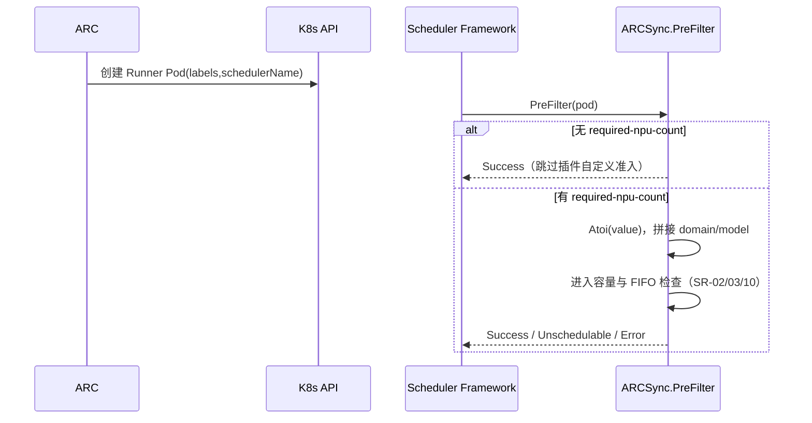

**AR 原子实现分解**

| AR | 已有实现动作 | 实现位置 | 已执行的处理逻辑 |
|---|---|---|---|
| **AR-01-01** | 从 Pod `Labels` 读取需求开关 | ``PreFilter():263-266`` | 缺失标签直接放行且不向 CycleState 写入自定义状态；属于源码行为，不能假设已校验为合法 Runner。 |
| **AR-01-02** | 解析资源数量与资源键 | ``PreFilter():268-271`` | 使用 `strconv.Atoi`，忽略错误；`ResourceDomain + "/" + ResourceModel`；输入非法可能得到零值。 |
| **AR-01-03** | 与 Scheduler Framework 结合 | ``cmd/scheduler/main.go:27-39`，D-BASE `configmap.yaml:15-28`` | 插件名 `ARCSync`，主要经 PreFilter 调用；其它 Pod 的既有 Kubernetes 调度能力不由本函数覆盖。 |

**AR 与 SR 的关系**：上述 AR 都可以在 S-BASE/D-BASE 静态取证；对应验证只要求确认行为与源码一致，不把其风险修复当成 AR 已交付。

**领域对象及状态变化**

相关对象：Pod `metadata.labels`：`ascend-ci.com/required-npu-count`、`ascend-ci.com/npu-resource-domain`、`ascend-ci.com/npu-resource-model`；`spec.schedulerName: npu-scheduler`。当前源码没有 `npu-managed` 字段。 状态由上表 AR 所列函数产生或消费；没有额外的持久化领域实体。

**验收用例（TC）**

- **TC-01-01**：标签缺失 → 插件 PreFilter 返回 Success 且不写 `ARCSync/state`（源码推导；需补独立测试）。
- **TC-01-02**：`required-npu-count=2`、资源域 `huawei.com`、型号 `npu` → 拼为 `huawei.com/npu`（源码推导）。
- **TC-01-03**：`required-npu-count=abc` → `Atoi` 错误被忽略，不能断言拒绝（需回归记录）。

**判定规则**：现有测试函数只说明代码仓包含该测试，不能在本次未执行 Go Test 或没有集群访问的情况下声称测试已通过。对于风险复现用例，预期结果应保持与当前源码一致。

**代码与配置证据**：[pkg/arcsync/arcsync.go#L25-L31](https://github.com/ascend-gha-runners/scheduler-plugins/blob/cc243f537e97ca4e34c6bd57030817a04ae204ec/pkg/arcsync/arcsync.go#L25-L31)；[pkg/arcsync/arcsync.go#L262-L275](https://github.com/ascend-gha-runners/scheduler-plugins/blob/cc243f537e97ca4e34c6bd57030817a04ae204ec/pkg/arcsync/arcsync.go#L262-L275)；[cmd/scheduler/main.go#L33-L43](https://github.com/ascend-gha-runners/scheduler-plugins/blob/cc243f537e97ca4e34c6bd57030817a04ae204ec/cmd/scheduler/main.go#L33-L43)。

##### 5.1.4.2 SR-02：统计本地和虚拟节点 NPU 资源占用

**功能概述与当前行为**

**当前行为**：本地使用 Pod 容器 NPU requests 与同型号 `npu-count` 标签两者较大值；虚拟 Node 使用同型号 Runner `required-npu-count` 累加。跳过 Succeeded/Failed Pod 和当前 Pod；占用快照不包含成员集群不可见的工作负载。

**证据状态**：CODE，已存在针对虚拟占用的单测。

**用户故事与前置条件**

**角色**：NPU 资源管理员。

**用户故事**：在 Runner 准入前，希望调度器参考当前节点剩余资源，而不是只看设备总量。

**场景前置条件**：已有 Kubernetes NodeStatus.Allocatable；Pod Snapshot 可列举节点 Pod；虚拟 Node 依据 Liqo Label 识别。

**用例实现思路**

1. 列出 NodeInfos。
2. 对每个 NodeInfo 的非终态 Pod 计数，并建立 knownPodUIDs、activeWorkflows。
3. 本地节点按 Requests、npu-count 取较大值；虚拟节点调用 calcVirtualNodeOccupied。
4. 将物理观察量复制到 nodeTotalOccupied，供后续叠加内存预留。

本轮不对尚未引入的算法或接口做开发选型；仅还原该代码基线真正采用的路径。

**用例时序图**

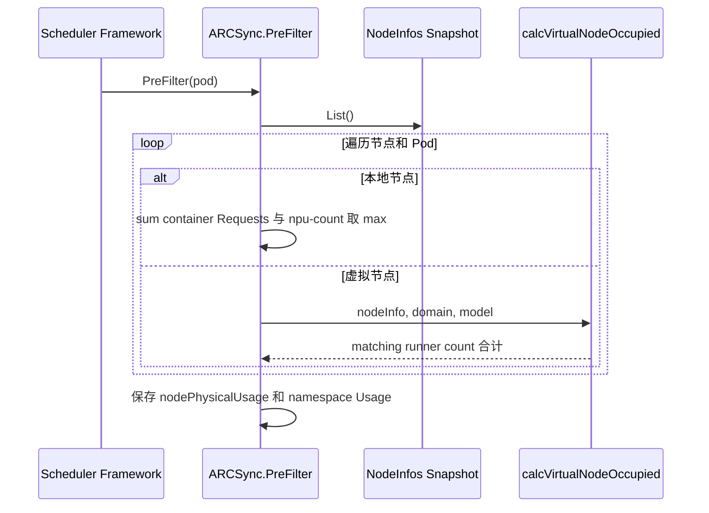

**AR 原子实现分解**

| AR | 已有实现动作 | 实现位置 | 已执行的处理逻辑 |
|---|---|---|---|
| **AR-02-01** | 过滤结束态及当前 Pod | ``PreFilter():286-310`` | 跳过 Succeeded/Failed 或当前 UID，记录其他 Pod UID 及 `-workflow` 名称标识。 |
| **AR-02-02** | 计算本地观察量 | ``PreFilter():311-329`` | 按普通 Containers Requests 求和，与同型号 `npu-count` 标签解析值取 max；还记录当前 namespace 观察量。 |
| **AR-02-03** | 计算虚拟节点观察量 | ``liqo.go:84-110`、`PreFilter():330-334`` | 按虚拟节点内 Runner 带匹配资源域/型号的 required-npu-count 累加，非数字忽略。 |
| **AR-02-04** | 产生占用映射 | ``PreFilter():337-340`` | 使用 nodeName → 观察占用量；后续预约合并见 SR-04。 |

**AR 与 SR 的关系**：上述 AR 都可以在 S-BASE/D-BASE 静态取证；对应验证只要求确认行为与源码一致，不把其风险修复当成 AR 已交付。

**领域对象及状态变化**

相关对象：Kubernetes `Node.status.allocatable`；Pod `containers[].resources.requests`；Pod label `ascend-ci.com/npu-count` 和三项 Runner 标签。 状态由上表 AR 所列函数产生或消费；没有额外的持久化领域实体。

**验收用例（TC）**

- **TC-02-01**：虚拟 Node 上同型号 2+3+1 卡 → 计算 6（现有 `TestCalcVirtualNodeOccupied`）。
- **TC-02-02**：异型号 Pod 被忽略（现有 `TestCalcVirtualNodeOccupiedMismatchedModel`）。
- **TC-02-03**：本地 Requests=2 与匹配 label=4 → 计 4（逻辑可由代码推导，本轮未发现专门单测）。

**判定规则**：现有测试函数只说明代码仓包含该测试，不能在本次未执行 Go Test 或没有集群访问的情况下声称测试已通过。对于风险复现用例，预期结果应保持与当前源码一致。

**代码与配置证据**：[pkg/arcsync/arcsync.go#L278-L340](https://github.com/ascend-gha-runners/scheduler-plugins/blob/cc243f537e97ca4e34c6bd57030817a04ae204ec/pkg/arcsync/arcsync.go#L278-L340)；[pkg/arcsync/liqo.go#L76-L110](https://github.com/ascend-gha-runners/scheduler-plugins/blob/cc243f537e97ca4e34c6bd57030817a04ae204ec/pkg/arcsync/liqo.go#L76-L110)；[pkg/arcsync/arcsync_test.go#L49-L115](https://github.com/ascend-gha-runners/scheduler-plugins/blob/cc243f537e97ca4e34c6bd57030817a04ae204ec/pkg/arcsync/arcsync_test.go#L49-L115)。

##### 5.1.4.3 SR-03：执行 NPU 聚合容量准入

**功能概述与当前行为**

**当前行为**：PreFilter 以可容忍污点、未 cordon 的本地节点总剩余和被保留的虚拟候选剩余求和，和需求数量比较；不足时返回 Unschedulable；足够才进入 FIFO 检查并写 CycleState。

**证据状态**：CODE + CONFIG；容器实际 NPU request 的逐节点判定由 SR-09 的 Filter 完成。

**用户故事与前置条件**

**角色**：CI 作业提交者。

**用户故事**：当 NPU 总余量低于需求时，希望 Runner 等待调度，而不是提前启动并等待 Workflow 无法落地。

**场景前置条件**：Pod 含 required-npu-count；Snapshot 列举成功；后续 Liqo/Queue 与 in-flight 处理已完成。

**用例实现思路**

1. PreFilter 获取计算后的 nodeTotalOccupied、nodeFreeNPU。
2. 遍历 NodeInfos，排除 cordon 和未容忍污点；虚拟 Node 还必须保留在 nodeFreeNPU。
3. 对本地节点不重新检查 NodeSelector 是否在 nodeFreeNPU 中，直接求和。
4. `totalNPUFree>=reqCount` 则继续，否则 Unschedulable。
5. 继续 FIFO，Success 时写 stateKey 的 requiredCount/resourceName/nodeFreeNPU。

本轮不对尚未引入的算法或接口做开发选型；仅还原该代码基线真正采用的路径。

**用例时序图**

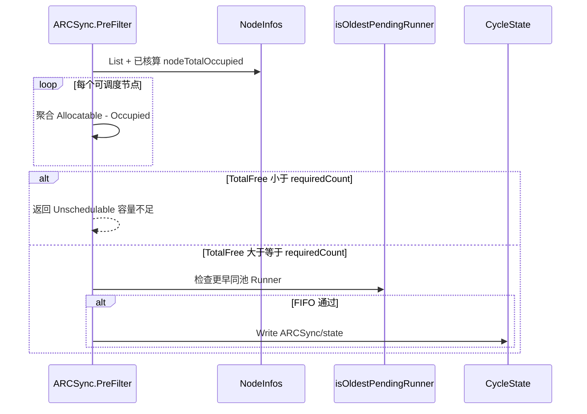

**AR 原子实现分解**

| AR | 已有实现动作 | 实现位置 | 已执行的处理逻辑 |
|---|---|---|---|
| **AR-03-01** | 按当前规则累计可用量 | ``PreFilter():419-440`` | 遍历节点累计 `Allocatable[fullResourceName]-nodeTotalOccupied[node]`；本地包含非最终候选 Node 的可能性。 |
| **AR-03-02** | 容量门禁 | ``PreFilter():441-447`` | 比较聚合数值；拒绝原因固定为 `No node has enough available NPU slots`，但措辞比真实总量判定更强。 |
| **AR-03-03** | 形成 CycleState | ``PreFilter():449-461`` | FIFO 通过时 Write `ARCSync/state`，包含需求量、资源键、候选节点空闲 map；不写入 Pod API。 |

**AR 与 SR 的关系**：上述 AR 都可以在 S-BASE/D-BASE 静态取证；对应验证只要求确认行为与源码一致，不把其风险修复当成 AR 已交付。

**领域对象及状态变化**

相关对象：同 SR-01 的 Runner labels；`Node.status.allocatable`；不新增用户接口。 状态由上表 AR 所列函数产生或消费；没有额外的持久化领域实体。

**验收用例（TC）**

- **TC-03-01**：剩余总量低于请求 → Unschedulable（需隔离 FIFO 影响）。
- **TC-03-02**：Runner 预约超过 NPU 总量 → 拒绝（现有 `TestPreFilterRejectsWhenRunnerReservationsExceedNPU`）。
- **TC-03-03**：预约未超过总量 → 准入（现有 `TestPreFilterAllowsRunnerWhenReservationsBelowNPU`）。
- **TC-03-04**：两个节点分别空闲 4 卡，申请 8 卡 → 当前聚合条件可能通过（风险复现实验，不得作为单节点可行性功能验收）。
- **TC-03-05**：本地空闲 8 卡、合格 Liqo 远端单节点空闲 10 卡、Runner 申请 12 卡且无其它限制 → 核查 Liqo 选择远端、聚合按 18 卡放行、远端不足 12 卡；这是待补的回归场景，并非已有自动化测试。

**判定规则**：现有测试函数只说明代码仓包含该测试，不能在本次未执行 Go Test 或没有集群访问的情况下声称测试已通过。对于风险复现用例，预期结果应保持与当前源码一致。

**代码与配置证据**：[pkg/arcsync/arcsync.go#L419-L461](https://github.com/ascend-gha-runners/scheduler-plugins/blob/cc243f537e97ca4e34c6bd57030817a04ae204ec/pkg/arcsync/arcsync.go#L419-L461)；[pkg/arcsync/arcsync_test.go#L948-L1001](https://github.com/ascend-gha-runners/scheduler-plugins/blob/cc243f537e97ca4e34c6bd57030817a04ae204ec/pkg/arcsync/arcsync_test.go#L948-L1001)。

#### 5.1.5 用户接口设计

**SR-01**：Pod `metadata.labels`：`ascend-ci.com/required-npu-count`、`ascend-ci.com/npu-resource-domain`、`ascend-ci.com/npu-resource-model`；`spec.schedulerName: npu-scheduler`。当前源码没有 `npu-managed` 字段。

**SR-02**：Kubernetes `Node.status.allocatable`；Pod `containers[].resources.requests`；Pod label `ascend-ci.com/npu-count` 和三项 Runner 标签。

**SR-03**：同 SR-01 的 Runner labels；`Node.status.allocatable`；不新增用户接口。

#### 5.1.6 实现接口设计

##### 5.1.6.1 接口设计与契约

**SR-01**：`func (pl *ARCSync) PreFilter(context.Context, *framework.CycleState, *v1.Pod) (*framework.PreFilterResult,*framework.Status)`；返回 Success/Unschedulable/Error，由 Framework 消费，不是 HTTP API。

**SR-02**：`calcVirtualNodeOccupied(nodeInfo *framework.NodeInfo,resDomain,resModel string) int64`；`PreFilter` 对 Snapshot 读操作；无自定义数据查询服务。

**SR-03**：`PreFilter` 返回 `framework.NewStatus(framework.Unschedulable,"No node has enough available NPU slots")` 或继续后续判断。

本功能域无自定义 REST 服务；Swagger/OpenAPI 为 **N/A**。Kubernetes 资源字段和 Framework 扩展点契约参见第 4.7 节。

#### 5.1.7 领域数据模型

数据对象、归属和销毁边界见第 3.4 节，各 SR 的状态变化见第 5.1.4 节。不新增持久化实体或 CRD。

#### 5.1.8 验收与追踪

- **SR-01**：TC-01-01、TC-01-02、TC-01-03；相关 AR 及源码证据见本 IR 对应用例和第 7.2 节。
- **SR-02**：TC-02-01、TC-02-02、TC-02-03；相关 AR 及源码证据见本 IR 对应用例和第 7.2 节。
- **SR-03**：TC-03-01、TC-03-02、TC-03-03、TC-03-04、TC-03-05；相关 AR 及源码证据见本 IR 对应用例和第 7.2 节。

测试案例覆盖现有行为与待验证的限制，不代表已经执行集群测试。

#### 5.1.9 DFX 分析

**安全性**：需求标签未严格校验，可能绕过准入。**可靠性**：Snapshot 不及时、资源聚合和单节点可行性不同，可能误放行。**可用性/性能**：容量扫描随 Node/Pod 规模增长，CI 排队阶段改善尚未实测。**可服务性**：须区分 Runner Pending 和 Workflow Pending，结合 Scheduler Status/Events 核查。

**FMEA（按 SR 区分独有失效模式与剩余风险）**

**SR-01 — 基于 Runner NPU 标签激活调度插件**

| FMEA 要素 | 基于当前代码的分析 |
|---|---|
| 失效模式 | 错误/负数标签未拒绝，导致需求被低估或绕过 |
| 失效原因 | Atoi 返回错误未处理；标签由 Pod 元数据提供 |
| 影响（可靠性/可用性） | 错误输入可能获得错误的准入判断 |
| 已有控制措施 | 源码无严格输入校验 |
| 检测与验证 | 非法标签 Pod 对比 Status、CycleState 和 Events |
| 剩余风险 | 非法或缺失需求标签可能令零需求/错误资源名进入后续准入路径；即使框架调度成功，也无法证明 Runner 标签与 Workflow NPU Requests 一致。 |

**SR-02 — 统计本地和虚拟节点 NPU 资源占用**

| FMEA 要素 | 基于当前代码的分析 |
|---|---|
| 失效模式 | 账面 NPU 数量与真实请求不一致 |
| 失效原因 | Snapshot 延迟、InitContainer 语义差异、虚拟 Node 计数依赖标签 |
| 影响（可靠性/可用性） | 准入误放行或错误拒绝 |
| 已有控制措施 | 读取当前 Snapshot，按资源类型计数 |
| 检测与验证 | 构造 requests/label 冲突、延迟快照与虚拟 Pod 场景 |
| 剩余风险 | Snapshot 更新滞后、InitContainer 申请未按同等语义核算或虚拟节点标签缺失时，节点占用可能被低估；目前没有真实设备占用的闭环校验。 |

**SR-03 — 执行 NPU 聚合容量准入**

| FMEA 要素 | 基于当前代码的分析 |
|---|---|
| 失效模式 | 资源池合计充足但单节点不满足 |
| 失效原因 | 聚合条件不是单节点可行性，且本地聚合未应用完整放置约束 |
| 影响（可靠性/可用性） | 未来 Workflow 长时间 Pending |
| 已有控制措施 | Filter 与默认插件只验证当前被绑定 Pod |
| 检测与验证 | 两节点各 4 卡、申请 8 卡及定向 selector 场景 |
| 剩余风险 | 本地/远端余量聚合可满足需求但获胜池单节点不足，或本地聚合计入不满足 NodeSelector 的节点；后续 Workflow 仍可能长期 Pending。 |

共性复杂度、可靠性和观测证据边界见第 3.6 节。

### 5.2 IR-02：NPU 在途预约及 Runner/Workflow 计量交接

#### 5.2.1 功能概述

避免 Runner 已通过调度但 Workflow 尚未生成时，未来 NPU 需求被下一轮 Runner 准入忽略。使用进程内软预约和命名匹配做计量交接，不提供硬件独占锁。

#### 5.2.2 SR 用例范围

- **SR-04**：管理进程内 NPU 在途预留
- **SR-05**：使用 Workflow 命名关系交接资源计量

#### 5.2.3 实现思路

Reserve 在 inFlightReservations 中建立记录；后续 PreFilter 根据 Pod UID、经过时间和 Workflow baseName 判断计数、跳过或清理；Unreserve 回滚。预约仅在调度进程内有效，且不同 namespace 的 baseName 可能冲突。

备选方案及当前选型边界见第 3.2 节；本章只描述源码和 GitOps 已有能力。

#### 5.2.4 设计思路（每个 SR 独立时序图与 AR）

##### 5.2.4.1 SR-04：管理进程内 NPU 在途预留

**功能概述与当前行为**

**当前行为**：配置启用 `Reserve`；框架调用时按 UID 建立进程内 reservation；`Unreserve` 删除；后续 PreFilter 合并非虚拟节点预约到 nodeTotalOccupied。

**证据状态**：CODE + CONFIG，属于软预留，不是 K8s Extended Resource 的原子 Reservation API。

**用户故事与前置条件**

**角色**：资源配额管理员。

**用户故事**：多个 Runner 连续调度时，希望调度器考虑尚未实际生成 Workflow 的未来 NPU 需求，减轻资源被重复承诺的问题。

**场景前置条件**：PreFilter 之前已写 CycleState；本次 Framework 运行 Reserve 扩展点；Reservation map 仅存在于同一进程。

**用例实现思路**

1. Framework 调用 Reserve(pod,nodeName)。
2. map[PodUID] 写入 nodeName/count/time/baseName/namespace。
3. 下一次 PreFilter 根据快照已知 UID、活动 Workflow 决定删除/忽略。
4. 本地/非虚拟 Node 的未交接预约累计到 nodeTotalOccupied。
5. Framework 失败回滚时可调用 Unreserve 删除当前 UID。

本轮不对尚未引入的算法或接口做开发选型；仅还原该代码基线真正采用的路径。

**用例时序图**

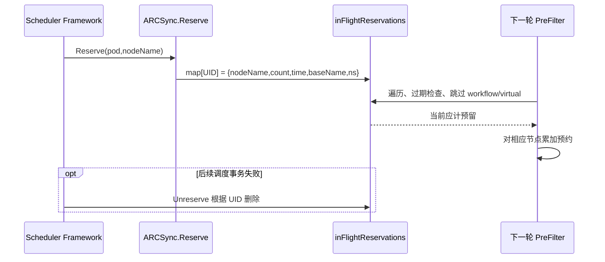

**AR 原子实现分解**

| AR | 已有实现动作 | 实现位置 | 已执行的处理逻辑 |
|---|---|---|---|
| **AR-04-01** | 登记预约 | ``Reserve():644-667`` | Map 键优先 Pod UID，为空回退 namespace/name；写入 Mutex 保护的内存状态。 |
| **AR-04-02** | 按快照回收与计费 | ``PreFilter():342-363`` | UID 不再见且超过 10s 删除；活动 Workflow 匹配则跳过；virtual node 预约跳过附加计数；其余占用加在保存的 res.nodeName。 |
| **AR-04-03** | 回滚预约 | ``Unreserve():669-678`` | 按 UID 或 namespace/name 删除；不调用 Kubernetes API，不写持久对象。 |

**AR 与 SR 的关系**：上述 AR 都可以在 S-BASE/D-BASE 静态取证；对应验证只要求确认行为与源码一致，不把其风险修复当成 AR 已交付。

**领域对象及状态变化**

相关对象：没有新增用户接口；逻辑预约由 Framework 内部 Reserve 生命周期自动触发，无法通过 REST 读取预约表。 状态由上表 AR 所列函数产生或消费；没有额外的持久化领域实体。

**验收用例（TC）**

- **TC-04-01**：预留 2 卡后，下一轮剩余计量减少 2；配合 CPU Runner 预约测试。
- **TC-04-02**：Unreserve 删除当前 UID 预约（源码推导，未发现独立单测）。
- **TC-04-03**：UID 不在快照且预约 age>10s 才删除；在快照中不因时间自然过期。
- **TC-04-04**：进程重启后 map 重新初始化为空（设计限制验证）。

**判定规则**：现有测试函数只说明代码仓包含该测试，不能在本次未执行 Go Test 或没有集群访问的情况下声称测试已通过。对于风险复现用例，预期结果应保持与当前源码一致。

**代码与配置证据**：[pkg/arcsync/arcsync.go#L34-L49](https://github.com/ascend-gha-runners/scheduler-plugins/blob/cc243f537e97ca4e34c6bd57030817a04ae204ec/pkg/arcsync/arcsync.go#L34-L49)；[pkg/arcsync/arcsync.go#L342-L363](https://github.com/ascend-gha-runners/scheduler-plugins/blob/cc243f537e97ca4e34c6bd57030817a04ae204ec/pkg/arcsync/arcsync.go#L342-L363)；[pkg/arcsync/arcsync.go#L644-L678](https://github.com/ascend-gha-runners/scheduler-plugins/blob/cc243f537e97ca4e34c6bd57030817a04ae204ec/pkg/arcsync/arcsync.go#L644-L678)。

##### 5.2.4.2 SR-05：使用 Workflow 命名关系交接资源计量

**功能概述与当前行为**

**当前行为**：在 PreFilter 中将所有以 `-workflow` 后缀结尾的 Pod 的 baseName 标记为活动 Workflow；任何预约 baseName 匹配该字符串都会跳过预约计入；`PostBind` 有清理本 Pod 预约代码，但主 YAML 未显式配置这一阶段。

**证据状态**：CODE；部分行为由 PreFilter 执行，PostBind 运行态未确认。

**用户故事与前置条件**

**角色**：ARC Container Mode 运维人员。

**用户故事**：当对应 Workflow Pod 出现并开始占用 NPU 后，希望调度器避免将 Runner 预约和 Workflow 资源 Requests 重复计为两份。

**场景前置条件**：Workflow Pod 与 Runner Pod 的名称能由 `getBaseName` 规则关联；Snapshot 已看见 Workflow。

**用例实现思路**

1. 扫描 Pod Snapshot，针对名字有 -workflow 后缀的 Pod 记下 baseName。
2. 遍历预约；若 activeWorkflows[baseName] 存在则跳过该预约累加。
3. 观察中的 Workflow 通过普通 Requests / npu-count 进入物理占用。
4. PostBind 如果实际被调用，会删除带目标资源 request 的当前 Pod UID 的预留。

本轮不对尚未引入的算法或接口做开发选型；仅还原该代码基线真正采用的路径。

**用例时序图**

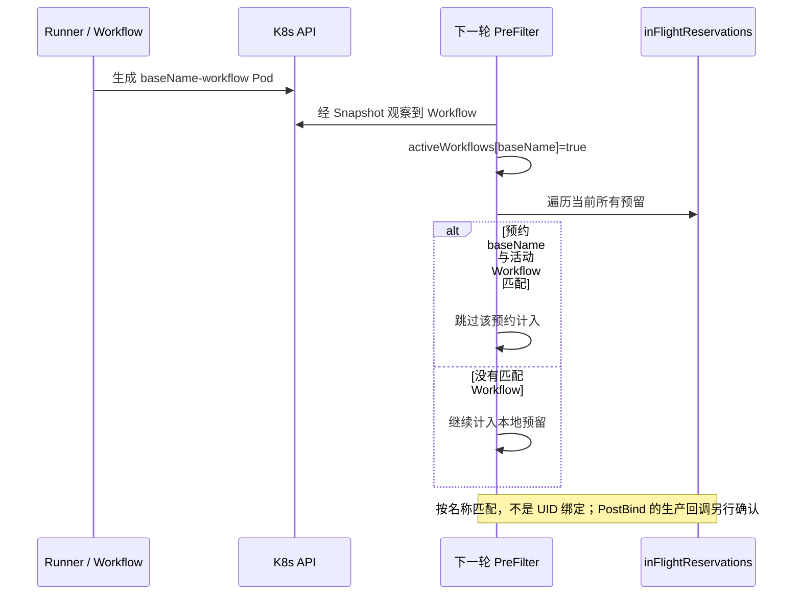

**AR 原子实现分解**

| AR | 已有实现动作 | 实现位置 | 已执行的处理逻辑 |
|---|---|---|---|
| **AR-05-01** | 计算工作流名称键 | ``getBaseName():172-178`、`PreFilter():304-307`` | 固定后缀 `-workflow`；没有读取 ownerReferences、Job ID、明确的 Runner UID 关联。 |
| **AR-05-02** | 跳过对应预约占用 | ``PreFilter():342-354`` | 只按 baseName 匹配，不带 namespace，可能跨 namespace 同名误命中。 |
| **AR-05-03** | PostBind 方法中的清理分支 | ``PostBind():680-704`` | 有目标资源 Requests 时删除当前 Pod UID 预留；Runner 不请求 NPU 则保留。配置是否让 Framework 实际调用必须独立确认。 |

**AR 与 SR 的关系**：上述 AR 都可以在 S-BASE/D-BASE 静态取证；对应验证只要求确认行为与源码一致，不把其风险修复当成 AR 已交付。

**领域对象及状态变化**

相关对象：Workflow Pod 的 `metadata.name`、namespace、container Requests、npu-count 等由 ARC/Workflow 系统确定；本插件不提供显式 Workflow ↔ Runner UID 绑定接口。 状态由上表 AR 所列函数产生或消费；没有额外的持久化领域实体。

**验收用例（TC）**

- **TC-05-01**：同 baseName Workflow 出现后，对应 Runner 预约跳过计数（源码推导，需独立单测）。
- **TC-05-02**：不同 namespace 的同名 baseName 可能误跳过预留（已知风险复现）。
- **TC-05-03**：PostBind 回调是否执行，必须以实际 Framework 配置/运行日志确认；不能只跑纯 Go 方法测试证明部署调用。

**判定规则**：现有测试函数只说明代码仓包含该测试，不能在本次未执行 Go Test 或没有集群访问的情况下声称测试已通过。对于风险复现用例，预期结果应保持与当前源码一致。

**代码与配置证据**：[pkg/arcsync/arcsync.go#L172-L178](https://github.com/ascend-gha-runners/scheduler-plugins/blob/cc243f537e97ca4e34c6bd57030817a04ae204ec/pkg/arcsync/arcsync.go#L172-L178)；[pkg/arcsync/arcsync.go#L298-L363](https://github.com/ascend-gha-runners/scheduler-plugins/blob/cc243f537e97ca4e34c6bd57030817a04ae204ec/pkg/arcsync/arcsync.go#L298-L363)；[pkg/arcsync/arcsync.go#L680-L704](https://github.com/ascend-gha-runners/scheduler-plugins/blob/cc243f537e97ca4e34c6bd57030817a04ae204ec/pkg/arcsync/arcsync.go#L680-L704)。

#### 5.2.5 用户接口设计

**SR-04**：没有新增用户接口；逻辑预约由 Framework 内部 Reserve 生命周期自动触发，无法通过 REST 读取预约表。

**SR-05**：Workflow Pod 的 `metadata.name`、namespace、container Requests、npu-count 等由 ARC/Workflow 系统确定；本插件不提供显式 Workflow ↔ Runner UID 绑定接口。

#### 5.2.6 实现接口设计

##### 5.2.6.1 接口设计与契约

**SR-04**：`Reserve(ctx,state,pod,nodeName) *framework.Status`、`Unreserve(ctx,state,pod,nodeName)`；`reservation{nodeName,count,timestamp,baseName,namespace}` 不是 CRD。

**SR-05**：`getBaseName(name string) string`；`PostBind(ctx,state,pod,nodeName)`；PreFilter 内联 `activeWorkflows map[string]bool`。

本功能域无自定义 REST 服务；Swagger/OpenAPI 为 **N/A**。Kubernetes 资源字段和 Framework 扩展点契约参见第 4.7 节。

#### 5.2.7 领域数据模型

数据对象、归属和销毁边界见第 3.4 节，各 SR 的状态变化见第 5.2.4 节。不新增持久化实体或 CRD。

#### 5.2.8 验收与追踪

- **SR-04**：TC-04-01、TC-04-02、TC-04-03、TC-04-04；相关 AR 及源码证据见本 IR 对应用例和第 7.2 节。
- **SR-05**：TC-05-01、TC-05-02、TC-05-03；相关 AR 及源码证据见本 IR 对应用例和第 7.2 节。

测试案例覆盖现有行为与待验证的限制，不代表已经执行集群测试。

#### 5.2.9 DFX 分析

**安全性**：Workflow 关联键缺少 namespace/UID，存在误匹配边界。**可靠性**：进程重启丢失预约，交接非原子。**可用性/性能**：锁和预约遍历开销随在途数增大。**可服务性**：需对齐 Snapshot、UID、预约与 Workflow 生命周期，不能只看 Runner 已绑定。

**FMEA（按 SR 区分独有失效模式与剩余风险）**

**SR-04 — 管理进程内 NPU 在途预留**

| FMEA 要素 | 基于当前代码的分析 |
|---|---|
| 失效模式 | 预约丢失或重复计量 |
| 失效原因 | 进程重启、Snapshot 不一致、CPU Node 上的逻辑负值 |
| 影响（可靠性/可用性） | 重复准入、容量计算不稳定 |
| 已有控制措施 | 进程内 mutex + Unreserve + 条件性快照清理 |
| 检测与验证 | 重启前后及并发多 Runner，比较 map 与快照 |
| 剩余风险 | Scheduler 重启使内存预约丢失；快照尚未出现的 UID 满足清理条件也可能被删，竞争调度器同时准入时仍可能重复分配逻辑容量。 |

**SR-05 — 使用 Workflow 命名关系交接资源计量**

| FMEA 要素 | 基于当前代码的分析 |
|---|---|
| 失效模式 | 跨 namespace 同名误跳过预约 |
| 失效原因 | baseName 缺 namespace/UID；交接依赖可见 Workflow |
| 影响（可靠性/可用性） | 占用少计，引起过量准入 |
| 已有控制措施 | Snapshot 观察到同名 Workflow 时跳过逻辑预约 |
| 检测与验证 | 双 namespace 同 baseName、Workflow 创建/删除时序 |
| 剩余风险 | 跨 namespace 相同 baseName 的 Workflow 可能错误跳过其他 Runner 预约；Workflow 不按约定命名时预约与真实占用也可能并存而重复计数。 |

共性复杂度、可靠性和观测证据边界见第 3.6 节。

### 5.3 IR-03：本地/远端资源池选择及调度约束

#### 5.3.1 功能概述

依 Liqo、Volcano 和 Kubernetes 放置约束确定适用资源池与候选节点，支撑 BG-01 的资源预估和 BG-02 的公平比较范围。本插件不替代 Liqo/Volcano 控制器。

#### 5.3.2 SR 用例范围

- **SR-06**：识别并筛选 Liqo 虚拟节点
- **SR-07**：本地与远端资源池的比较及择优
- **SR-08**：有条件读取 Volcano Queue 限额
- **SR-09**：候选节点 Filter 和空闲量 Score

#### 5.3.3 实现思路

过滤 Liqo 虚拟节点，比较本地空闲总量与一个远端虚拟节点最大余量；条件性读取 Pod Queue annotation 影响本地额度，之后由 Filter/Score 参与节点选择。队列、选择器及外围缓存缺失时的降级行为以现有源码为准。

备选方案及当前选型边界见第 3.2 节；本章只描述源码和 GitOps 已有能力。

#### 5.3.4 设计思路（每个 SR 独立时序图与 AR）

##### 5.3.4.1 SR-06：识别并筛选 Liqo 虚拟节点

**功能概述与当前行为**

**当前行为**：有 `NamespaceOffloading` CR 时，通过 `nodeSelectorTerms` 选候选虚拟 Node，预先删除不匹配的远端；无 CR 则所有虚拟 Node 从 ARCSync map 移除。

**证据状态**：CODE + COND（Liqo CRD 存在且 informer 可读）。

**用户故事与前置条件**

**角色**：多集群资源管理员。

**用户故事**：为指定 Namespace 允许向部分远端集群 offload 时，希望候选虚拟节点符合 Liqo NamespaceOffloading 的 clusterSelector。

**场景前置条件**：节点通过 label `liqo.io/remote-cluster-id` 标识；namespace 对应 `NamespaceOffloading` 可从缓存读取。

**用例实现思路**

1. 初始化时创建 DynamicInformer（如果 CRD 存在）。
2. PreFilter 通过 `nsOffloadingLister.Get(pod.Namespace)` 查对象。
3. 解析 `spec.clusterSelector` 为 NodeSelectorTerms。
4. 匹配虚拟节点 Node Labels；删除不被选定的虚拟节点候选。
5. 没有 NamespaceOffloading 则删除所有虚拟节点候选。

本轮不对尚未引入的算法或接口做开发选型；仅还原该代码基线真正采用的路径。

**用例时序图**

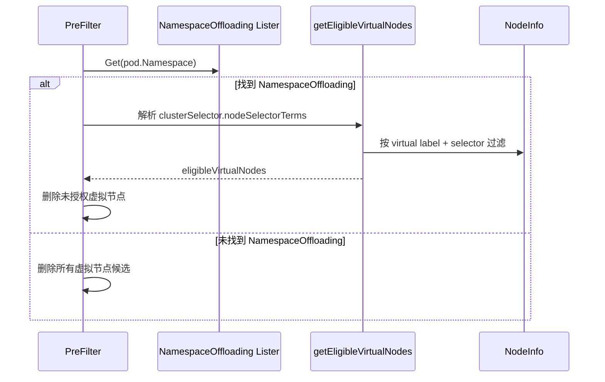

**AR 原子实现分解**

| AR | 已有实现动作 | 实现位置 | 已执行的处理逻辑 |
|---|---|---|---|
| **AR-06-01** | CRD informer 初始化 | ``New():68-104`、`liqo.go:18-23`` | GVR=offloading.liqo.io/v1beta1/namespaceoffloadings；未同步时 Get 可能还看不到对象。 |
| **AR-06-02** | 识别虚拟 Node | ``isVirtualNode():76-82`` | 检查 key 是否存在，不校验标签值。 |
| **AR-06-03** | 解析 NodeSelectorTerms | ``extractClusterSelectorTerms():130-153`` | 对 `spec.clusterSelector` 反序列化成 `v1.NodeSelector`；支持 term OR、expression AND；含 matchFields 的 term 不匹配。 |
| **AR-06-04** | 过滤不合规虚拟节点 | ``getEligibleVirtualNodes():112-128`、`applyLiqoComparison():503-518`` | 有效 selector 下只保留匹配项；不存在有效 terms 时会把所有虚拟节点标为 eligible。 |

**AR 与 SR 的关系**：上述 AR 都可以在 S-BASE/D-BASE 静态取证；对应验证只要求确认行为与源码一致，不把其风险修复当成 AR 已交付。

**领域对象及状态变化**

相关对象：外部 CRD：`NamespaceOffloading`，`spec.clusterSelector.nodeSelectorTerms[].matchExpressions`；虚拟 Node labels。不能按仓库 `ARCSYNC_GUIDE.md` 的 `matchLabels` 示例直接认定生效。 状态由上表 AR 所列函数产生或消费；没有额外的持久化领域实体。

**验收用例（TC）**

- **TC-06-01**：匹配指定远端 → 仅匹配 Node 保留（`TestGetEligibleVirtualNodes`）。
- **TC-06-02**：非目标远端排除（`TestGetEligibleVirtualNodesExcludesNonTargetedCluster`）。
- **TC-06-03**：无有效 selector terms → 当前实现允许所有虚拟 Node（`TestGetEligibleVirtualNodesNoSelector`）。
- **TC-06-04**：无 NamespaceOffloading 时虚拟 Node 被删除（`TestPreFilterNoNamespaceOffloading`）。

**判定规则**：现有测试函数只说明代码仓包含该测试，不能在本次未执行 Go Test 或没有集群访问的情况下声称测试已通过。对于风险复现用例，预期结果应保持与当前源码一致。

**代码与配置证据**：[pkg/arcsync/liqo.go#L16-L28](https://github.com/ascend-gha-runners/scheduler-plugins/blob/cc243f537e97ca4e34c6bd57030817a04ae204ec/pkg/arcsync/liqo.go#L16-L28)；[pkg/arcsync/liqo.go#L112-L183](https://github.com/ascend-gha-runners/scheduler-plugins/blob/cc243f537e97ca4e34c6bd57030817a04ae204ec/pkg/arcsync/liqo.go#L112-L183)；[pkg/arcsync/arcsync.go#L379-L417](https://github.com/ascend-gha-runners/scheduler-plugins/blob/cc243f537e97ca4e34c6bd57030817a04ae204ec/pkg/arcsync/arcsync.go#L379-L417)。

##### 5.3.4.2 SR-07：本地与远端资源池的比较及择优

**功能概述与当前行为**

**当前行为**：以本地空闲 NPU 之和与 eligible 虚拟节点单节点最大余量比较，平局本地胜。若本地有单节点足额、某虚拟节点有同类 Pending Runner，该虚拟节点可能被略过。

**证据状态**：CODE + COND（namespace 有可读取的 NamespaceOffloading）。

**用户故事与前置条件**

**角色**：多集群平台 SRE。

**用户故事**：当 Liqo 远端可用时，希望调度器按已观察的 NPU 余量选本地或一个远端虚拟节点，减少资源不匹配。

**场景前置条件**：已产生 nodeFreeNPU；已过滤 nodeSelector/required affinity/taint；Liqo eligibleVirtuals 非空。

**用例实现思路**

1. 求本地 nodeFreeNPU 的合计；如发现 Queue 额度则取限额余量较小值。
2. 寻找 eligibleVirtuals 中最大剩余的虚拟节点。
3. 如果本地存在单节点足够，将同类 Pending Runner 竞争的虚拟节点排除比较。
4. 本地 >= 远端最大 → 删除所有 eligible 虚拟节点。
5. 远端更大 → 只保留获胜虚拟节点。
6. 后续仍由聚合容量门禁 + Filter 决定 Pod 是否调度。

本轮不对尚未引入的算法或接口做开发选型；仅还原该代码基线真正采用的路径。

**用例时序图**

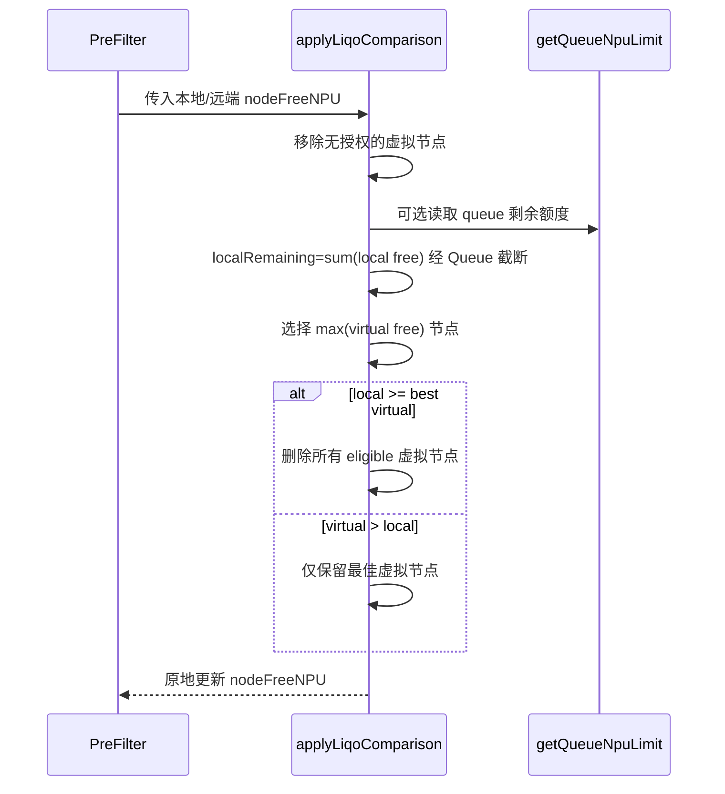

**AR 原子实现分解**

| AR | 已有实现动作 | 实现位置 | 已执行的处理逻辑 |
|---|---|---|---|
| **AR-07-01** | 本地总剩余量 | ``applyLiqoComparison():520-547`` | 依据 `nodeFreeNPU` 中本地节点余量求和；queueLimit 可改变本地比较值。 |
| **AR-07-02** | 挑选最佳虚拟节点 | ``applyLiqoComparison():549-568`` | 只在 `eligibleVirtuals` 中考虑 `free > bestVirtRemaining` 的节点；map 遍历本身没有显式排序。 |
| **AR-07-03** | Pool 选择及排除 | ``applyLiqoComparison():570-586`` | 比较 `localRemaining >= bestVirtRemaining`；本地胜删除虚拟，远端胜只保留最佳虚拟。 |

**AR 与 SR 的关系**：上述 AR 都可以在 S-BASE/D-BASE 静态取证；对应验证只要求确认行为与源码一致，不把其风险修复当成 AR 已交付。

**领域对象及状态变化**

相关对象：Pod 所在 namespace 的 NamespaceOffloading、Node label、Pod 节点约束；算法没有独立配置开关或权重参数。 状态由上表 AR 所列函数产生或消费；没有额外的持久化领域实体。

**验收用例（TC）**

- **TC-07-01**：本地余量大于远端 → 本地胜（`TestPreFilterLocalWins`）。
- **TC-07-02**：远端余量大于本地 → 远端胜（`TestPreFilterVirtualWins`）。
- **TC-07-03**：本地被其他 namespace 占满 → 应按全量占用核算（`TestPreFilterVirtualWinsWhenLocalOccupiedByOtherNamespace`）。
- **TC-07-04**：NodeAffinity 不允许虚拟 Node → 不被选为最佳（`TestPreFilterAffinityExcludesNonTargetedVirtual`）。
- **TC-07-05**：本地 8 卡、远端 10 卡、需求 12 卡 → 检查远端胜出但本地仍计入聚合；结果以源码执行路径为准（待添加测试，不声称测试已通过）。

**判定规则**：现有测试函数只说明代码仓包含该测试，不能在本次未执行 Go Test 或没有集群访问的情况下声称测试已通过。对于风险复现用例，预期结果应保持与当前源码一致。

**代码与配置证据**：[pkg/arcsync/arcsync.go#L492-L586](https://github.com/ascend-gha-runners/scheduler-plugins/blob/cc243f537e97ca4e34c6bd57030817a04ae204ec/pkg/arcsync/arcsync.go#L492-L586)；[pkg/arcsync/arcsync_test.go#L462-L699](https://github.com/ascend-gha-runners/scheduler-plugins/blob/cc243f537e97ca4e34c6bd57030817a04ae204ec/pkg/arcsync/arcsync_test.go#L462-L699)。

##### 5.3.4.3 SR-08：有条件读取 Volcano Queue 限额

**功能概述与当前行为**

**当前行为**：Queue 名称**从 Pod annotation 读取**；有 NamespaceOffloading 才调用 Queue 额度路径；额度影响本地剩余量与本地 Node 是否保留，不能承诺对未启用 Liqo 的 Pod 强制队列配额。

**证据状态**：CODE + COND（Volcano Queue CRD 可读、Pod annotation 设置且 NamespaceOffloading 存在）。

**用户故事与前置条件**

**角色**：命名空间资源管理员。

**用户故事**：当 Runner Pod 关联 Volcano Queue 时，希望本地 NPU 选择参考该队列的 capability 限额。

**场景前置条件**：Pod `metadata.annotations["scheduling.volcano.sh/queue-name"]`、Queue CRD 的 `spec.capability[fullResourceName]`；可用 dynamic Queue Lister。

**用例实现思路**

1. 从待调度 Pod annotations 读取队列名。
2. Queue Lister 获取对象，解析 capability 中对应的扩展资源 Quantity。
3. 在 Liqo 比较时本地余量取 `min(localRemaining, max(0, queueLimit-nsLocalOccupied))`。
4. 同一 PreFilter 继续核对当前命名空间本地占用+需求与限额。
5. 超额则删除本地 Node，虚拟候选不在此循环中删除。

本轮不对尚未引入的算法或接口做开发选型；仅还原该代码基线真正采用的路径。

**用例时序图**

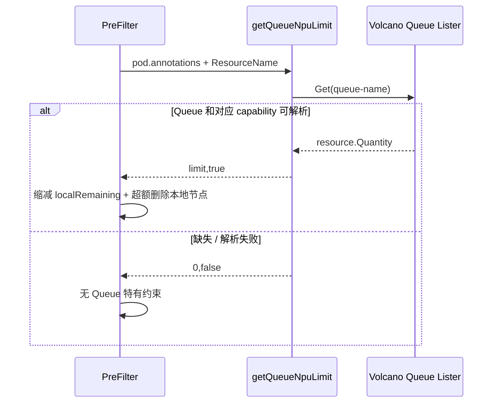

**AR 原子实现分解**

| AR | 已有实现动作 | 实现位置 | 已执行的处理逻辑 |
|---|---|---|---|
| **AR-08-01** | 解析 Queue 容量 | ``volcano.go:11-42`` | 仅 Pod annotation 生效；无值、Lister 不可用、资源键缺失、Quantity 无法解析均返回 `(0,false)`。 |
| **AR-08-02** | 参与本地/远端比选 | ``applyLiqoComparison():531-544`` | 对本地有效余量进行最小值截断；这是本地候选倾向，不是完整 Queue 调度。 |
| **AR-08-03** | 超额时排除本地候选 | ``PreFilter():392-409`` | 仅在 nsHasOffloading 分支；基于 namespace 本地观察占用+预留与 requestedCount 做判断。 |

**AR 与 SR 的关系**：上述 AR 都可以在 S-BASE/D-BASE 静态取证；对应验证只要求确认行为与源码一致，不把其风险修复当成 AR 已交付。

**领域对象及状态变化**

相关对象：Pod annotation `scheduling.volcano.sh/queue-name: my-queue`；外部 `Queue.spec.capability` 资源名如 `huawei.com/npu`。Namespace 上同名 annotation 本身不会被当前函数读取。 状态由上表 AR 所列函数产生或消费；没有额外的持久化领域实体。

**验收用例（TC）**

- **TC-08-01**：合法 Queue capability 返回数值（`TestGetQueueNpuLimit`）。
- **TC-08-02**：Queue 限额降低本地优势使远端获胜（`TestPreFilterVolcanoQueueCapsLocal`）。
- **TC-08-03**：只有 Namespace annotation、没有 Pod annotation → 当前代码不会读取 Queue（待复现实验）。
- **TC-08-04**：无 NamespaceOffloading 时即使有 Queue annotation，也不执行本地 Queue 限制（源码推导）。

**判定规则**：现有测试函数只说明代码仓包含该测试，不能在本次未执行 Go Test 或没有集群访问的情况下声称测试已通过。对于风险复现用例，预期结果应保持与当前源码一致。

**代码与配置证据**：[pkg/arcsync/volcano.go#L11-L42](https://github.com/ascend-gha-runners/scheduler-plugins/blob/cc243f537e97ca4e34c6bd57030817a04ae204ec/pkg/arcsync/volcano.go#L11-L42)；[pkg/arcsync/arcsync.go#L385-L409](https://github.com/ascend-gha-runners/scheduler-plugins/blob/cc243f537e97ca4e34c6bd57030817a04ae204ec/pkg/arcsync/arcsync.go#L385-L409)；[pkg/arcsync/arcsync.go#L531-L544](https://github.com/ascend-gha-runners/scheduler-plugins/blob/cc243f537e97ca4e34c6bd57030817a04ae204ec/pkg/arcsync/arcsync.go#L531-L544)。

##### 5.3.4.4 SR-09：候选节点 Filter 和空闲量 Score

**功能概述与当前行为**

**当前行为**：Filter 要求候选节点存在于 CycleState 的 map；只有容器明确 Requests 目标 NPU 的 Pod 才在 Filter 检查节点 NPU 是否足额。Score 按剩余量升序值直接评分（剩余越多分数越高），截断在 0～100。

**证据状态**：CODE + CONFIG（主部署 Filter、Score 都启用）。

**用户故事与前置条件**

**角色**：Runner ScaleSet 管理员。

**用户故事**：当 Pod 已通过 PreFilter 时，希望 ARCSync 对被选出的候选节点进行约束过滤，并提供可解释的资源优先分数。

**场景前置条件**：成功执行 PreFilter 并写 `ARCSync/state`；Framework 遍历每个候选 NodeInfo。

**用例实现思路**

1. Filter 从 CycleState 读取 `ARCSync/state`；读不到 state 直接 Success。
2. 若 nodeName 不在 nodeFreeNPU，返回 Unschedulable。
3. 若 Pod 无目标 NPU 的 container Request，只凭候选 map 放行；有 Request 则检查 free>=requiredCount。
4. Score 从 state 读取 nodeFreeNPU[nodeName] 并截断至 0～100。

本轮不对尚未引入的算法或接口做开发选型；仅还原该代码基线真正采用的路径。

**用例时序图**

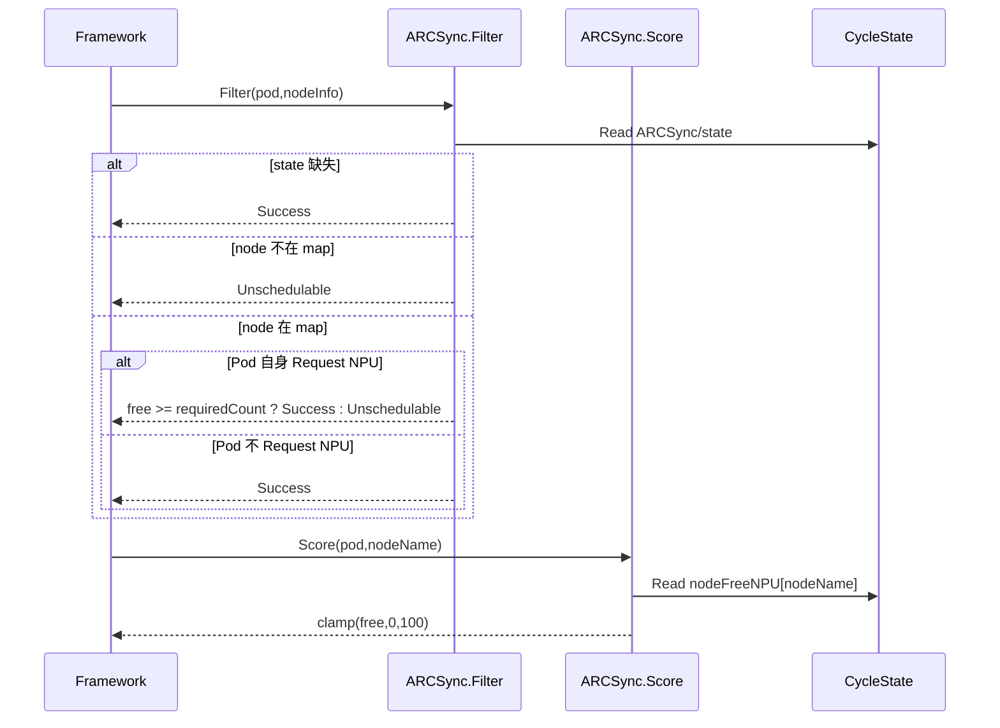

**AR 原子实现分解**

| AR | 已有实现动作 | 实现位置 | 已执行的处理逻辑 |
|---|---|---|---|
| **AR-09-01** | 计算可用节点 Map | ``PreFilter():365-377`` | 先排除 cordon / 不容忍污点 / nodeSelector / required affinity，得到 nodeName → free。 |
| **AR-09-02** | 节点过滤 | ``Filter():588-621`` | map 不包含节点就拒绝；无目标 NPU Request 的 Runner 不以该 Node 的 NPU free 判拒绝。 |
| **AR-09-03** | 节点评分 | ``Score():623-641`` | `score = clamp(free,0,MaxNodeScore)`；无独立 normalize，不能称之为 best-fit 评分。 |

**AR 与 SR 的关系**：上述 AR 都可以在 S-BASE/D-BASE 静态取证；对应验证只要求确认行为与源码一致，不把其风险修复当成 AR 已交付。

**领域对象及状态变化**

相关对象：Pod nodeSelector、tolerations、nodeAffinity、container Requests；没有独立评分权重参数在 ARCSync 代码中。 状态由上表 AR 所列函数产生或消费；没有额外的持久化领域实体。

**验收用例（TC）**

- **TC-09-01**：Runner 仅标签要求 NPU，实际放在 CPU Node 时 Filter 返回 Success（`TestFilterRunnerPodPassesCPUNode`）。
- **TC-09-02**：NodeAffinity 禁止远端时不进入候选（`TestNodeMatchesPodSelection`）。
- **TC-09-03**：不在 nodeFreeNPU 的 Node 返回 `node not eligible...`（源码推导）。
- **TC-09-04**：free=8 分数为 8、free=150 截为 100、free<0 截为 0（源码推导）。

**判定规则**：现有测试函数只说明代码仓包含该测试，不能在本次未执行 Go Test 或没有集群访问的情况下声称测试已通过。对于风险复现用例，预期结果应保持与当前源码一致。

**代码与配置证据**：[pkg/arcsync/arcsync.go#L129-L169](https://github.com/ascend-gha-runners/scheduler-plugins/blob/cc243f537e97ca4e34c6bd57030817a04ae204ec/pkg/arcsync/arcsync.go#L129-L169)；[pkg/arcsync/arcsync.go#L365-L377](https://github.com/ascend-gha-runners/scheduler-plugins/blob/cc243f537e97ca4e34c6bd57030817a04ae204ec/pkg/arcsync/arcsync.go#L365-L377)；[pkg/arcsync/arcsync.go#L588-L641](https://github.com/ascend-gha-runners/scheduler-plugins/blob/cc243f537e97ca4e34c6bd57030817a04ae204ec/pkg/arcsync/arcsync.go#L588-L641)。

#### 5.3.5 用户接口设计

**SR-06**：外部 CRD：`NamespaceOffloading`，`spec.clusterSelector.nodeSelectorTerms[].matchExpressions`；虚拟 Node labels。不能按仓库 `ARCSYNC_GUIDE.md` 的 `matchLabels` 示例直接认定生效。

**SR-07**：Pod 所在 namespace 的 NamespaceOffloading、Node label、Pod 节点约束；算法没有独立配置开关或权重参数。

**SR-08**：Pod annotation `scheduling.volcano.sh/queue-name: my-queue`；外部 `Queue.spec.capability` 资源名如 `huawei.com/npu`。Namespace 上同名 annotation 本身不会被当前函数读取。

**SR-09**：Pod nodeSelector、tolerations、nodeAffinity、container Requests；没有独立评分权重参数在 ARCSync 代码中。

#### 5.3.6 实现接口设计

##### 5.3.6.1 接口设计与契约

**SR-06**：`getEligibleVirtualNodes(nodeInfos,nsOffloading) map[string]bool`；`extractClusterSelectorTerms(*unstructured.Unstructured)`；`nsOffloadingLister.Get(namespace)`。

**SR-07**：`applyLiqoComparison(nodeInfos,pod,resDomain,resModel,resourceName,nsLocalOccupied,nodeFreeNPU,nsOffloading,reqCount,virtualNodes)` 会**原地修改** map，不返回独立 PlacementPlan。

**SR-08**：`getQueueNpuLimit(pod *v1.Pod,qLister queueLister,fullResourceName v1.ResourceName) (int64,bool)`；不是调用 Volcano Scheduler 或 Queue Admission Webhook。

**SR-09**：`Filter(...nodeInfo *framework.NodeInfo) *framework.Status`、`Score(...nodeName string)(int64,*framework.Status)`；内置 NodeResourcesFit/NodeAffinity 等其它插件仍会运行。

本功能域无自定义 REST 服务；Swagger/OpenAPI 为 **N/A**。Kubernetes 资源字段和 Framework 扩展点契约参见第 4.7 节。

#### 5.3.7 领域数据模型

数据对象、归属和销毁边界见第 3.4 节，各 SR 的状态变化见第 5.3.4 节。不新增持久化实体或 CRD。

#### 5.3.8 验收与追踪

- **SR-06**：TC-06-01、TC-06-02、TC-06-03、TC-06-04；相关 AR 及源码证据见本 IR 对应用例和第 7.2 节。
- **SR-07**：TC-07-01、TC-07-02、TC-07-03、TC-07-04、TC-07-05；相关 AR 及源码证据见本 IR 对应用例和第 7.2 节。
- **SR-08**：TC-08-01、TC-08-02、TC-08-03、TC-08-04；相关 AR 及源码证据见本 IR 对应用例和第 7.2 节。
- **SR-09**：TC-09-01、TC-09-02、TC-09-03、TC-09-04；相关 AR 及源码证据见本 IR 对应用例和第 7.2 节。

测试案例覆盖现有行为与待验证的限制，不代表已经执行集群测试。

#### 5.3.9 DFX 分析

**安全性**：Queue annotation 和 CRD 信息不是强配额授权证明。**可靠性**：空 selector、Queue 读取失败、池选择和聚合范围不一致可能导致误放行。**可用性/性能**：候选计算和外部缓存影响调度成本，未获得压测数据。**可服务性**：应明确区分 Liqo、Volcano 和 Framework 失败阶段。

**FMEA（按 SR 区分独有失效模式与剩余风险）**

**SR-06 — 识别并筛选 Liqo 虚拟节点**

| FMEA 要素 | 基于当前代码的分析 |
|---|---|
| 失效模式 | 远端候选集扩大或错误回退 |
| 失效原因 | 空 selector terms、informer 异步同步 |
| 影响（可靠性/可用性） | 任务可能选择不符合预期的池 |
| 已有控制措施 | NamespaceOffloading 节点过滤与择优 |
| 检测与验证 | 空/合法 selector、未同步缓存 |
| 剩余风险 | 空 clusterSelector terms 会扩大虚拟节点候选范围；NamespaceOffloading informer 尚未同步时，候选集可能不符合预期远端授权。 |

**SR-07 — 本地与远端资源池的比较及择优**

| FMEA 要素 | 基于当前代码的分析 |
|---|---|
| 失效模式 | 错误容量比较或池选择 |
| 失效原因 | 本地余量合计与远端单节点最大值不同口径 |
| 影响（可靠性/可用性） | 跨池放置结果偏离资源可行性 |
| 已有控制措施 | 已有 applyLiqoComparison |
| 检测与验证 | 本地与远端容量相等、局部不足的场景 |
| 剩余风险 | 本地总余量与远端单节点最大余量比较口径不同，选中远端仍可能缺乏完整单节点容量；池选择平局规则也不能保证未来 Workflow 放置。 |

**SR-08 — 有条件读取 Volcano Queue 限额**

| FMEA 要素 | 基于当前代码的分析 |
|---|---|
| 失效模式 | 限制缺失或仅对本地生效 |
| 失效原因 | Queue 注解取自 Pod、必须进入 offloading 分支；失败可能忽略 |
| 影响（可靠性/可用性） | 配额超预期或不公平 |
| 已有控制措施 | 仅对本地剩余额度和候选进行裁剪 |
| 检测与验证 | 有无 offloading、缺失注解、无效 Queue CR |
| 剩余风险 | Queue 缺失、读取失败或未进入 offloading 分支时限制可能不生效；即使 Queue 限制在本地生效，远端候选仍未由该分支强制限制。 |

**SR-09 — 候选节点 Filter 和空闲量 Score**

| FMEA 要素 | 基于当前代码的分析 |
|---|---|
| 失效模式 | 节点评分与真实可用卡数偏差 |
| 失效原因 | CycleState 缺失返回成功；分数裁剪到 100 |
| 影响（可靠性/可用性） | 节点选择不符合预期，性能波动 |
| 已有控制措施 | Framework 默认 Filter 与本插件 Filter/Score |
| 检测与验证 | 缺失 state、CPU Runner、NPU Request Pod |
| 剩余风险 | CycleState 缺失时 Filter/Score 的成功或零分回退可能掩盖未执行的 NPU 检查；Runner 绑定节点的高分不保证未来 Workflow 容量。 |

共性复杂度、可靠性和观测证据边界见第 3.6 节。

### 5.4 IR-04：有范围的 FIFO 公平调度

#### 5.4.1 功能概述

与 BG-01 并列实现 BG-02。通过阻止同范围内后创建的 Runner 先调度，减少旧大任务因 backoff 被新小任务持续越过；不宣称绝对避免饥饿。

#### 5.4.2 SR 用例范围

- **SR-10**：按命名空间和资源域执行严格 FIFO

#### 5.4.3 实现思路

容量预检通过后运行 isOldestPendingRunner：Pod Lister 过滤同 namespace、同资源域/型号、可比较调度池内未绑定旧任务，按 CreationTimestamp/UID 判断顺序。若有更旧任务则返回 Unschedulable；无 Backfill、QueueSort 或等待时间保证。

备选方案及当前选型边界见第 3.2 节；本章只描述源码和 GitOps 已有能力。

#### 5.4.4 设计思路（每个 SR 独立时序图与 AR）

##### 5.4.4.1 SR-10：按命名空间和资源域执行严格 FIFO

**功能概述与当前行为**

**当前行为**：每次 PreFilter 聚合容量通过后才进入 `isOldestPendingRunner`；基于 CreationTimestamp/UID 检查更早未绑定的同类 Runner；存在更早任务时返回 Unschedulable。

**证据状态**：CODE + CONFIG（由主部署 PreFilter 激活）。

**用户故事与前置条件**

**角色**：CI 开发者。

**用户故事**：作为同一 NPU 资源池的作业提交者，希望早提交且未绑定的 Runner 不因为调度重试被后来 Pod 越过。

**场景前置条件**：Pod 含 required-npu-count 标签；PodLister 可列出同 namespace Pod；容量门禁已通过。

**用例实现思路**

1. 从 Pod Lister 列出全部 Pod；只筛选同 namespace、同 ResourceDomain、同 ResourceModel 和未绑定的有需求 Pod。
2. 依据 NamespaceOffloading 状态判断使用远端池 key，还是比较旧 Pod NodeSelector 约束。
3. 比较 CreationTimestamp 与 UID，发现更早者返回 false。
4. PreFilter 返回 `FIFO: waiting for older runner pods to be scheduled first`，否则继续写 state。

本轮不对尚未引入的算法或接口做开发选型；仅还原该代码基线真正采用的路径。

**用例时序图**

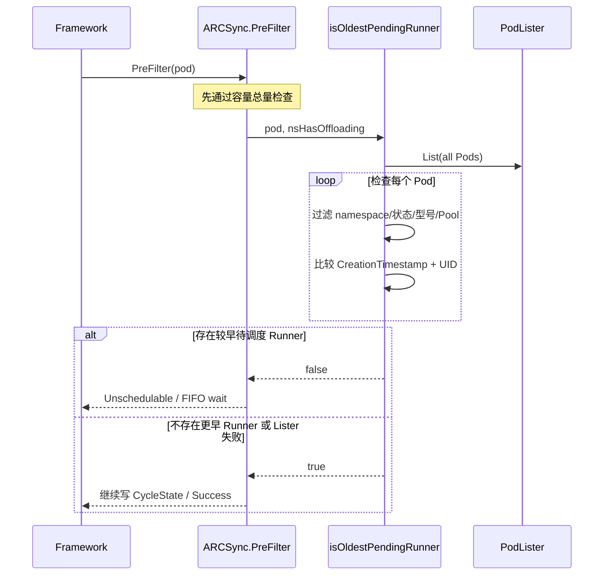

**AR 原子实现分解**

| AR | 已有实现动作 | 实现位置 | 已执行的处理逻辑 |
|---|---|---|---|
| **AR-10-01** | 枚举更早 Pod | ``isOldestPendingRunner():193-227`` | 过滤不同命名空间、终态、已绑定、无 NPU 标签或资源类型不同的 Pod。 |
| **AR-10-02** | 按当前规则形成公平域 | ``isOldestPendingRunner():228-243`、`npuFIFOPool():255-260`` | Liqo 模式按 nodeSelector 的 remote-cluster-id；否则对旧 Pod 的 NodeSelector 做非对称包含检查。 |
| **AR-10-03** | 顺序判定及失败策略 | ``isOldestPendingRunner():244-253`、`PreFilter():449-453`` | 创建时间早者优先，时间相同时 UID 字典序小者优先；PodLister 列表报错时 fail-open。 |

**AR 与 SR 的关系**：上述 AR 都可以在 S-BASE/D-BASE 静态取证；对应验证只要求确认行为与源码一致，不把其风险修复当成 AR 已交付。

**领域对象及状态变化**

相关对象：Pod `metadata.creationTimestamp`、UID、namespace、ResourceDomain/ResourceModel、NodeSelector；用户无独立 FIFO 开关或权重配置。 状态由上表 AR 所列函数产生或消费；没有额外的持久化领域实体。

**验收用例（TC）**

- **TC-10-01**：同 namespace 同型号两个未绑定 Runner，较新的 Pod 应由 FIFO 阻止（源码规则，需独立单测）。
- **TC-10-02**：已绑定、终态、异型号、跨 namespace 不阻止当前 Pod（源码规则）。
- **TC-10-03**：同一时间戳以 UID 小者优先（源码规则）。
- **TC-10-04**：无法获得 Pod 列表时 fail-open（源码规则）。
- **TC-10-05**：大卡数头部资源暂缺造成后续小任务阻塞（已知行为，不作为优化已完成）。

**判定规则**：现有测试函数只说明代码仓包含该测试，不能在本次未执行 Go Test 或没有集群访问的情况下声称测试已通过。对于风险复现用例，预期结果应保持与当前源码一致。

**代码与配置证据**：[pkg/arcsync/arcsync.go#L180-L260](https://github.com/ascend-gha-runners/scheduler-plugins/blob/cc243f537e97ca4e34c6bd57030817a04ae204ec/pkg/arcsync/arcsync.go#L180-L260)；[pkg/arcsync/arcsync.go#L443-L461](https://github.com/ascend-gha-runners/scheduler-plugins/blob/cc243f537e97ca4e34c6bd57030817a04ae204ec/pkg/arcsync/arcsync.go#L443-L461)。

#### 5.4.5 用户接口设计

**SR-10**：Pod `metadata.creationTimestamp`、UID、namespace、ResourceDomain/ResourceModel、NodeSelector；用户无独立 FIFO 开关或权重配置。

#### 5.4.6 实现接口设计

##### 5.4.6.1 接口设计与契约

**SR-10**：`isOldestPendingRunner(pod *v1.Pod,nsHasOffloading bool) bool`、`npuFIFOPool(*v1.Pod) string`；调用方 `PreFilter` 转换为 Framework Status。

本功能域无自定义 REST 服务；Swagger/OpenAPI 为 **N/A**。Kubernetes 资源字段和 Framework 扩展点契约参见第 4.7 节。

#### 5.4.7 领域数据模型

数据对象、归属和销毁边界见第 3.4 节，各 SR 的状态变化见第 5.4.4 节。不新增持久化实体或 CRD。

#### 5.4.8 验收与追踪

- **SR-10**：TC-10-01、TC-10-02、TC-10-03、TC-10-04、TC-10-05；相关 AR 及源码证据见本 IR 对应用例和第 7.2 节。

测试案例覆盖现有行为与待验证的限制，不代表已经执行集群测试。

#### 5.4.9 DFX 分析

**安全性**：Pod 标签/namespace/selector 决定比较范围，非跨租户强公平。**可靠性**：Lister 失败 fail-open，非 Liqo selector 比较非对称。**可用性/性能**：Lister 扫描及队首阻塞影响吞吐；大任务仍可能因不可用资源持续 Pending。**可服务性**：以创建时间、旧/新 Runner ID 和拒绝事件分析插队。

**FMEA（按 SR 区分独有失效模式与剩余风险）**

**SR-10 — 按命名空间和资源域执行严格 FIFO**

| FMEA 要素 | 基于当前代码的分析 |
|---|---|
| 失效模式 | 队首阻塞与不对称比较 |
| 失效原因 | 严格等待、无 backfill、selector 单向匹配 |
| 影响（可靠性/可用性） | 小任务饥饿或部分任务比较范围不一致 |
| 已有控制措施 | CreationTimestamp + UID 检查；同范围拦截 |
| 检测与验证 | 旧大任务/新小任务、对称性、Lister 错误 |
| 剩余风险 | 严格 FIFO 可能让无法满足的大任务长期阻塞同范围小任务；非 Liqo 路径的非对称 selector 比较使不同 Runner 观察到的前驱集合不一致。 |

共性复杂度、可靠性和观测证据边界见第 3.6 节。

### 5.5 IR-05：Scheduler Framework 事件与 GitOps 运行支撑

#### 5.5.1 功能概述

为两个业务目标提供真实可执行的插件接入、事件、缓存、部署与权限基础。单副本及 GitOps 声明不代表已证明生产高可用。

#### 5.5.2 SR 用例范围

- **SR-11**：订阅调度相关事件与初始化外围缓存
- **SR-12**：按 GitOps 部署与配置专用 NPU Scheduler

#### 5.5.3 实现思路

main.go 注册 ARCSync，New 初始化 Pod Lister 与可选动态 informer，EventsToRegister 声明 Pod/Node 事件；GitOps 显式启用 PreFilter、Filter、Score、Reserve。PostBind 存在方法但未在主 profile 显式启用。

备选方案及当前选型边界见第 3.2 节；本章只描述源码和 GitOps 已有能力。

#### 5.5.4 设计思路（每个 SR 独立时序图与 AR）

##### 5.5.4.1 SR-11：订阅调度相关事件与初始化外围缓存

**功能概述与当前行为**

**当前行为**：`EventsToRegister` 声明 Pod Add/Update/Delete、Node Add/Update；`New()` 初始化 Pod Lister 与两个可选 DynamicInformer；等待同步在 goroutine 中进行，`New` 不会先阻塞确保缓存已同步。

**证据状态**：CODE；实际 requeue 调度时机取决于 Scheduler Framework 处理事件的实现与主配置。

**用户故事与前置条件**

**角色**：Scheduler 平台 SRE。

**用户故事**：在 Pod 或 Node 状态发生变化时，希望原调度器能够对之前无法调度的 Pod 重新考虑，并在启动时读取 Liqo/Volcano 的可选 CRD。

**场景前置条件**：Framework Handle 具有 SharedInformerFactory 与 KubeConfig；API 可达；可选 CRD 可能不存在。

**用例实现思路**

1. `New` 从 Framework 取得 Pod Lister，初始化 map。
2. 使用 KubeConfig 构造 Dynamic Client；失败时返回不带外部 Lister 的插件。
3. 探测 NamespaceOffloading 与 Queue 资源是否存在，并分别启动 informer。
4. 如果存在待同步 cache，启动后台 goroutine `WaitForCacheSync`。
5. 声明框架应关注的 Pod 和 Node 事件。

本轮不对尚未引入的算法或接口做开发选型；仅还原该代码基线真正采用的路径。

**用例时序图**

```mermaid
sequenceDiagram
  participant BOOT as kube-scheduler
  participant AR as ARCSync.New
  participant API as K8s API
  participant INF as DynamicInformers
  participant FW as Scheduling Framework
  BOOT->>AR: New(ctx,handle)
  AR->>API: 探测 NamespaceOffloading / Queue CRD
  opt 对应 CRD 可用
    AR->>INF: 启动 informer.Run(ctx.Done)
    AR->>INF: 后台 WaitForCacheSync
  end
  AR-->>BOOT: Plugin
  FW->>AR: EventsToRegister()
  AR-->>FW: Pod Add/Update/Delete; Node Add/Update
  Note over AR,FW: CRD 变化事件未直接列在该返回列表
```

**AR 原子实现分解**

| AR | 已有实现动作 | 实现位置 | 已执行的处理逻辑 |
|---|---|---|---|
| **AR-11-01** | 初始化插件 | ``New():68-104`` | 使用 DynamicSharedInformerFactory(30s resync)，但手工启动实际 informer；KubeConfig 不可用时仍返回非 nil 插件。 |
| **AR-11-02** | 检查 CRD 存在 | ``crdExists():107-117`` | List 成功视为存在；NotFound 视为不存在；其他错误仍可能视为存在。 |
| **AR-11-03** | 注册事件类型 | ``EventsToRegister():122-127`` | Pod Add/Update/Delete；Node Add/Update。没有独立注册 Queue/NamespaceOffloading 的 Enqueue 事件。 |

**AR 与 SR 的关系**：上述 AR 都可以在 S-BASE/D-BASE 静态取证；对应验证只要求确认行为与源码一致，不把其风险修复当成 AR 已交付。

**领域对象及状态变化**

相关对象：无需新用户接口；监听依赖 K8s API；事件源是 Framework Pod/Node 事件。 状态由上表 AR 所列函数产生或消费；没有额外的持久化领域实体。

**验收用例（TC）**

- **TC-11-01**：声明 Pod Add/Update/Delete 和 Node Add/Update（源码检查）。
- **TC-11-02**：Liqo CRD 不存在时 pl.nsOffloadingLister 为 nil（源码行为）。
- **TC-11-03**：CRD 缓存尚未同步时可能只有本地候选（行为复现）。
- **TC-11-04**：只更新 Queue/NamespaceOffloading CR 是否立刻使 Pending Runner 重排——不可从本代码保证，需要集成验证。

**判定规则**：现有测试函数只说明代码仓包含该测试，不能在本次未执行 Go Test 或没有集群访问的情况下声称测试已通过。对于风险复现用例，预期结果应保持与当前源码一致。

**代码与配置证据**：[pkg/arcsync/arcsync.go#L68-L127](https://github.com/ascend-gha-runners/scheduler-plugins/blob/cc243f537e97ca4e34c6bd57030817a04ae204ec/pkg/arcsync/arcsync.go#L68-L127)；[pkg/arcsync/liqo.go#L18-L74](https://github.com/ascend-gha-runners/scheduler-plugins/blob/cc243f537e97ca4e34c6bd57030817a04ae204ec/pkg/arcsync/liqo.go#L18-L74)。

##### 5.5.4.2 SR-12：按 GitOps 部署与配置专用 NPU Scheduler

**功能概述与当前行为**

**当前行为**：D-BASE 主清单：Deployment 单副本、ARM64、hostNetwork、镜像 `cc243f...`；ConfigMap 启用 ARCSync 的 PreFilter/Filter/Score/Reserve；`leaderElect=false`；ClusterRoleBinding 引用 cluster-admin。

**证据状态**：CONFIG + CODE；实际运行态未知。

**用户故事与前置条件**

**角色**：集群平台管理员。

**用户故事**：当集群启用 NPU Runner 时，希望可以通过 GitOps 清单部署独立 kube-scheduler，并指定哪些 Pod 归该 scheduler 处理。

**场景前置条件**：集群配置好 Argo CD、Kube API、镜像拉取 Secret，且 Pod.spec.schedulerName=npu-scheduler。

**用例实现思路**

1. Argo CD Application 指向 `manifests/scheduler-plugins-new`。
2. Kustomize 注入 ConfigMap/Deployment/ServiceAccount 与 ClusterRoleBinding。
3. Deployment 启动 `/bin/kube-scheduler --config=... --v=4`。
4. Kube Scheduler 按 profile 接管 schedulerName=npu-scheduler 的 Pod。
5. ARCSync 仅在显式配置的扩展点生效；由 Framework 与内置插件共同调度。

本轮不对尚未引入的算法或接口做开发选型；仅还原该代码基线真正采用的路径。

**用例时序图**

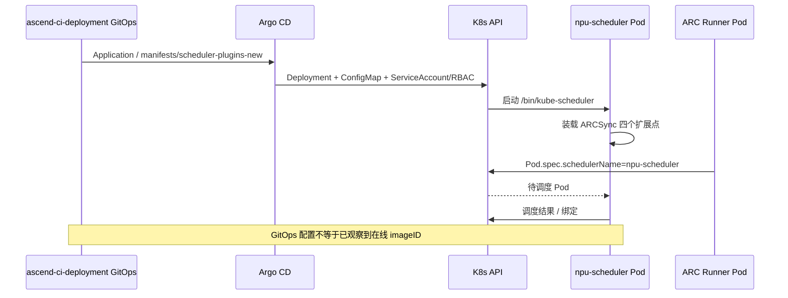

**AR 原子实现分解**

| AR | 已有实现动作 | 实现位置 | 已执行的处理逻辑 |
|---|---|---|---|
| **AR-12-01** | 定义调度器工作负载 | `D-BASE `manifests/scheduler-plugins-new/deployment.yaml`` | 单副本/ARM64/hostNetwork/专用 ConfigMap；imagePullPolicy Always。 |
| **AR-12-02** | 声明 Framework 扩展点 | `D-BASE `manifests/scheduler-plugins-new/configmap.yaml`` | PreFilter/Filter/Score/Reserve 显式启用；未显式列 PostBind。 |
| **AR-12-03** | 授予 API 权限 | `D-BASE `manifests/scheduler-plugins-new/serviceaccount.yaml`` | ServiceAccount npu-scheduler；ClusterRoleBinding 到 cluster-admin。 |
| **AR-12-04** | 指定 Runner 使用调度器 | `D-BASE `other/ascend-gha-runners/linux-aarch64-a5-2-sh001/values.yaml`` | Runner 模板定义 schedulerName=npu-scheduler 与 NPU 需求标签；属于一个已查阅配置样例。 |

**AR 与 SR 的关系**：上述 AR 都可以在 S-BASE/D-BASE 静态取证；对应验证只要求确认行为与源码一致，不把其风险修复当成 AR 已交付。

**领域对象及状态变化**

相关对象：GitOps YAML；Runner Pod.spec.schedulerName；Pod labels。没有 ARCSync 自定义 UI 或 Swagger。 状态由上表 AR 所列函数产生或消费；没有额外的持久化领域实体。

**验收用例（TC）**

- **TC-12-01**：静态检查主配置启用四个扩展点且 schedulerName=npu-scheduler（已核对 YAML）。
- **TC-12-02**：实际 Pod spec.image 与 status.containerStatuses[].imageID 必须在目标集群核对（尚未执行）。
- **TC-12-03**：运行时是否触发 PostBind 需要实际 Scheduler 调用链验证。
- **TC-12-04**：单副本终止或重启期间 Pending 行为须在线观察（尚未执行）。

**判定规则**：现有测试函数只说明代码仓包含该测试，不能在本次未执行 Go Test 或没有集群访问的情况下声称测试已通过。对于风险复现用例，预期结果应保持与当前源码一致。

**代码与配置证据**：[cmd/scheduler/main.go#L33-L43](https://github.com/ascend-gha-runners/scheduler-plugins/blob/cc243f537e97ca4e34c6bd57030817a04ae204ec/cmd/scheduler/main.go#L33-L43)；[manifests/scheduler-plugins-new/deployment.yaml](https://github.com/opensourceways/ascend-ci-deployment/blob/3dd81ed95e0fe659d81b1cbf629fc62620bbfff8/manifests/scheduler-plugins-new/deployment.yaml)；[manifests/scheduler-plugins-new/configmap.yaml](https://github.com/opensourceways/ascend-ci-deployment/blob/3dd81ed95e0fe659d81b1cbf629fc62620bbfff8/manifests/scheduler-plugins-new/configmap.yaml)；[manifests/scheduler-plugins-new/serviceaccount.yaml](https://github.com/opensourceways/ascend-ci-deployment/blob/3dd81ed95e0fe659d81b1cbf629fc62620bbfff8/manifests/scheduler-plugins-new/serviceaccount.yaml)。

#### 5.5.5 用户接口设计

**SR-11**：无需新用户接口；监听依赖 K8s API；事件源是 Framework Pod/Node 事件。

**SR-12**：GitOps YAML；Runner Pod.spec.schedulerName；Pod labels。没有 ARCSync 自定义 UI 或 Swagger。

#### 5.5.6 实现接口设计

##### 5.5.6.1 接口设计与契约

**SR-11**：`New(ctx,runtime.Object,h framework.Handle)(framework.Plugin,error)`、`EventsToRegister(ctx) ([]framework.ClusterEventWithHint,error)`。

**SR-12**：外部接口：KubeSchedulerConfiguration(v1)、Deployment(v1)、ServiceAccount、ClusterRoleBinding 和 Argo CD Application；运行命令为 `/bin/kube-scheduler --config=/etc/kubernetes/scheduler-config.yaml --v=4`。

本功能域无自定义 REST 服务；Swagger/OpenAPI 为 **N/A**。Kubernetes 资源字段和 Framework 扩展点契约参见第 4.7 节。

#### 5.5.7 领域数据模型

数据对象、归属和销毁边界见第 3.4 节，各 SR 的状态变化见第 5.5.4 节。不新增持久化实体或 CRD。

#### 5.5.8 验收与追踪

- **SR-11**：TC-11-01、TC-11-02、TC-11-03、TC-11-04；相关 AR 及源码证据见本 IR 对应用例和第 7.2 节。
- **SR-12**：TC-12-01、TC-12-02、TC-12-03、TC-12-04；相关 AR 及源码证据见本 IR 对应用例和第 7.2 节。

测试案例覆盖现有行为与待验证的限制，不代表已经执行集群测试。

#### 5.5.9 DFX 分析

**安全性**：ServiceAccount 绑定 cluster-admin，权限较广。**可靠性**：单副本、未启用选主且状态仅内存保存。**可用性/性能**：缓存时效与事件触发影响调度响应。**可服务性**：应以 live imageID、Framework 配置和实际运行事件验证，而非仅据 YAML 断言。

**FMEA（按 SR 区分独有失效模式与剩余风险）**

**SR-11 — 订阅调度相关事件与初始化外围缓存**

| FMEA 要素 | 基于当前代码的分析 |
|---|---|
| 失效模式 | 外部 CR 修改后 Pending 未及时重新评估 |
| 失效原因 | 未注册 CR 变更入队事件，cache 异步同步 |
| 影响（可靠性/可用性） | 配置变化生效滞后 |
| 已有控制措施 | Pod/Node 事件注册、informer 缓存 |
| 检测与验证 | 仅修改 CR 与修改 Pod/Node 对比重试时间 |
| 剩余风险 | Queue/NamespaceOffloading CR 单独更新不触发显式重新入队事件；缓存同步延迟可能使待调度 Runner 继续使用过期策略。 |

**SR-12 — 按 GitOps 部署与配置专用 NPU Scheduler**

| FMEA 要素 | 基于当前代码的分析 |
|---|---|
| 失效模式 | 单点故障或过度权限 |
| 失效原因 | 单副本无选主、cluster-admin、实例内存状态 |
| 影响（可靠性/可用性） | 调度暂停、风险扩大、重启预约丢失 |
| 已有控制措施 | GitOps 部署声明；K8s 控制平面 |
| 检测与验证 | 只读检查 live imageID/RBAC、重启前后行为 |
| 剩余风险 | 单副本无选主在故障/升级时中断专用调度；cluster-admin 扩大受损影响面，重启又会清空进程内预约账本。 |

共性复杂度、可靠性和观测证据边界见第 3.6 节。

## 6 当前实现差距与证据闭环（非本次开发范围）

> 本章只是记录根据源码发现的业务目标风险，不给出现网中不存在的具体接口/算法作为“既有设计”。任何改造都需要后续独立立项、设计和实现，本次**不修改业务代码**。

| GAP | 对应 IR / SR | 当前代码事实 | 对 BG 的可能影响 | 如何补充证据（仅验证，不实施改造） |
|---|---|---|---|---|
| GAP-01 | IR-01 / SR-01 | `Atoi` 错误被忽略；缺少对资源域/型号格式的强校验 | 无效 Runner 资源声明可能绕过保护 | 构造非法标签 Pod，检查 Events 和调度结果 |
| GAP-02 | IR-01 / SR-03 | `totalNPUFree` 为节点剩余量求和，非单节点可行性 | 4+4 可能放行未来需要单节点 8 卡的 Runner | 造两个 4 卡节点、1 个 8 卡 Runner，记录其状态 |
| GAP-03 | IR-01 / SR-03/SR-09 | 聚合总量本地分支未重复校验 NodeSelector/affinity | 预检可能统计不满足 Pod placement 约束的本地 NPU | nodeSelector 定向无 NPU Node，其它 Node 有 NPU |
| GAP-04 | IR-02 / SR-04 | 预约仅存在进程内、生命周期依赖 Snapshot 与当前 scheduler | 重启或多实例造成预留丢失/不一致 | Scheduler 单副本重启前后比对 Pending/预留行为 |
| GAP-05 | IR-02 / SR-05 | `activeWorkflows` key 仅为 baseName，不带 namespace；`PostBind` 没有被主 YAML 显式启用 | 跨 namespace 同名干扰、交接不确定 | 构造双 namespace 同名 Workflow，确认计算结果；检查运行回调 |
| GAP-06 | IR-03 / SR-06 | `clusterSelector` 无 terms 时匹配所有虚拟 Node | 远端候选扩大，潜在违背授权意图 | 用无 selector terms 的 NamespaceOffloading 复现 |
| GAP-07 | IR-03 / SR-08 | 读取 Pod Queue annotation，且只在 NamespaceOffloading 分支应用 | 配额未生效/只限制本地 | 分别配 Pod 和 Namespace annotation；比较 No-Liqo 路径 |
| GAP-08 | IR-04 / SR-10 | FIFO 严格拦截，没有 Backfill；非 Liqo 的选择器比较非对称 | 队首阻塞、部分边界不符合“公平”直觉 | 构造同 pool 先 8 卡后 1 卡的压力情景 |
| GAP-09 | IR-05 / SR-11 | CRD 缓存同步异步、Queue/Offloading 事件未显式注册 | 配置刚变更时 Pending Pod 可能不能及时重新评估 | CRD 单独修改后观察重试触发源及时间 |
| GAP-10 | IR-05 / SR-12 | 单副本、leaderElect:false、ClusterRoleBinding 到 cluster-admin | 可用性和权限面风险 | 只读审计 Argo CD Live State、RBAC 和镜像 digest |
| GAP-11 | BG-01 / 系统外部 | 示例 Workflow 使用 `schedulerName: volcano`，不由 ARCSync 完整决定 | 无法凭 Runner 准入证明 Workflow 一定运行 | 联合观察 Runner、Workflow NodeName、GPU/NPU Request、排队与执行时序 |

### 6.1 ARCSYNC_GUIDE.md 与实现的不一致

| 指南叙述 | 真实源码 | 文档写法原则 |
|---|---|---|
| “至少一个节点满足未来 Workflow 需求” | `hasCandidate` 采用 `Σ node free >= requiredCount` | **以源码为准：聚合余量判定** |
| 先读取 `npu-count` 再 Requests | 本地占用为 `max(Requests之和,匹配的 npu-count)` | **以源码为准：取较大值** |
| NamespaceOffloading 示例 `clusterSelector.matchLabels` | `extractClusterSelectorTerms` 解析 `v1.NodeSelector.nodeSelectorTerms` | **以源码为准：不采纳 matchLabels 示例** |
| Queue 名称来自 Namespace annotation | `getQueueNpuLimit` 读取 `pod.Annotations[...]` | **以源码为准：Pod annotation** |
| 公平等待概述 | 有范围的严格 FIFO，Lister 失败 fail-open | **保留真实比较条件和失败规则** |
| PostBind 有函数即可工作 | GitOps 未显式启用 PostBind 阶段 | **区分 CODE 与 CONFIG / RUNTIME-UNKNOWN** |

### 6.2 “忠于代码”的复审清单

- [x] 源码按 S-BASE 固定提交，而不是引用最新 master。
- [x] 对应部署版本按 D-BASE 的 GitOps 声明取证，未冒充实时运行态。
- [x] BG-01 NPU 感知准入与 BG-02 有范围 FIFO 公平调度是两个并列目标。
- [x] 章节为 2 功能域概述、3 总体方案、4 规格、5 功能实现设计。
- [x] 第 5 章按 IR 分节；每个 SR 有用户故事、AR、时序图及 TC；每个 IR 有接口与 DFX/FMEA。
- [x] 所有 AR 都回指当前函数或 YAML 的实际动作，而非新方法、新 CRD 或待开发功能。
- [x] 尚未实现的需求和缺陷单列 GAP，不写成生产能力。
- [ ] 实际集群 `imageID`、各扩展点回调、Job 排队指标——本次未访问在线集群。
- [ ] Go test / Kubernetes e2e——本次只编制文档，**未修改或执行业务代码**。

## 7 源码索引与验收追踪总表

### 7.1 主仓库源码索引

- [注册入口：cmd/scheduler/main.go](https://github.com/ascend-gha-runners/scheduler-plugins/blob/cc243f537e97ca4e34c6bd57030817a04ae204ec/cmd/scheduler/main.go)
- [调度核心：pkg/arcsync/arcsync.go](https://github.com/ascend-gha-runners/scheduler-plugins/blob/cc243f537e97ca4e34c6bd57030817a04ae204ec/pkg/arcsync/arcsync.go)
- [Liqo 适配：pkg/arcsync/liqo.go](https://github.com/ascend-gha-runners/scheduler-plugins/blob/cc243f537e97ca4e34c6bd57030817a04ae204ec/pkg/arcsync/liqo.go)
- [Volcano 适配：pkg/arcsync/volcano.go](https://github.com/ascend-gha-runners/scheduler-plugins/blob/cc243f537e97ca4e34c6bd57030817a04ae204ec/pkg/arcsync/volcano.go)
- [现有 Go 单测：pkg/arcsync/arcsync_test.go](https://github.com/ascend-gha-runners/scheduler-plugins/blob/cc243f537e97ca4e34c6bd57030817a04ae204ec/pkg/arcsync/arcsync_test.go)
- [主部署 ConfigMap](https://github.com/opensourceways/ascend-ci-deployment/blob/3dd81ed95e0fe659d81b1cbf629fc62620bbfff8/manifests/scheduler-plugins-new/configmap.yaml)
- [主部署 Deployment](https://github.com/opensourceways/ascend-ci-deployment/blob/3dd81ed95e0fe659d81b1cbf629fc62620bbfff8/manifests/scheduler-plugins-new/deployment.yaml)
- [Argo CD Applications](https://github.com/opensourceways/ascend-ci-deployment/blob/3dd81ed95e0fe659d81b1cbf629fc62620bbfff8/argocd/clusters/scheduler-plugins.yaml)

### 7.2 IR → SR → AR → TC 追踪

| IR | SR | AR（当前代码动作） | TC（本次提供的验收场景） |
|---|---|---|---|
| IR-01 | SR-01 基于 Runner NPU 标签激活调度插件 | AR-01-01, AR-01-02, AR-01-03 | TC-01-01, TC-01-02, TC-01-03 |
| IR-01 | SR-02 统计本地和虚拟节点 NPU 资源占用 | AR-02-01, AR-02-02, AR-02-03, AR-02-04 | TC-02-01, TC-02-02, TC-02-03 |
| IR-01 | SR-03 执行 NPU 聚合容量准入 | AR-03-01, AR-03-02, AR-03-03 | TC-03-01, TC-03-02, TC-03-03, TC-03-04, TC-03-05 |
| IR-02 | SR-04 管理进程内 NPU 在途预留 | AR-04-01, AR-04-02, AR-04-03 | TC-04-01, TC-04-02, TC-04-03, TC-04-04 |
| IR-02 | SR-05 使用 Workflow 命名关系交接资源计量 | AR-05-01, AR-05-02, AR-05-03 | TC-05-01, TC-05-02, TC-05-03 |
| IR-03 | SR-06 识别并筛选 Liqo 虚拟节点 | AR-06-01, AR-06-02, AR-06-03, AR-06-04 | TC-06-01, TC-06-02, TC-06-03, TC-06-04 |
| IR-03 | SR-07 本地与远端资源池的比较及择优 | AR-07-01, AR-07-02, AR-07-03 | TC-07-01, TC-07-02, TC-07-03, TC-07-04, TC-07-05 |
| IR-03 | SR-08 有条件读取 Volcano Queue 限额 | AR-08-01, AR-08-02, AR-08-03 | TC-08-01, TC-08-02, TC-08-03, TC-08-04 |
| IR-03 | SR-09 候选节点 Filter 和空闲量 Score | AR-09-01, AR-09-02, AR-09-03 | TC-09-01, TC-09-02, TC-09-03, TC-09-04 |
| IR-04 | SR-10 按命名空间和资源域执行严格 FIFO | AR-10-01, AR-10-02, AR-10-03 | TC-10-01, TC-10-02, TC-10-03, TC-10-04, TC-10-05 |
| IR-05 | SR-11 订阅调度相关事件与初始化外围缓存 | AR-11-01, AR-11-02, AR-11-03 | TC-11-01, TC-11-02, TC-11-03, TC-11-04 |
| IR-05 | SR-12 按 GitOps 部署与配置专用 NPU Scheduler | AR-12-01, AR-12-02, AR-12-03, AR-12-04 | TC-12-01, TC-12-02, TC-12-03, TC-12-04 |

> 编号状态：AR 表示**现存的实现动作**；TC 表示**建议核验当前行为的测试场景**，并不宣称本轮已运行全部 TC。后续如真实代码升级，应基于新的 commit 更新这一追踪表，再编制 TO-BE 变更设计，不得在 AS-IS 文档中先写新功能。
