# ARC NPU 调度功能域详细设计说明（现有代码基线版）

> **文档性质**：已实现系统的设计逆向与规格化说明（AS-IS），不是待开发方案、变更申请或代码提交。**本次交付不修改任何业务代码。**
>
> **源码基线**：[`ascend-gha-runners/scheduler-plugins` 的 `liqo-lb` 分支，commit `cc243f537e97ca4e34c6bd57030817a04ae204ec`](https://github.com/ascend-gha-runners/scheduler-plugins/tree/cc243f537e97ca4e34c6bd57030817a04ae204ec)（简称 **S-BASE**）。
>
> **部署配置基线**：[`opensourceways/ascend-ci-deployment`，commit `3dd81ed95e0fe659d81b1cbf629fc62620bbfff8`](https://github.com/opensourceways/ascend-ci-deployment/tree/3dd81ed95e0fe659d81b1cbf629fc62620bbfff8)（简称 **D-BASE**）。
>
> **证据强度**：`源码已实现` = S-BASE 中有对应代码；`GitOps 已配置` = D-BASE 的 YAML 声明；`测试已覆盖` = 存在相应 Go 测试用例，但本轮未执行；`待运行确认` = 需要访问集群 / 镜像 digest / GitHub 真实 Job 才能证明。实际在线状态不从 GitOps 推断。
>
> **追踪规则**：`业务目标 BG → 系统要求 IR → 可独立验证的系统功能/用户故事 SR → 现有实现活动 AR → 代码证据 / 验证案例 TC`。**这里的 AR 是现有代码已经执行的实现活动，不是新代码开发任务**；对未实现的增强项只在第 6 章列差距。

## 1 文档说明和业务目标

### 1.1 业务目标

**BG-01：解决 ARC Container Mode Runner Pod 启动时无法感知后续 Workflow NPU 资源的问题。** 在 ARC 创建 Runner Pod 后、Runner 能够进入工作状态前，由专用调度器根据 Runner 的 `required-npu-count` 等标签，以 Kubernetes Node/Pod 可观察信息预估未来 Workflow 的 NPU 需求及容量。如果当前条件不满足，拒绝本轮调度，让 Runner 维持待调度状态。该机制是**准入预估**，不等于未来 Workflow 可成功启动的绝对保证。参见 [ARCSync 使用指南](https://github.com/ascend-gha-runners/scheduler-plugins/blob/cc243f537e97ca4e34c6bd57030817a04ae204ec/ARCSYNC_GUIDE.md) 和 [PreFilter 源码](https://github.com/ascend-gha-runners/scheduler-plugins/blob/cc243f537e97ca4e34c6bd57030817a04ae204ec/pkg/arcsync/arcsync.go#L262-L461)。

**BG-02：解决 NPU 任务调度不公平的问题。** 对纳入 ARCSync 管理的 Runner，使用创建时间而不是重新入队时间决定同一比较范围内的先后次序，避免新 Pod 因旧 Pod 重试退避而持续越过旧 Pod。目前实现的是**有范围的严格 FIFO**；它不是跨命名空间或跨组织加权公平，也不包含 EASY Backfill / 防饿死保障。

### 1.2 适用范围与非目标

- **适用**：`schedulerName: npu-scheduler`、Pod 带 `ascend-ci.com/required-npu-count` 标签、且使用 D-BASE 主部署配置的工作负载。Kubernetes Framework 的其它默认插件仍影响最后放置。
- **非本模块实现**：Github Actions 作业分发、ARC Runner 扩缩容、实际 Workflow Pod 构造与调度、Ascend 设备检测、Liqo 跨集群网络、Volcano Queue 控制器；本模块读取这些系统经 Kubernetes API 表达的数据。
- **本次不主张**：单节点 NPU 可行性保证、硬件卡锁定、跨调度器原子预约、重启后预约恢复、Queue 全局强制配额、EASY 回填、GitHub Queue Time 改善已被实测证明。这些均没有在所选源码与部署配置中得到充分支持。

### 1.3 本文设计对象与状态标识

| 标记 | 含义 | 实例 |
|---|---|---|
| `CODE` | S-BASE 存在真实逻辑 | `ARCSync.PreFilter` 聚合容量并做 FIFO 校验 |
| `CONFIG` | D-BASE 配置实际启用 | 主配置启用 `PreFilter/Filter/Score/Reserve` |
| `COND` | 依赖 Pod 标签/额外 CRD/外部系统 | Liqo `NamespaceOffloading`、Volcano `Queue` |
| `GAP` | 对业务目标尚不完备；**非现有功能** | 独立 NPU Target 单节点判定、持久化预约 |
| `RUNTIME-UNKNOWN` | 静态源码/配置不足以确认 | 实际镜像 digest、所有集群 Rollout、PostBind 实际回调 |

### 1.4 版本与配置口径

| 路径 | Scheduler 名称 | 镜像版本 | Framework 中显式启用的 ARCSync 阶段 | 结论 |
|---|---|---|---|---|
| [`manifests/scheduler-plugins-new`](https://github.com/opensourceways/ascend-ci-deployment/blob/3dd81ed95e0fe659d81b1cbf629fc62620bbfff8/manifests/scheduler-plugins-new/deployment.yaml) | `npu-scheduler` | `cc243f537e97ca4e34c6bd57030817a04ae204ec` | PreFilter、Filter、Score、Reserve | **本文主要说明对象** |
| [`manifests/scheduler-plugins-test`](https://github.com/opensourceways/ascend-ci-deployment/blob/3dd81ed95e0fe659d81b1cbf629fc62620bbfff8/manifests/scheduler-plugins-test/configmap.yaml) | `npu-scheduler` | `799f435a914669947e4c73a7ca34f37892dc4fe9` | PreFilter | 仅作为部署差异说明；不可套用主版行为 |
| [`manifests/scheduler-plugins`](https://github.com/opensourceways/ascend-ci-deployment/blob/3dd81ed95e0fe659d81b1cbf629fc62620bbfff8/manifests/scheduler-plugins/configmap.yaml) | `runner-pod-npu-scheduler` | `v1.0.2` | `runnerScheduler` 的 Filter | 旧实现；本文不对镜像源码作结论 |

主 Deployment 声明 `replicas: 1`、`leaderElect: false`、`nodeSelector: kubernetes.io/arch=arm64`、`hostNetwork: true`；ServiceAccount 绑定 `cluster-admin`。`PostBind` 函数虽在源码中存在，但**主配置没有显式列为启用插件阶段**，不得以函数存在作为已执行的证明。D-BASE 的 Argo CD Application 以 `targetRevision: HEAD` 引用部署清单，并有一个集群明确覆盖同一个镜像标签；生产实际拉起版本仍需 `kubectl` 验证。

## 2 功能域概述（IR：系统级现有要求）

### 2.1 功能域概述

本功能域由 `kube-scheduler` 可执行程序与自定义 `ARCSync` 插件组成。输入包括：带 NPU 需求标签的 Pod、Kubernetes Node/Pod Snapshot、Pod 级调度约束、可选的 Liqo `NamespaceOffloading` 与 Volcano `Queue` 对象。输出包括：`framework.Status`（放行/不可调度/错误）、`nodeFreeNPU` 候选节点集合及 Score、内存预约记录与日志。没有自定义 REST API、Web UI 或独立 CRD。

### 2.2 IR → SR 需求矩阵

| IR（系统层） | 需求含义（对现状的行为描述） | BG | 用户/系统受益方 | SR（可独立验证） |
|---|---|---|---|---|
| **IR-01 未来 NPU 需求准入** | 根据 Pod 标签触发 ARCSync，并利用 Node/Pod 信息核算 NPU 资源，按聚合余量判定能否继续调度 | BG-01 | ARC 维护者、CI 开发者 | SR-01、SR-02、SR-03 |
| **IR-02 资源使用生命周期** | 使用进程内预约避免调度瞬间重复放行，并以 Workflow 命名关联决定何时停止重复计费 | BG-01 | NPU 资源管理员 | SR-04、SR-05 |
| **IR-03 本地/远端池选择** | 根据 Liqo 配置和 Node 约束选择本地或虚拟节点；条件性读取 Volcano Queue 额度；完成 Filter 与 Score | BG-01（配额部分也涉及 BG-02） | 多集群运维、资源管理员 | SR-06、SR-07、SR-08、SR-09 |
| **IR-04 同池 FIFO 公平性** | 对同一比较范围内的未绑定 Runner 按创建时间阻止插队 | BG-02 | CI 作业提交者 | SR-10 |
| **IR-05 事件与部署可运维性** | 由 Framework 调用扩展点，读取可选 CRD 缓存并重新触发 Pod 调度；通过 Argo CD 部署专用调度器 | BG-01、BG-02 的质量约束 | SRE、平台运维 | SR-11、SR-12 |

**口径说明**：此处 IR 是对现行功能域系统行为的重新组织，不是将已有差距包装成“当前系统已经满足”的新需求承诺。每个 SR 的独立验证是验证**源码规则是否如实执行**，并非证明整体业务目标完全实现。

### 2.3 外部角色与现有用例关系

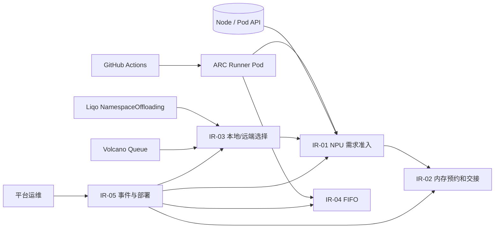

### 2.4 IR 系统边界与验收口径

- IR-01：可用标签和快照重现当前准入状态码。**不**把剩余容量总和推导为单节点可承载。
- IR-02：可观察进程内 `inFlightReservations` 的新增/删除与跳过计数；无 API 级持久化对象。
- IR-03：仅对存在有效可观察 CRD/资源字段的路径认定能力；不把 Queue 读取等同于 Volcano 控制器完整配额保障。
- IR-04：FIFO 比较规则以 `isOldestPendingRunner` 实际筛选谓词为准，不扩大到跨 namespace。
- IR-05：区分源码里的回调方法和在 GitOps 中真正启用的扩展点；区分期望部署与已运行实例。

## 3 功能域总体方案（实际架构）

### 3.1 总体设计原则、设计模式及约束（由源码反推）

1. **复用 Scheduler Framework**：使用 `app.NewSchedulerCommand(app.WithPlugin(arcsync.Name, arcsync.New))` 注册插件；主配置启用 PreFilter/Filter/Score/Reserve，没有独立队列或独立 Scheduler 核心重写。
2. **标签表达未来需求**：Runner 真实容器可不声明 NPU Request；通过 `required-npu-count`、资源域、型号三个标签参与准入。没有校验其与未来 Workflow 申请的一致性。
3. **Node/Pod 快照估算**：本地物理占用按照容器 Requests 与 `npu-count` 标签最大值统计；虚拟节点按带标签的 Runner 数量估算；结果依赖 Scheduler 缓存时效。
4. **进程内软预约**：使用受 Mutex 保护的 `map[string]reservation`，只保证当前调度器进程内部的观测与核算；没有 API 持久化及跨多个 Scheduler 实例的共享状态。
5. **有条件访问外围 CRD**：通过 Kubernetes dynamic informer 获取 Liqo 和 Volcano；缺 CRD / 读取失败可能使附加规则缺席。没有单独的外部服务调用层。
6. **严格 FIFO**：以 Pod `CreationTimestamp`、UID 为排序依据，通过 `PreFilter` 拒绝较新的 Pod；没有实现 QueueSort 自定义堆排序，也没有回填。
7. **最低限度放置约束**：插件自定义检查 cordon、NoSchedule/NoExecute taints、`nodeSelector`、required nodeAffinity；其它 Kubernetes 默认 Filter 继续参与最终调度。

### 3.2 技术方案说明和选型的事实边界

| 设计关注点 | 当前实际采用 | 未采用或无法证实的替代方案 | 取证位置 |
|---|---|---|---|
| Scheduler 接入 | kube-scheduler Scheduling Framework + 插件扩展点 | 完全独立调度器、Webhook | `cmd/scheduler/main.go` |
| 需求传入 | Pod labels | 自定义 Demand CRD、外部 REST | `arcsync.go` 常量与 PreFilter |
| NPU 准入 | 集群总剩余 NPU 求和 | 单节点/单完整 Workflow 可行性检查 | `arcsync.go:419-446` |
| 资源计量 | Scheduler Snapshot + 进程内预约 | 实时设备 API、持久化配额账本 | `arcsync.go:278-377` |
| 远端管理 | Liqo virtual Node + NamespaceOffloading informer | 远端成员集群直连调度 | `liqo.go`、`applyLiqoComparison` |
| Queue 能力 | Volcano Queue CRD 的 `spec.capability` 读取 | 自实现跨租户 Queue Controller | `volcano.go` |
| 公平性 | `PreFilter` 内同池严格 FIFO 检查 | Backfill、DRF、权重调度、队列抢占 | `isOldestPendingRunner` |
| 高可用 | 单副本、关闭选主 | 多副本 Leader Election、跨实例预约账本 | D-BASE deployment/configmap |

未提供历史架构评审材料来证明**为何**选定上述路线，因此本节只陈述实际技术实现及其取舍结果，不虚构选型会议结论。

### 3.3 系统元素与周边系统关系

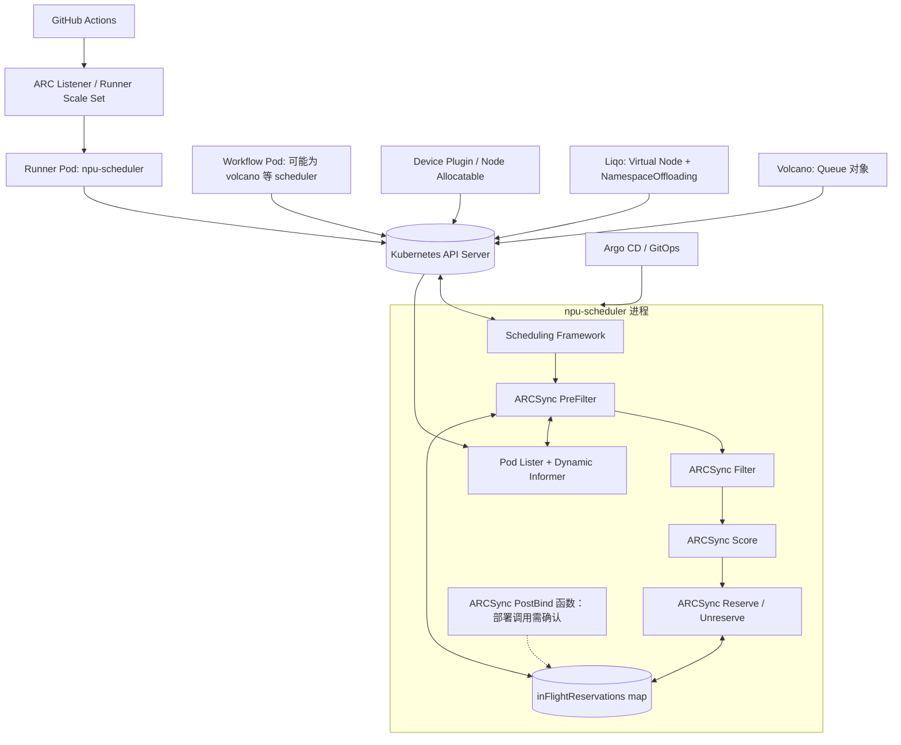

**实现职责边界**：`cmd/scheduler/main.go` 负责插件注册；`pkg/arcsync/arcsync.go` 负责主调度、FIFO、预约；`pkg/arcsync/liqo.go` 负责资源域、虚拟节点选择解析；`pkg/arcsync/volcano.go` 负责 Queue 额度读取；D-BASE 的 manifests 负责 Deployment、ConfigMap、ServiceAccount/RBAC。

### 3.4 领域对象模型与关系

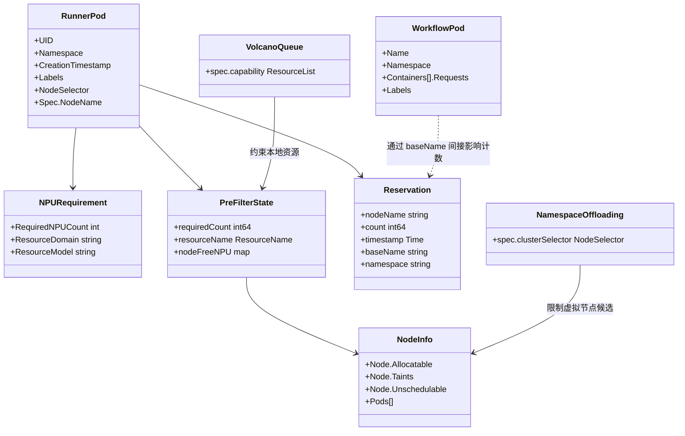

| 数据对象 | 实际存储与生命周期 | 来源与更新者 | 删除/销毁行为（现状） | 注意事项 |
|---|---|---|---|---|
| Runner Pod / Workflow Pod | Kubernetes Pod API 对象 | ARC / Workflow 创建；K8s API 保存 | Pod 自身遵循 Kubernetes 删除/GC，非插件销毁 | 插件只读取快照和元数据 |
| Node / NodeInfo | Kubernetes API + Framework Snapshot | 集群控制平面、Scheduler 缓存 | 随 Node 对象及缓存生命周期 | NPU `Allocatable` 依赖外部设备资源上报 |
| `preFilterState` | 单次调度 `CycleState` | `PreFilter` 写入 | 调度周期结束随状态结束 | `Clone` 返回同一指针，代码未实现深拷贝 |
| `reservation` | 进程内 `inFlightReservations` map | `Reserve`/`Unreserve`/`PostBind` | 反向调用删除；UID 不在快照且超过 10s 删除；进程退出丢失 | **不是持久化记录**，不保存 Token |
| `NamespaceOffloading` | 外部 CRD + informer 缓存 | Liqo | 按外部控制器与 API GC 管理 | 选择条件解析为 NodeSelectorTerms |
| Volcano `Queue` | 外部 CRD + informer 缓存 | Volcano | 外部管理；插件无删除操作 | Queue 名称来自 **Pod annotation** |
| 日志 | 容器 stdout / 集群日志后端（如配置） | klog | 插件未定义日志留存和销毁策略 | 记录 Pod、Node 名称，不在本进程保存凭据 |

本功能域**没有自行实现数据分级销毁操作或日志保留周期策略**，因此数据销毁规格限于现有 Kubernetes API GC、进程生命周期及外部日志系统；不得写成已实现的敏感数据销毁能力。

### 3.5 源码模块和函数定位

| 模块 | 主要符号 | 输入 | 输出/副作用 |
|---|---|---|---|
| 注册入口 | `main()`、`app.WithPlugin` | Scheduler CLI 和 YAML | 注册 `ARCSync` |
| 插件初始化 | `New()`、`crdExists()` | Framework Handle / KubeConfig | 创建 Pod Lister、预约 map、动态 informer |
| 调度准入 | `PreFilter()` | Pod、CycleState、Snapshot | 计算占用、可选 Liqo/Queue、聚合容量、FIFO、写 CycleState |
| FIFO | `isOldestPendingRunner()`、`npuFIFOPool()` | 当前 Pod、Pod Lister、offloading 标志 | 比较更早未绑定的同类 Pod |
| 本地/远端 | `applyLiqoComparison()`、`getEligibleVirtualNodes()` | NodeInfos、CR、可用量 | 删除不在获胜池的候选节点 |
| 调度放置 | `Filter()`、`Score()` | CycleState、NodeInfo | `Status`、0～100 Score |
| 预约 | `Reserve()`、`Unreserve()`、`PostBind()` | Pod、CycleState | 内存 map 增删 |
| 事件 | `EventsToRegister()` | Framework | Pod / Node 事件声明 |

## 4 功能域规格变更与设计（本轮只描述现有规格）

### 4.1 功能域规格变更

**N/A**。本轮既不调整现网规格，也不改变代码或接口。本文只是根据 S-BASE/D-BASE 将历史需求与实际代码重新对齐。下述 4.2～4.5 所称“规格”为**当前可观察规则**，不是拟新增规格。

### 4.2 NPU 容量与准入规格

#### 4.2.1 实现思路（现状）

插件读取 `ascend-ci.com/required-npu-count`，只有**存在**该标签才进行相关预检；`strconv.Atoi` 的错误返回被忽略。资源名直接拼接为 `ResourceDomain + "/" + ResourceModel`；没有在 PreFilter 中完成正整数和资源名合法性校验。

本地已占用（按每个 Pod）：`max(Σ containers[].resources.requests[resourceName], 匹配资源类型的 Pod 标签 npu-count)`；虚拟节点占用来自相同资源型号的 Runner 需求标签累加。

容量计算与准入判定为：

\[
TotalFree = \sum_{n\in EligibleLocal} (Allocatable_n - ObservedOccupied_n - InFlight_n) + \sum_{v\in EligibleVirtual} (Allocatable_v - ObservedOccupied_v)
\]

这里 `EligibleLocal` **只按未 cordon、污点可容忍过滤**；总量遍历对本地节点**没有重复应用 `nodeSelector` / NodeAffinity**。被选中的虚拟节点必须在 `nodeFreeNPU` 中；本地节点是否属于最终获胜池也未在这一步复核。`TotalFree >= requiredCount` 即通过容量预检。某些在 CPU 节点保留的 Runner 逻辑预约以负数余量体现在求和中。

#### 4.2.2 实现设计与限制

- `nodeFreeNPU` 的形成会应用 cordon/taint/nodeSelector/required affinity；在 `Filter` 中不在此 map 的节点被拒绝。
- 当前算法**不是** `exists node: free_npu(node) >= request`。例如，两节点各剩 4 NPU、未来 Pod 需 8 NPU，聚合预检可能通过；但带 NPU request 的 Pod 到 `Filter` 会被单节点空闲量拒绝。
- 对**未在容器 Requests 声明 NPU 的 Runner**，`Filter` 只检查节点是否在候选 map 中，不在此处要求该节点本身具有足够 NPU。正是因此 Runner 可以放置在 CPU 节点，未来 Workflow 另外申请 NPU。
- 因外部 Workflow 可使用其它调度器，**不能保证**其实际运行位置、拓扑和其他资源都能满足。

### 4.3 FIFO 公平规格

#### 4.3.1 实现思路（现状）

`isOldestPendingRunner()` 从全 Pod Lister 取列表，筛选：UID 不同、未终态、尚未绑定、同 namespace、带非空 `required-npu-count`、同 `ResourceDomain` 与 `ResourceModel`。若当前命名空间具备 NamespaceOffloading，则比较 `npuFIFOPool()`（Pod nodeSelector 中的 `liqo.io/remote-cluster-id`，否则为 `local`）。若不具备 offloading，则用**旧 Pod 的 NodeSelector 是否都被当前 Pod 满足**来过滤比较对象，注意这是非对称关系。

如果存在 `CreationTimestamp` 更早的 Pod，或时间相同但 UID 字典序更小的 Pod，则当前 Pod 拒绝。Pod Lister 不可用或列表出错时 **fail-open**。

#### 4.3.2 实现设计与限制

- 拒绝是通过 PreFilter 的 `framework.Unschedulable` 实现，而不是通过 Framework `QueueSort` 插件主动把旧任务置于队首。
- 没有跨 namespace 公平、全局租户权重、Backfill、头部保护、饥饿上限。
- 该 FIFO 判断发生在聚合容量检查之后；如果容量不足，先返回容量错误，再不进入 FIFO 判断。
- 严格 FIFO 可能导致一个不可满足的大任务阻塞后续较小任务，作为当前设计的**已知特性/风险**记录。

### 4.4 Liqo 和 Volcano 接入规格

#### 4.4.1 Liqo

- 虚拟 Node 依据 `liqo.io/remote-cluster-id` 标签的**存在性**识别。
- 读取 `offloading.liqo.io/v1beta1` 的 `NamespaceOffloading`；`spec.clusterSelector` 被解析成 Kubernetes `v1.NodeSelector` 的 **`nodeSelectorTerms`**，不是普通 `matchLabels` 对象。
- 如果没有有效 selector terms，`getEligibleVirtualNodes` 当前将匹配**所有带虚拟节点标签的 Node**（`!hasTerms` 分支），是必须如实标注的风险。
- 有 CR 时，先去除不在选定远端集合的虚拟节点，再对比本地节点**空闲和**与各远端**单节点空闲最大值**；平局本地胜。若本地存在单节点可容纳要求的节点，选择远端时可能跳过带匹配 Pending Runner 的虚拟 Node。
- 无 `NamespaceOffloading` 时，`PreFilter` 从候选 `nodeFreeNPU` 中删除所有虚拟 Node；但它并不因此修改 Kubernetes/Liqo 控制器真实的 namespace offloading 配置。

#### 4.4.2 Volcano

- 读取 GVR `scheduling.volcano.sh/v1beta1/queues` 的 `spec.capability[resourceName]`。
- Queue 名称来自**当前待调度 Pod 的 annotation** `scheduling.volcano.sh/queue-name`；源码未查询 Namespace annotation。`ARCSYNC_GUIDE.md` 中引用 Namespace annotation 的文字不能作为实现依据。
- 仅在已找到 NamespaceOffloading 的分支中调用 Queue 额度逻辑。先用 Queue 剩余额度截断本地 `localRemaining`；若当前 namespace 本地占用加本次请求超过额度，删除本地候选 Node。虚拟节点不在此删除循环中。
- Queue 读取或解析失败则视为没有额度，不构成强制拒绝；所以不是完整 Volcano Queue 强制配额系统。

### 4.5 在途预约与交接规格

- `Reserve` 在内存 `map[PodUID]reservation` 写入 `nodeName`、需求量、时间、`baseName`、namespace。UID 为空时用 `namespace/name` 作为键。
- `Unreserve` 按相同键删除记录；`PostBind` 函数若被 Framework 调用且 Pod 容器 requests 包含目标 NPU，则按当前 Pod 自身 UID 删除其预留；对于不请求 NPU 的 Runner 不删除。
- 下一次 PreFilter 中，对在 Scheduler 快照内可识别的活动 Workflow，按名称去掉 `-workflow` 后缀，构成 `activeWorkflows[baseName]`，如果匹配预约的 `baseName`，不再把预约加入占用。
- 交接键**仅为 baseName，不带 namespace/UID**；跨 namespace 同名产生误匹配的可能性需要作为现有设计风险记录。未发现持久化、重启恢复机制。
- 如果 map 中 Pod UID 已不在 NodeInfo 快照，且自预约时间已超过 10 秒，PreFilter 会删除该预约；不能把此规则写成“10 秒后所有预留都超时”。

### 4.6 无独立用户交互界面

模块没有 Web UI/CLI 自定义命令、Swagger/REST 服务或自定义 API Server。所谓“用户接口”仅指 Kubernetes Pod 的 `schedulerName`、labels、annotations、nodeSelector/tolerations/affinity，以及 Liqo / Volcano 的外部 CRD。接口设计按 Go 扩展点、Kubernetes 对象 Schema 和 YAML 示例展开，不虚构 HTTP Path。


## 5 功能实现设计（SR → AR；完全对应当前代码）

本章每个 SR 为可以**独立复现现有系统行为**的用户故事。AR 是该故事在当前源码/配置中已经存在的实现动作。凡在单测中没有直接覆盖的行为都明确写成“源码推导、待测试”，不把拟议修复混为已实现。为方便全文编号，采用 `SR-01..SR-12` 和 `AR-01-01..`。

### 5.1 SR-01：基于 Runner NPU 标签激活调度插件（IR-01）

#### 5.1.1 功能概述

**当前行为**：只有存在 `ascend-ci.com/required-npu-count` 标签时，ARCSync PreFilter 才进入资源检查；标签缺失直接返回 Success，未写 CycleState；`Atoi` 错误不检查，资源名由域和型号字符串直接拼接。

**证据状态**：CODE + CONFIG（经 `npu-scheduler` 且 PreFilter 被启用时）。

#### 5.1.2 用户故事与独立验收场景

**角色**：Runner ScaleSet 管理员。

**用户故事**：当 ARC 创建带有 NPU 需求标签的 Runner Pod 时，希望专用调度器识别该 Pod 的未来 NPU 资源类型及数量，而不要求 Runner 自身声明容器 NPU request。

**场景前置条件**：Pod.spec.schedulerName=`npu-scheduler`；主配置启用 PreFilter；Pod 可以或不可以携带三类标签。

#### 5.1.3 实现思路（实际源码）

1. Framework 接到目标 Pod，调用 ARCSync.PreFilter。
2. 检查 Pod labels 是否含 RequiredNPUCount；若无，立即返回 Success。
3. 若有，则将值转成 int，拼接资源名并进入 Snapshot 准入。

本轮不对尚未引入的算法或接口做开发选型；仅还原该代码基线真正采用的路径。

#### 5.1.4 实现设计

##### 5.1.4.1 SR-01 用例时序图

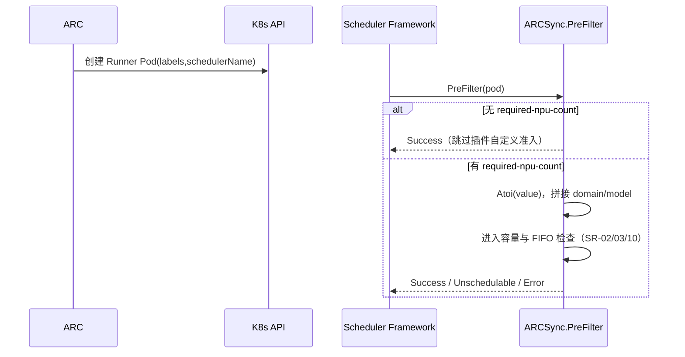

##### 5.1.4.2 SR-01 的 AR 原子实现分解

| AR | 已有实现动作 | 实现位置 | 已执行的处理逻辑 |
|---|---|---|---|
| **AR-01-01** | 从 Pod `Labels` 读取需求开关 | ``PreFilter():263-266`` | 缺失标签直接放行且不向 CycleState 写入自定义状态；属于源码行为，不能假设已校验为合法 Runner。 |
| **AR-01-02** | 解析资源数量与资源键 | ``PreFilter():268-271`` | 使用 `strconv.Atoi`，忽略错误；`ResourceDomain + "/" + ResourceModel`；输入非法可能得到零值。 |
| **AR-01-03** | 与 Scheduler Framework 结合 | ``cmd/scheduler/main.go:27-39`，D-BASE `configmap.yaml:15-28`` | 插件名 `ARCSync`，主要经 PreFilter 调用；其它 Pod 的既有 Kubernetes 调度能力不由本函数覆盖。 |

**AR 与 SR 的关系**：上述 AR 都可以在 S-BASE/D-BASE 静态取证；对应验证只要求确认行为与源码一致，不把其风险修复当成 AR 已交付。

#### 5.1.5 用户接口设计

Pod `metadata.labels`：`ascend-ci.com/required-npu-count`、`ascend-ci.com/npu-resource-domain`、`ascend-ci.com/npu-resource-model`；`spec.schedulerName: npu-scheduler`。当前源码没有 `npu-managed` 字段。

#### 5.1.6 实现接口设计

##### 5.1.6.1 接口签名、契约和返回

`func (pl *ARCSync) PreFilter(context.Context, *framework.CycleState, *v1.Pod) (*framework.PreFilterResult,*framework.Status)`；返回 Success/Unschedulable/Error，由 Framework 消费，不是 HTTP API。

本 SR 无独立 HTTP API，因而 Swagger/OpenAPI 路径 **N/A**；Kubernetes 资源结构及 Go Framework 扩展点是实际接口。

#### 5.1.7 领域对象与状态变更

相关对象：Pod `metadata.labels`：`ascend-ci.com/required-npu-count`、`ascend-ci.com/npu-resource-domain`、`ascend-ci.com/npu-resource-model`；`spec.schedulerName: npu-scheduler`。当前源码没有 `npu-managed` 字段。 状态由上表 AR 所列函数产生或消费；没有额外的持久化领域实体。

#### 5.1.8 验收与验证说明

- **TC-01-01**：TC-01A：标签缺失 → 插件 PreFilter 返回 Success 且不写 `ARCSync/state`（源码推导；需补独立测试）。
- **TC-01-02**：TC-01B：`required-npu-count=2`、资源域 `huawei.com`、型号 `npu` → 拼为 `huawei.com/npu`（源码推导）。
- **TC-01-03**：TC-01C：`required-npu-count=abc` → `Atoi` 错误被忽略，不能断言拒绝（需回归记录）。

**判定规则**：现有测试函数只说明代码仓包含该测试，不能在本次未执行 Go Test 或没有集群访问的情况下声称测试已通过。对于风险复现用例，预期结果应保持与当前源码一致。

#### 5.1.9 DFX 分析（基于当前实现的 FMEA）

| FMEA 项 | 分析 |
|---|---|
| 失效模式/潜在影响 | 非法值没有 fail-close 机制，可能构成绕过准入；把标签字段的文档“必填”误写成代码的严格验证。 |
| 安全/可靠/性能/服务性 | 安全：来源只是 Pod 元数据，不验证可信性；可靠性：不具备非法输入专门状态码；性能：单次解析为 O(1)；可服务性：缺标签不会产生专有拒绝原因。 |
| 当前控制措施与局限 | 需求标签的存在是激活条件，不是对未来 Workflow 真实 request 的一致性证明；非法值没有严格拒绝。 |

**FMEA 检测性分析**：构造缺失和非法 label 的 Runner，观察 PreFilter 返回、Pod Event 与日志。静态源码能够识别潜在故障与部分控制措施，但没有真实故障频率、恢复耗时和告警检出率，故本轮不虚构 S/O/D 数值或 RPN 排名。


**代码与配置证据**：[pkg/arcsync/arcsync.go#L25-L31](https://github.com/ascend-gha-runners/scheduler-plugins/blob/cc243f537e97ca4e34c6bd57030817a04ae204ec/pkg/arcsync/arcsync.go#L25-L31)；[pkg/arcsync/arcsync.go#L262-L275](https://github.com/ascend-gha-runners/scheduler-plugins/blob/cc243f537e97ca4e34c6bd57030817a04ae204ec/pkg/arcsync/arcsync.go#L262-L275)；[cmd/scheduler/main.go#L33-L43](https://github.com/ascend-gha-runners/scheduler-plugins/blob/cc243f537e97ca4e34c6bd57030817a04ae204ec/cmd/scheduler/main.go#L33-L43)。

### 5.2 SR-02：统计本地和虚拟节点 NPU 资源占用（IR-01）

#### 5.2.1 功能概述

**当前行为**：本地使用 Pod 容器 NPU requests 与同型号 `npu-count` 标签两者较大值；虚拟 Node 使用同型号 Runner `required-npu-count` 累加。跳过 Succeeded/Failed Pod 和当前 Pod；占用快照不包含成员集群不可见的工作负载。

**证据状态**：CODE，已存在针对虚拟占用的单测。

#### 5.2.2 用户故事与独立验收场景

**角色**：NPU 资源管理员。

**用户故事**：在 Runner 准入前，希望调度器参考当前节点剩余资源，而不是只看设备总量。

**场景前置条件**：已有 Kubernetes NodeStatus.Allocatable；Pod Snapshot 可列举节点 Pod；虚拟 Node 依据 Liqo Label 识别。

#### 5.2.3 实现思路（实际源码）

1. 列出 NodeInfos。
2. 对每个 NodeInfo 的非终态 Pod 计数，并建立 knownPodUIDs、activeWorkflows。
3. 本地节点按 Requests、npu-count 取较大值；虚拟节点调用 calcVirtualNodeOccupied。
4. 将物理观察量复制到 nodeTotalOccupied，供后续叠加内存预留。

本轮不对尚未引入的算法或接口做开发选型；仅还原该代码基线真正采用的路径。

#### 5.2.4 实现设计

##### 5.2.4.1 SR-02 用例时序图

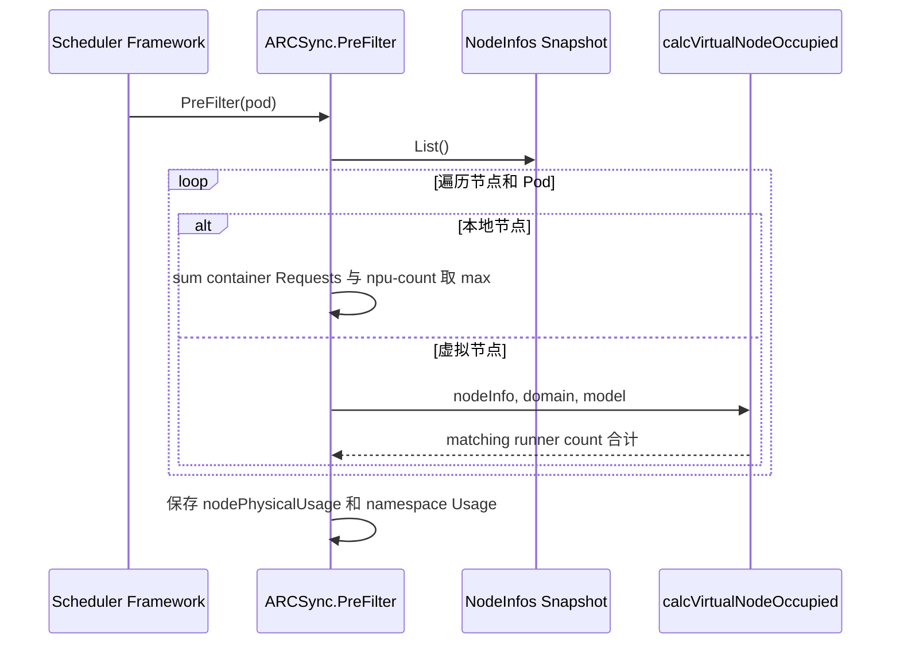

##### 5.2.4.2 SR-02 的 AR 原子实现分解

| AR | 已有实现动作 | 实现位置 | 已执行的处理逻辑 |
|---|---|---|---|
| **AR-02-01** | 过滤结束态及当前 Pod | ``PreFilter():286-310`` | 跳过 Succeeded/Failed 或当前 UID，记录其他 Pod UID 及 `-workflow` 名称标识。 |
| **AR-02-02** | 计算本地观察量 | ``PreFilter():311-329`` | 按普通 Containers Requests 求和，与同型号 `npu-count` 标签解析值取 max；还记录当前 namespace 观察量。 |
| **AR-02-03** | 计算虚拟节点观察量 | ``liqo.go:84-110`、`PreFilter():330-334`` | 按虚拟节点内 Runner 带匹配资源域/型号的 required-npu-count 累加，非数字忽略。 |
| **AR-02-04** | 产生占用映射 | ``PreFilter():337-340`` | 使用 nodeName → 观察占用量；后续预约合并见 SR-04。 |

**AR 与 SR 的关系**：上述 AR 都可以在 S-BASE/D-BASE 静态取证；对应验证只要求确认行为与源码一致，不把其风险修复当成 AR 已交付。

#### 5.2.5 用户接口设计

Kubernetes `Node.status.allocatable`；Pod `containers[].resources.requests`；Pod label `ascend-ci.com/npu-count` 和三项 Runner 标签。

#### 5.2.6 实现接口设计

##### 5.2.6.1 接口签名、契约和返回

`calcVirtualNodeOccupied(nodeInfo *framework.NodeInfo,resDomain,resModel string) int64`；`PreFilter` 对 Snapshot 读操作；无自定义数据查询服务。

本 SR 无独立 HTTP API，因而 Swagger/OpenAPI 路径 **N/A**；Kubernetes 资源结构及 Go Framework 扩展点是实际接口。

#### 5.2.7 领域对象与状态变更

相关对象：Kubernetes `Node.status.allocatable`；Pod `containers[].resources.requests`；Pod label `ascend-ci.com/npu-count` 和三项 Runner 标签。 状态由上表 AR 所列函数产生或消费；没有额外的持久化领域实体。

#### 5.2.8 验收与验证说明

- **TC-02-01**：TC-02A：虚拟 Node 上同型号 2+3+1 卡 → 计算 6（现有 `TestCalcVirtualNodeOccupied`）。
- **TC-02-02**：TC-02B：异型号 Pod 被忽略（现有 `TestCalcVirtualNodeOccupiedMismatchedModel`）。
- **TC-02-03**：TC-02C：本地 Requests=2 与匹配 label=4 → 计 4（逻辑可由代码推导，本轮未发现专门单测）。

**判定规则**：现有测试函数只说明代码仓包含该测试，不能在本次未执行 Go Test 或没有集群访问的情况下声称测试已通过。对于风险复现用例，预期结果应保持与当前源码一致。

#### 5.2.9 DFX 分析（基于当前实现的 FMEA）

| FMEA 项 | 分析 |
|---|---|
| 失效模式/潜在影响 | 错误标签和缓存滞后可导致 NPU 账面资源失真；普通 Containers 累加不等于 Kubernetes InitContainer 资源语义；远端资源不可见。 |
| 安全/可靠/性能/服务性 | 安全：只读 API 对象；可靠性：数据依赖 Snapshot 最新性；性能：每次 PreFilter 遍历所有 NodeInfo 及其 Pods，复杂度近似 O(nodes+pods)；可服务性：目前主要靠 klog，没有独立容量诊断 API。 |
| 当前控制措施与局限 | 统计是 Scheduler 观察模型，不保证硬件独占，也不能直接据此证明 Workflow 一定能够运行。 |

**FMEA 检测性分析**：对照 Node Allocatable、Pod Requests 与同型号标签，构造虚拟节点混合负载。静态源码能够识别潜在故障与部分控制措施，但没有真实故障频率、恢复耗时和告警检出率，故本轮不虚构 S/O/D 数值或 RPN 排名。


**代码与配置证据**：[pkg/arcsync/arcsync.go#L278-L340](https://github.com/ascend-gha-runners/scheduler-plugins/blob/cc243f537e97ca4e34c6bd57030817a04ae204ec/pkg/arcsync/arcsync.go#L278-L340)；[pkg/arcsync/liqo.go#L76-L110](https://github.com/ascend-gha-runners/scheduler-plugins/blob/cc243f537e97ca4e34c6bd57030817a04ae204ec/pkg/arcsync/liqo.go#L76-L110)；[pkg/arcsync/arcsync_test.go#L49-L115](https://github.com/ascend-gha-runners/scheduler-plugins/blob/cc243f537e97ca4e34c6bd57030817a04ae204ec/pkg/arcsync/arcsync_test.go#L49-L115)。

### 5.3 SR-03：执行 NPU 聚合容量准入（IR-01）

#### 5.3.1 功能概述

**当前行为**：PreFilter 以可容忍污点、未 cordon 的本地节点总剩余和被保留的虚拟候选剩余求和，和需求数量比较；不足时返回 Unschedulable；足够才进入 FIFO 检查并写 CycleState。

**证据状态**：CODE + CONFIG；容器实际 NPU request 的逐节点判定由 SR-09 的 Filter 完成。

#### 5.3.2 用户故事与独立验收场景

**角色**：CI 作业提交者。

**用户故事**：当 NPU 总余量低于需求时，希望 Runner 等待调度，而不是提前启动并等待 Workflow 无法落地。

**场景前置条件**：Pod 含 required-npu-count；Snapshot 列举成功；后续 Liqo/Queue 与 in-flight 处理已完成。

#### 5.3.3 实现思路（实际源码）

1. PreFilter 获取计算后的 nodeTotalOccupied、nodeFreeNPU。
2. 遍历 NodeInfos，排除 cordon 和未容忍污点；虚拟 Node 还必须保留在 nodeFreeNPU。
3. 对本地节点不重新检查 NodeSelector 是否在 nodeFreeNPU 中，直接求和。
4. `totalNPUFree>=reqCount` 则继续，否则 Unschedulable。
5. 继续 FIFO，Success 时写 stateKey 的 requiredCount/resourceName/nodeFreeNPU。

本轮不对尚未引入的算法或接口做开发选型；仅还原该代码基线真正采用的路径。

#### 5.3.4 实现设计

##### 5.3.4.1 SR-03 用例时序图

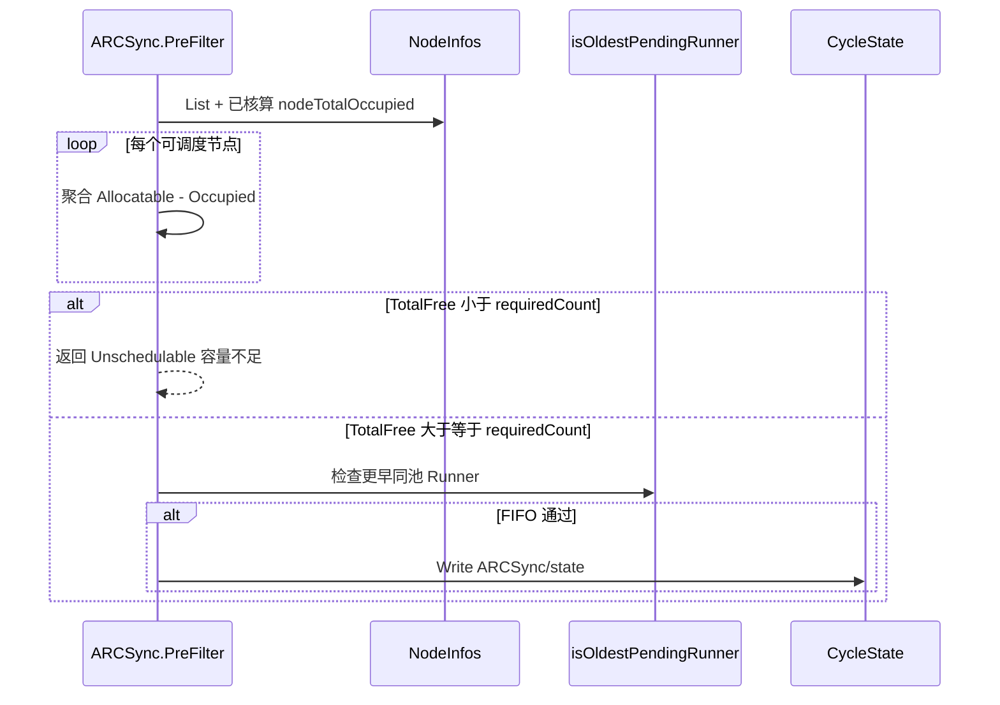

##### 5.3.4.2 SR-03 的 AR 原子实现分解

| AR | 已有实现动作 | 实现位置 | 已执行的处理逻辑 |
|---|---|---|---|
| **AR-03-01** | 按当前规则累计可用量 | ``PreFilter():419-440`` | 遍历节点累计 `Allocatable[fullResourceName]-nodeTotalOccupied[node]`；本地包含非最终候选 Node 的可能性。 |
| **AR-03-02** | 容量门禁 | ``PreFilter():441-447`` | 比较聚合数值；拒绝原因固定为 `No node has enough available NPU slots`，但措辞比真实总量判定更强。 |
| **AR-03-03** | 形成 CycleState | ``PreFilter():449-461`` | FIFO 通过时 Write `ARCSync/state`，包含需求量、资源键、候选节点空闲 map；不写入 Pod API。 |

**AR 与 SR 的关系**：上述 AR 都可以在 S-BASE/D-BASE 静态取证；对应验证只要求确认行为与源码一致，不把其风险修复当成 AR 已交付。

#### 5.3.5 用户接口设计

同 SR-01 的 Runner labels；`Node.status.allocatable`；不新增用户接口。

#### 5.3.6 实现接口设计

##### 5.3.6.1 接口签名、契约和返回

`PreFilter` 返回 `framework.NewStatus(framework.Unschedulable,"No node has enough available NPU slots")` 或继续后续判断。

本 SR 无独立 HTTP API，因而 Swagger/OpenAPI 路径 **N/A**；Kubernetes 资源结构及 Go Framework 扩展点是实际接口。

#### 5.3.7 领域对象与状态变更

相关对象：同 SR-01 的 Runner labels；`Node.status.allocatable`；不新增用户接口。 状态由上表 AR 所列函数产生或消费；没有额外的持久化领域实体。

#### 5.3.8 验收与验证说明

- **TC-03-01**：TC-03A：剩余总量低于请求 → Unschedulable（需隔离 FIFO 影响）。
- **TC-03-02**：TC-03B：Runner 预约超过 NPU 总量 → 拒绝（现有 `TestPreFilterRejectsWhenRunnerReservationsExceedNPU`）。
- **TC-03-03**：TC-03C：预约未超过总量 → 准入（现有 `TestPreFilterAllowsRunnerWhenReservationsBelowNPU`）。
- **TC-03-04**：TC-03D：两个节点分别空闲 4 卡，申请 8 卡 → 当前聚合条件可能通过（风险复现实验，不得作为单节点可行性功能验收）。

**判定规则**：现有测试函数只说明代码仓包含该测试，不能在本次未执行 Go Test 或没有集群访问的情况下声称测试已通过。对于风险复现用例，预期结果应保持与当前源码一致。

#### 5.3.9 DFX 分析（基于当前实现的 FMEA）

| FMEA 项 | 分析 |
|---|---|
| 失效模式/潜在影响 | 聚合足额但无单节点足额时可能放行 Runner；本地总和不完全服从 nodeSelector/affinity；负容量通过 CPU 节点预约在求和中体现。 |
| 安全/可靠/性能/服务性 | 安全：依赖 Pod 声明需求量；可靠性：状态基于调度缓存；性能：追加一次 O(nodes) 线性求和；可服务性：固定拒绝文本，不包含失败节点详情。 |
| 当前控制措施与局限 | 当前状态是总量预检，不能在文档中写成“保证至少一个单节点可容纳 Workflow”。 |

**FMEA 检测性分析**：构造 4+4→8 卡、节点亲和性与 CPU Runner 预留用例，并对比调度结果。静态源码能够识别潜在故障与部分控制措施，但没有真实故障频率、恢复耗时和告警检出率，故本轮不虚构 S/O/D 数值或 RPN 排名。


**代码与配置证据**：[pkg/arcsync/arcsync.go#L419-L461](https://github.com/ascend-gha-runners/scheduler-plugins/blob/cc243f537e97ca4e34c6bd57030817a04ae204ec/pkg/arcsync/arcsync.go#L419-L461)；[pkg/arcsync/arcsync_test.go#L948-L1001](https://github.com/ascend-gha-runners/scheduler-plugins/blob/cc243f537e97ca4e34c6bd57030817a04ae204ec/pkg/arcsync/arcsync_test.go#L948-L1001)。

### 5.4 SR-04：管理进程内 NPU 在途预留（IR-02）

#### 5.4.1 功能概述

**当前行为**：配置启用 `Reserve`；框架调用时按 UID 建立进程内 reservation；`Unreserve` 删除；后续 PreFilter 合并非虚拟节点预约到 nodeTotalOccupied。

**证据状态**：CODE + CONFIG，属于软预留，不是 K8s Extended Resource 的原子 Reservation API。

#### 5.4.2 用户故事与独立验收场景

**角色**：资源配额管理员。

**用户故事**：多个 Runner 连续调度时，希望调度器考虑尚未实际生成 Workflow 的未来 NPU 需求，减轻资源被重复承诺的问题。

**场景前置条件**：PreFilter 之前已写 CycleState；本次 Framework 运行 Reserve 扩展点；Reservation map 仅存在于同一进程。

#### 5.4.3 实现思路（实际源码）

1. Framework 调用 Reserve(pod,nodeName)。
2. map[PodUID] 写入 nodeName/count/time/baseName/namespace。
3. 下一次 PreFilter 根据快照已知 UID、活动 Workflow 决定删除/忽略。
4. 本地/非虚拟 Node 的未交接预约累计到 nodeTotalOccupied。
5. Framework 失败回滚时可调用 Unreserve 删除当前 UID。

本轮不对尚未引入的算法或接口做开发选型；仅还原该代码基线真正采用的路径。

#### 5.4.4 实现设计

##### 5.4.4.1 SR-04 用例时序图

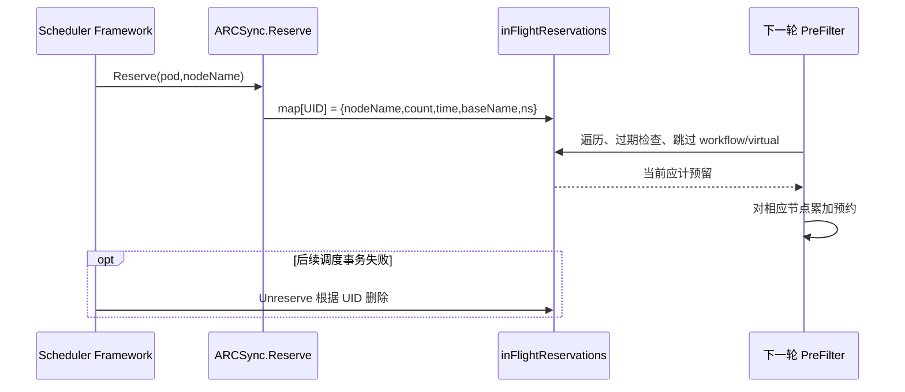

##### 5.4.4.2 SR-04 的 AR 原子实现分解

| AR | 已有实现动作 | 实现位置 | 已执行的处理逻辑 |
|---|---|---|---|
| **AR-04-01** | 登记预约 | ``Reserve():644-667`` | Map 键优先 Pod UID，为空回退 namespace/name；写入 Mutex 保护的内存状态。 |
| **AR-04-02** | 按快照回收与计费 | ``PreFilter():342-363`` | UID 不再见且超过 10s 删除；活动 Workflow 匹配则跳过；virtual node 预约跳过附加计数；其余占用加在保存的 res.nodeName。 |
| **AR-04-03** | 回滚预约 | ``Unreserve():669-678`` | 按 UID 或 namespace/name 删除；不调用 Kubernetes API，不写持久对象。 |

**AR 与 SR 的关系**：上述 AR 都可以在 S-BASE/D-BASE 静态取证；对应验证只要求确认行为与源码一致，不把其风险修复当成 AR 已交付。

#### 5.4.5 用户接口设计

没有新增用户接口；逻辑预约由 Framework 内部 Reserve 生命周期自动触发，无法通过 REST 读取预约表。

#### 5.4.6 实现接口设计

##### 5.4.6.1 接口签名、契约和返回

`Reserve(ctx,state,pod,nodeName) *framework.Status`、`Unreserve(ctx,state,pod,nodeName)`；`reservation{nodeName,count,timestamp,baseName,namespace}` 不是 CRD。

本 SR 无独立 HTTP API，因而 Swagger/OpenAPI 路径 **N/A**；Kubernetes 资源结构及 Go Framework 扩展点是实际接口。

#### 5.4.7 领域对象与状态变更

相关对象：没有新增用户接口；逻辑预约由 Framework 内部 Reserve 生命周期自动触发，无法通过 REST 读取预约表。 状态由上表 AR 所列函数产生或消费；没有额外的持久化领域实体。

#### 5.4.8 验收与验证说明

- **TC-04-01**：TC-04A：预留 2 卡后，下一轮剩余计量减少 2；配合 CPU Runner 预约测试。
- **TC-04-02**：TC-04B：Unreserve 删除当前 UID 预约（源码推导，未发现独立单测）。
- **TC-04-03**：TC-04C：UID 不在快照且预约 age>10s 才删除；在快照中不因时间自然过期。
- **TC-04-04**：TC-04D：进程重启后 map 重新初始化为空（设计限制验证）。

**判定规则**：现有测试函数只说明代码仓包含该测试，不能在本次未执行 Go Test 或没有集群访问的情况下声称测试已通过。对于风险复现用例，预期结果应保持与当前源码一致。

#### 5.4.9 DFX 分析（基于当前实现的 FMEA）

| FMEA 项 | 分析 |
|---|---|
| 失效模式/潜在影响 | 进程重启导致预约丢失；CPU Node 保存的预约不是物理 NPU 所在节点；多 Scheduler 实例无法共享 map；Snapshot 与预约间存在并发和时效边界。 |
| 安全/可靠/性能/服务性 | 安全：内存仅保存元数据；可靠性：无持久化；性能：每次 PreFilter 遍历当前预约 O(reservations) 并受 Mutex 保护；可服务性：Reserve/Unreserve 有日志，无预约列表 API。 |
| 当前控制措施与局限 | 仅记录当前进程的逻辑需求，没有实现跨调度器或跨集群真实 NPU 卡的强占位。 |

**FMEA 检测性分析**：观察 Reserve/Unreserve 日志及重启前后相同负载的容量判断。静态源码能够识别潜在故障与部分控制措施，但没有真实故障频率、恢复耗时和告警检出率，故本轮不虚构 S/O/D 数值或 RPN 排名。


**代码与配置证据**：[pkg/arcsync/arcsync.go#L34-L49](https://github.com/ascend-gha-runners/scheduler-plugins/blob/cc243f537e97ca4e34c6bd57030817a04ae204ec/pkg/arcsync/arcsync.go#L34-L49)；[pkg/arcsync/arcsync.go#L342-L363](https://github.com/ascend-gha-runners/scheduler-plugins/blob/cc243f537e97ca4e34c6bd57030817a04ae204ec/pkg/arcsync/arcsync.go#L342-L363)；[pkg/arcsync/arcsync.go#L644-L678](https://github.com/ascend-gha-runners/scheduler-plugins/blob/cc243f537e97ca4e34c6bd57030817a04ae204ec/pkg/arcsync/arcsync.go#L644-L678)。

### 5.5 SR-05：使用 Workflow 命名关系交接资源计量（IR-02）

#### 5.5.1 功能概述

**当前行为**：在 PreFilter 中将所有以 `-workflow` 后缀结尾的 Pod 的 baseName 标记为活动 Workflow；任何预约 baseName 匹配该字符串都会跳过预约计入；`PostBind` 有清理本 Pod 预约代码，但主 YAML 未显式配置这一阶段。

**证据状态**：CODE；部分行为由 PreFilter 执行，PostBind 运行态未确认。

#### 5.5.2 用户故事与独立验收场景

**角色**：ARC Container Mode 运维人员。

**用户故事**：当对应 Workflow Pod 出现并开始占用 NPU 后，希望调度器避免将 Runner 预约和 Workflow 资源 Requests 重复计为两份。

**场景前置条件**：Workflow Pod 与 Runner Pod 的名称能由 `getBaseName` 规则关联；Snapshot 已看见 Workflow。

#### 5.5.3 实现思路（实际源码）

1. 扫描 Pod Snapshot，针对名字有 -workflow 后缀的 Pod 记下 baseName。
2. 遍历预约；若 activeWorkflows[baseName] 存在则跳过该预约累加。
3. 观察中的 Workflow 通过普通 Requests / npu-count 进入物理占用。
4. PostBind 如果实际被调用，会删除带目标资源 request 的当前 Pod UID 的预留。

本轮不对尚未引入的算法或接口做开发选型；仅还原该代码基线真正采用的路径。

#### 5.5.4 实现设计

##### 5.5.4.1 SR-05 用例时序图

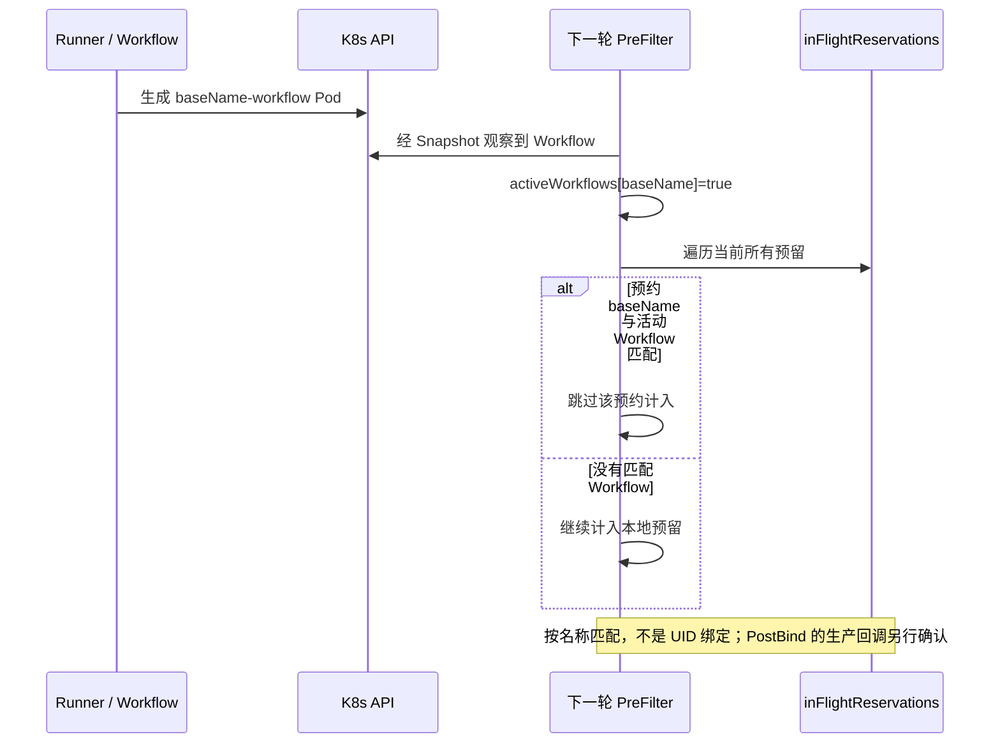

##### 5.5.4.2 SR-05 的 AR 原子实现分解

| AR | 已有实现动作 | 实现位置 | 已执行的处理逻辑 |
|---|---|---|---|
| **AR-05-01** | 计算工作流名称键 | ``getBaseName():172-178`、`PreFilter():304-307`` | 固定后缀 `-workflow`；没有读取 ownerReferences、Job ID、明确的 Runner UID 关联。 |
| **AR-05-02** | 跳过对应预约占用 | ``PreFilter():342-354`` | 只按 baseName 匹配，不带 namespace，可能跨 namespace 同名误命中。 |
| **AR-05-03** | PostBind 方法中的清理分支 | ``PostBind():680-704`` | 有目标资源 Requests 时删除当前 Pod UID 预留；Runner 不请求 NPU 则保留。配置是否让 Framework 实际调用必须独立确认。 |

**AR 与 SR 的关系**：上述 AR 都可以在 S-BASE/D-BASE 静态取证；对应验证只要求确认行为与源码一致，不把其风险修复当成 AR 已交付。

#### 5.5.5 用户接口设计

Workflow Pod 的 `metadata.name`、namespace、container Requests、npu-count 等由 ARC/Workflow 系统确定；本插件不提供显式 Workflow ↔ Runner UID 绑定接口。

#### 5.5.6 实现接口设计

##### 5.5.6.1 接口签名、契约和返回

`getBaseName(name string) string`；`PostBind(ctx,state,pod,nodeName)`；PreFilter 内联 `activeWorkflows map[string]bool`。

本 SR 无独立 HTTP API，因而 Swagger/OpenAPI 路径 **N/A**；Kubernetes 资源结构及 Go Framework 扩展点是实际接口。

#### 5.5.7 领域对象与状态变更

相关对象：Workflow Pod 的 `metadata.name`、namespace、container Requests、npu-count 等由 ARC/Workflow 系统确定；本插件不提供显式 Workflow ↔ Runner UID 绑定接口。 状态由上表 AR 所列函数产生或消费；没有额外的持久化领域实体。

#### 5.5.8 验收与验证说明

- **TC-05-01**：TC-05A：同 baseName Workflow 出现后，对应 Runner 预约跳过计数（源码推导，需独立单测）。
- **TC-05-02**：TC-05B：不同 namespace 的同名 baseName 可能误跳过预留（已知风险复现）。
- **TC-05-03**：TC-05C：PostBind 回调是否执行，必须以实际 Framework 配置/运行日志确认；不能只跑纯 Go 方法测试证明部署调用。

**判定规则**：现有测试函数只说明代码仓包含该测试，不能在本次未执行 Go Test 或没有集群访问的情况下声称测试已通过。对于风险复现用例，预期结果应保持与当前源码一致。

#### 5.5.9 DFX 分析（基于当前实现的 FMEA）

| FMEA 项 | 分析 |
|---|---|
| 失效模式/潜在影响 | 同名冲突引发跨 namespace 计费干扰；后缀与实际 ARC 命名不一致使交接失败；若 PostBind 未调用，预约管理仍依赖 PreFilter 的动态判断。 |
| 安全/可靠/性能/服务性 | 安全：命名字符串不是可信 ownership；可靠性：依赖 Snapshot 与约定后缀；性能：每次扫描 O(pods)；可服务性：现有普通日志，缺 Runner/Workflow 相关 UID 链路。 |
| 当前控制措施与局限 | 不会向 Workflow 实际申请 NPU，也不保证 Workflow 最终由 ARCSync Scheduler 执行。 |

**FMEA 检测性分析**：构造同 baseName 不同 namespace 的 Runner/Workflow，核对占用变化。静态源码能够识别潜在故障与部分控制措施，但没有真实故障频率、恢复耗时和告警检出率，故本轮不虚构 S/O/D 数值或 RPN 排名。


**代码与配置证据**：[pkg/arcsync/arcsync.go#L172-L178](https://github.com/ascend-gha-runners/scheduler-plugins/blob/cc243f537e97ca4e34c6bd57030817a04ae204ec/pkg/arcsync/arcsync.go#L172-L178)；[pkg/arcsync/arcsync.go#L298-L363](https://github.com/ascend-gha-runners/scheduler-plugins/blob/cc243f537e97ca4e34c6bd57030817a04ae204ec/pkg/arcsync/arcsync.go#L298-L363)；[pkg/arcsync/arcsync.go#L680-L704](https://github.com/ascend-gha-runners/scheduler-plugins/blob/cc243f537e97ca4e34c6bd57030817a04ae204ec/pkg/arcsync/arcsync.go#L680-L704)。

### 5.6 SR-06：识别并筛选 Liqo 虚拟节点（IR-03）

#### 5.6.1 功能概述

**当前行为**：有 `NamespaceOffloading` CR 时，通过 `nodeSelectorTerms` 选候选虚拟 Node，预先删除不匹配的远端；无 CR 则所有虚拟 Node 从 ARCSync map 移除。

**证据状态**：CODE + COND（Liqo CRD 存在且 informer 可读）。

#### 5.6.2 用户故事与独立验收场景

**角色**：多集群资源管理员。

**用户故事**：为指定 Namespace 允许向部分远端集群 offload 时，希望候选虚拟节点符合 Liqo NamespaceOffloading 的 clusterSelector。

**场景前置条件**：节点通过 label `liqo.io/remote-cluster-id` 标识；namespace 对应 `NamespaceOffloading` 可从缓存读取。

#### 5.6.3 实现思路（实际源码）

1. 初始化时创建 DynamicInformer（如果 CRD 存在）。
2. PreFilter 通过 `nsOffloadingLister.Get(pod.Namespace)` 查对象。
3. 解析 `spec.clusterSelector` 为 NodeSelectorTerms。
4. 匹配虚拟节点 Node Labels；删除不被选定的虚拟节点候选。
5. 没有 NamespaceOffloading 则删除所有虚拟节点候选。

本轮不对尚未引入的算法或接口做开发选型；仅还原该代码基线真正采用的路径。

#### 5.6.4 实现设计

##### 5.6.4.1 SR-06 用例时序图

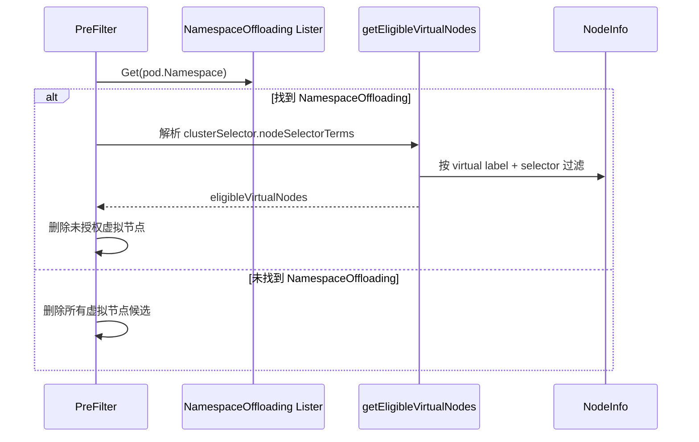

##### 5.6.4.2 SR-06 的 AR 原子实现分解

| AR | 已有实现动作 | 实现位置 | 已执行的处理逻辑 |
|---|---|---|---|
| **AR-06-01** | CRD informer 初始化 | ``New():68-104`、`liqo.go:18-23`` | GVR=offloading.liqo.io/v1beta1/namespaceoffloadings；未同步时 Get 可能还看不到对象。 |
| **AR-06-02** | 识别虚拟 Node | ``isVirtualNode():76-82`` | 检查 key 是否存在，不校验标签值。 |
| **AR-06-03** | 解析 NodeSelectorTerms | ``extractClusterSelectorTerms():130-153`` | 对 `spec.clusterSelector` 反序列化成 `v1.NodeSelector`；支持 term OR、expression AND；含 matchFields 的 term 不匹配。 |
| **AR-06-04** | 过滤不合规虚拟节点 | ``getEligibleVirtualNodes():112-128`、`applyLiqoComparison():503-518`` | 有效 selector 下只保留匹配项；不存在有效 terms 时会把所有虚拟节点标为 eligible。 |

**AR 与 SR 的关系**：上述 AR 都可以在 S-BASE/D-BASE 静态取证；对应验证只要求确认行为与源码一致，不把其风险修复当成 AR 已交付。

#### 5.6.5 用户接口设计

外部 CRD：`NamespaceOffloading`，`spec.clusterSelector.nodeSelectorTerms[].matchExpressions`；虚拟 Node labels。不能按仓库 `ARCSYNC_GUIDE.md` 的 `matchLabels` 示例直接认定生效。

#### 5.6.6 实现接口设计

##### 5.6.6.1 接口签名、契约和返回

`getEligibleVirtualNodes(nodeInfos,nsOffloading) map[string]bool`；`extractClusterSelectorTerms(*unstructured.Unstructured)`；`nsOffloadingLister.Get(namespace)`。

本 SR 无独立 HTTP API，因而 Swagger/OpenAPI 路径 **N/A**；Kubernetes 资源结构及 Go Framework 扩展点是实际接口。

#### 5.6.7 领域对象与状态变更

相关对象：外部 CRD：`NamespaceOffloading`，`spec.clusterSelector.nodeSelectorTerms[].matchExpressions`；虚拟 Node labels。不能按仓库 `ARCSYNC_GUIDE.md` 的 `matchLabels` 示例直接认定生效。 状态由上表 AR 所列函数产生或消费；没有额外的持久化领域实体。

#### 5.6.8 验收与验证说明

- **TC-06-01**：TC-06A：匹配指定远端 → 仅匹配 Node 保留（`TestGetEligibleVirtualNodes`）。
- **TC-06-02**：TC-06B：非目标远端排除（`TestGetEligibleVirtualNodesExcludesNonTargetedCluster`）。
- **TC-06-03**：TC-06C：无有效 selector terms → 当前实现允许所有虚拟 Node（`TestGetEligibleVirtualNodesNoSelector`）。
- **TC-06-04**：TC-06D：无 NamespaceOffloading 时虚拟 Node 被删除（`TestPreFilterNoNamespaceOffloading`）。

**判定规则**：现有测试函数只说明代码仓包含该测试，不能在本次未执行 Go Test 或没有集群访问的情况下声称测试已通过。对于风险复现用例，预期结果应保持与当前源码一致。

#### 5.6.9 DFX 分析（基于当前实现的 FMEA）

| FMEA 项 | 分析 |
|---|---|
| 失效模式/潜在影响 | 未配置或无法解析的 clusterSelector 会意外扩大 eligible virtuals；CRD informer 缓存滞后会影响选择结果。 |
| 安全/可靠/性能/服务性 | 安全：远端授权语义依赖外部 CRD，且无 selector terms 为潜在 fail-open；可靠性：缓存延迟可能暂时退化本地；性能：节点扫描 O(nodes)；可服务性：未提供远端授权诊断接口。 |
| 当前控制措施与局限 | 仓库指南的 `matchLabels` 示例与当前 NodeSelectorTerms 解析方式不一致，不能把示例当作当前源码契约。 |

**FMEA 检测性分析**：以空 clusterSelector、非目标 remote-cluster-id 与冷启动缓存场景验证。静态源码能够识别潜在故障与部分控制措施，但没有真实故障频率、恢复耗时和告警检出率，故本轮不虚构 S/O/D 数值或 RPN 排名。


**代码与配置证据**：[pkg/arcsync/liqo.go#L16-L28](https://github.com/ascend-gha-runners/scheduler-plugins/blob/cc243f537e97ca4e34c6bd57030817a04ae204ec/pkg/arcsync/liqo.go#L16-L28)；[pkg/arcsync/liqo.go#L112-L183](https://github.com/ascend-gha-runners/scheduler-plugins/blob/cc243f537e97ca4e34c6bd57030817a04ae204ec/pkg/arcsync/liqo.go#L112-L183)；[pkg/arcsync/arcsync.go#L379-L417](https://github.com/ascend-gha-runners/scheduler-plugins/blob/cc243f537e97ca4e34c6bd57030817a04ae204ec/pkg/arcsync/arcsync.go#L379-L417)。

### 5.7 SR-07：本地与远端资源池的比较及择优（IR-03）

#### 5.7.1 功能概述

**当前行为**：以本地空闲 NPU 之和与 eligible 虚拟节点单节点最大余量比较，平局本地胜。若本地有单节点足额、某虚拟节点有同类 Pending Runner，该虚拟节点可能被略过。

**证据状态**：CODE + COND（namespace 有可读取的 NamespaceOffloading）。

#### 5.7.2 用户故事与独立验收场景

**角色**：多集群平台 SRE。

**用户故事**：当 Liqo 远端可用时，希望调度器按已观察的 NPU 余量选本地或一个远端虚拟节点，减少资源不匹配。

**场景前置条件**：已产生 nodeFreeNPU；已过滤 nodeSelector/required affinity/taint；Liqo eligibleVirtuals 非空。

#### 5.7.3 实现思路（实际源码）

1. 求本地 nodeFreeNPU 的合计；如发现 Queue 额度则取限额余量较小值。
2. 寻找 eligibleVirtuals 中最大剩余的虚拟节点。
3. 如果本地存在单节点足够，将同类 Pending Runner 竞争的虚拟节点排除比较。
4. 本地 >= 远端最大 → 删除所有 eligible 虚拟节点。
5. 远端更大 → 只保留获胜虚拟节点。
6. 后续仍由聚合容量门禁 + Filter 决定 Pod 是否调度。

本轮不对尚未引入的算法或接口做开发选型；仅还原该代码基线真正采用的路径。

#### 5.7.4 实现设计

##### 5.7.4.1 SR-07 用例时序图

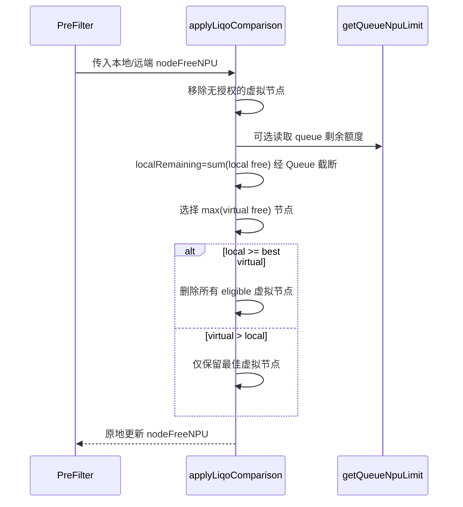

##### 5.7.4.2 SR-07 的 AR 原子实现分解

| AR | 已有实现动作 | 实现位置 | 已执行的处理逻辑 |
|---|---|---|---|
| **AR-07-01** | 本地总剩余量 | ``applyLiqoComparison():520-547`` | 依据 `nodeFreeNPU` 中本地节点余量求和；queueLimit 可改变本地比较值。 |
| **AR-07-02** | 挑选最佳虚拟节点 | ``applyLiqoComparison():549-568`` | 只在 `eligibleVirtuals` 中考虑 `free > bestVirtRemaining` 的节点；map 遍历本身没有显式排序。 |
| **AR-07-03** | Pool 选择及排除 | ``applyLiqoComparison():570-586`` | 比较 `localRemaining >= bestVirtRemaining`；本地胜删除虚拟，远端胜只保留最佳虚拟。 |

**AR 与 SR 的关系**：上述 AR 都可以在 S-BASE/D-BASE 静态取证；对应验证只要求确认行为与源码一致，不把其风险修复当成 AR 已交付。

#### 5.7.5 用户接口设计

Pod 所在 namespace 的 NamespaceOffloading、Node label、Pod 节点约束；算法没有独立配置开关或权重参数。

#### 5.7.6 实现接口设计

##### 5.7.6.1 接口签名、契约和返回

`applyLiqoComparison(nodeInfos,pod,resDomain,resModel,resourceName,nsLocalOccupied,nodeFreeNPU,nsOffloading,reqCount,virtualNodes)` 会**原地修改** map，不返回独立 PlacementPlan。

本 SR 无独立 HTTP API，因而 Swagger/OpenAPI 路径 **N/A**；Kubernetes 资源结构及 Go Framework 扩展点是实际接口。

#### 5.7.7 领域对象与状态变更

相关对象：Pod 所在 namespace 的 NamespaceOffloading、Node label、Pod 节点约束；算法没有独立配置开关或权重参数。 状态由上表 AR 所列函数产生或消费；没有额外的持久化领域实体。

#### 5.7.8 验收与验证说明

- **TC-07-01**：TC-07A：本地余量大于远端 → 本地胜（`TestPreFilterLocalWins`）。
- **TC-07-02**：TC-07B：远端余量大于本地 → 远端胜（`TestPreFilterVirtualWins`）。
- **TC-07-03**：TC-07C：本地被其他 namespace 占满 → 应按全量占用核算（`TestPreFilterVirtualWinsWhenLocalOccupiedByOtherNamespace`）。
- **TC-07-04**：TC-07D：NodeAffinity 不允许虚拟 Node → 不被选为最佳（`TestPreFilterAffinityExcludesNonTargetedVirtual`）。

**判定规则**：现有测试函数只说明代码仓包含该测试，不能在本次未执行 Go Test 或没有集群访问的情况下声称测试已通过。对于风险复现用例，预期结果应保持与当前源码一致。

#### 5.7.9 DFX 分析（基于当前实现的 FMEA）

| FMEA 项 | 分析 |
|---|---|
| 失效模式/潜在影响 | 本地“总量”可来自多个无法承载完整需求的节点；本地与远端比较口径不对称；多个同分远端节点的选择依赖无序 map 遍历。 |
| 安全/可靠/性能/服务性 | 安全：先按 CRD 过滤远端；可靠性：外部缓存及代理 Allocatable 决定准确度；性能：节点线性遍历；可服务性：本地/远端获胜日志包含候选余量。 |
| 当前控制措施与局限 | 不是跨远端集群的实时负载均衡，也没有远端 Workflow 实际占用的权威视图。 |

**FMEA 检测性分析**：比较 localRemaining、bestVirtRemaining 和最终候选集合/日志。静态源码能够识别潜在故障与部分控制措施，但没有真实故障频率、恢复耗时和告警检出率，故本轮不虚构 S/O/D 数值或 RPN 排名。


**代码与配置证据**：[pkg/arcsync/arcsync.go#L492-L586](https://github.com/ascend-gha-runners/scheduler-plugins/blob/cc243f537e97ca4e34c6bd57030817a04ae204ec/pkg/arcsync/arcsync.go#L492-L586)；[pkg/arcsync/arcsync_test.go#L462-L699](https://github.com/ascend-gha-runners/scheduler-plugins/blob/cc243f537e97ca4e34c6bd57030817a04ae204ec/pkg/arcsync/arcsync_test.go#L462-L699)。

### 5.8 SR-08：有条件读取 Volcano Queue 限额（IR-03）

#### 5.8.1 功能概述

**当前行为**：Queue 名称**从 Pod annotation 读取**；有 NamespaceOffloading 才调用 Queue 额度路径；额度影响本地剩余量与本地 Node 是否保留，不能承诺对未启用 Liqo 的 Pod 强制队列配额。

**证据状态**：CODE + COND（Volcano Queue CRD 可读、Pod annotation 设置且 NamespaceOffloading 存在）。

#### 5.8.2 用户故事与独立验收场景

**角色**：命名空间资源管理员。

**用户故事**：当 Runner Pod 关联 Volcano Queue 时，希望本地 NPU 选择参考该队列的 capability 限额。

**场景前置条件**：Pod `metadata.annotations["scheduling.volcano.sh/queue-name"]`、Queue CRD 的 `spec.capability[fullResourceName]`；可用 dynamic Queue Lister。

#### 5.8.3 实现思路（实际源码）

1. 从待调度 Pod annotations 读取队列名。
2. Queue Lister 获取对象，解析 capability 中对应的扩展资源 Quantity。
3. 在 Liqo 比较时本地余量取 `min(localRemaining, max(0, queueLimit-nsLocalOccupied))`。
4. 同一 PreFilter 继续核对当前命名空间本地占用+需求与限额。
5. 超额则删除本地 Node，虚拟候选不在此循环中删除。

本轮不对尚未引入的算法或接口做开发选型；仅还原该代码基线真正采用的路径。

#### 5.8.4 实现设计

##### 5.8.4.1 SR-08 用例时序图

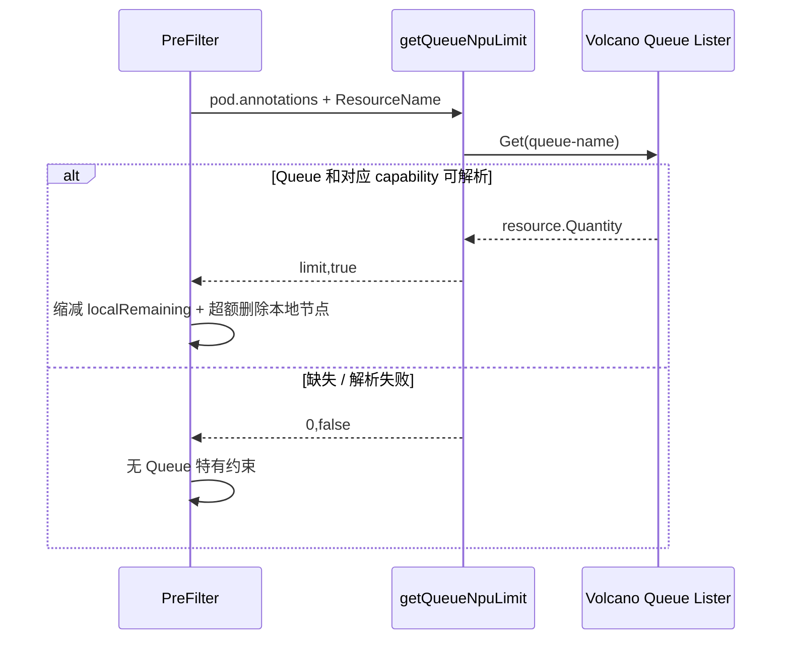

##### 5.8.4.2 SR-08 的 AR 原子实现分解

| AR | 已有实现动作 | 实现位置 | 已执行的处理逻辑 |
|---|---|---|---|
| **AR-08-01** | 解析 Queue 容量 | ``volcano.go:11-42`` | 仅 Pod annotation 生效；无值、Lister 不可用、资源键缺失、Quantity 无法解析均返回 `(0,false)`。 |
| **AR-08-02** | 参与本地/远端比选 | ``applyLiqoComparison():531-544`` | 对本地有效余量进行最小值截断；这是本地候选倾向，不是完整 Queue 调度。 |
| **AR-08-03** | 超额时排除本地候选 | ``PreFilter():392-409`` | 仅在 nsHasOffloading 分支；基于 namespace 本地观察占用+预留与 requestedCount 做判断。 |

**AR 与 SR 的关系**：上述 AR 都可以在 S-BASE/D-BASE 静态取证；对应验证只要求确认行为与源码一致，不把其风险修复当成 AR 已交付。

#### 5.8.5 用户接口设计

Pod annotation `scheduling.volcano.sh/queue-name: my-queue`；外部 `Queue.spec.capability` 资源名如 `huawei.com/npu`。Namespace 上同名 annotation 本身不会被当前函数读取。

#### 5.8.6 实现接口设计

##### 5.8.6.1 接口签名、契约和返回

`getQueueNpuLimit(pod *v1.Pod,qLister queueLister,fullResourceName v1.ResourceName) (int64,bool)`；不是调用 Volcano Scheduler 或 Queue Admission Webhook。

本 SR 无独立 HTTP API，因而 Swagger/OpenAPI 路径 **N/A**；Kubernetes 资源结构及 Go Framework 扩展点是实际接口。

#### 5.8.7 领域对象与状态变更

相关对象：Pod annotation `scheduling.volcano.sh/queue-name: my-queue`；外部 `Queue.spec.capability` 资源名如 `huawei.com/npu`。Namespace 上同名 annotation 本身不会被当前函数读取。 状态由上表 AR 所列函数产生或消费；没有额外的持久化领域实体。

#### 5.8.8 验收与验证说明

- **TC-08-01**：TC-08A：合法 Queue capability 返回数值（`TestGetQueueNpuLimit`）。
- **TC-08-02**：TC-08B：Queue 限额降低本地优势使远端获胜（`TestPreFilterVolcanoQueueCapsLocal`）。
- **TC-08-03**：TC-08C：只有 Namespace annotation、没有 Pod annotation → 当前代码不会读取 Queue（待复现实验）。
- **TC-08-04**：TC-08D：无 NamespaceOffloading 时即使有 Queue annotation，也不执行本地 Queue 限制（源码推导）。

**判定规则**：现有测试函数只说明代码仓包含该测试，不能在本次未执行 Go Test 或没有集群访问的情况下声称测试已通过。对于风险复现用例，预期结果应保持与当前源码一致。

#### 5.8.9 DFX 分析（基于当前实现的 FMEA）

| FMEA 项 | 分析 |
|---|---|
| 失效模式/潜在影响 | 配置文档错误会使预期配额根本不生效；Queue 异常返回 false 形成 fail-open；Queue 只约束本地路径时可能与真实多租户配额语义不一致。 |
| 安全/可靠/性能/服务性 | 安全：Pod 可携带其声明的 Queue 名，不实现队列使用权限验证；可靠性：Lister 失败无显式强拒绝；性能：缓存 Get；可服务性：本地超额有 klog，Queue 缺失不一定有错误诊断。 |
| 当前控制措施与局限 | 不能把本模块描述为 Volcano Queue 的完整调度器，更不能把 Namespace annotation 写成当前已实现的入口。 |

**FMEA 检测性分析**：仅在 Pod annotation 设置队列、仅在 Namespace annotation 设置队列、缺 CRD 三种对照。静态源码能够识别潜在故障与部分控制措施，但没有真实故障频率、恢复耗时和告警检出率，故本轮不虚构 S/O/D 数值或 RPN 排名。


**代码与配置证据**：[pkg/arcsync/volcano.go#L11-L42](https://github.com/ascend-gha-runners/scheduler-plugins/blob/cc243f537e97ca4e34c6bd57030817a04ae204ec/pkg/arcsync/volcano.go#L11-L42)；[pkg/arcsync/arcsync.go#L385-L409](https://github.com/ascend-gha-runners/scheduler-plugins/blob/cc243f537e97ca4e34c6bd57030817a04ae204ec/pkg/arcsync/arcsync.go#L385-L409)；[pkg/arcsync/arcsync.go#L531-L544](https://github.com/ascend-gha-runners/scheduler-plugins/blob/cc243f537e97ca4e34c6bd57030817a04ae204ec/pkg/arcsync/arcsync.go#L531-L544)。

### 5.9 SR-09：候选节点 Filter 和空闲量 Score（IR-03）

#### 5.9.1 功能概述

**当前行为**：Filter 要求候选节点存在于 CycleState 的 map；只有容器明确 Requests 目标 NPU 的 Pod 才在 Filter 检查节点 NPU 是否足额。Score 按剩余量升序值直接评分（剩余越多分数越高），截断在 0～100。

**证据状态**：CODE + CONFIG（主部署 Filter、Score 都启用）。

#### 5.9.2 用户故事与独立验收场景

**角色**：Runner ScaleSet 管理员。

**用户故事**：当 Pod 已通过 PreFilter 时，希望 ARCSync 对被选出的候选节点进行约束过滤，并提供可解释的资源优先分数。

**场景前置条件**：成功执行 PreFilter 并写 `ARCSync/state`；Framework 遍历每个候选 NodeInfo。

#### 5.9.3 实现思路（实际源码）

1. Filter 从 CycleState 读取 `ARCSync/state`；读不到 state 直接 Success。
2. 若 nodeName 不在 nodeFreeNPU，返回 Unschedulable。
3. 若 Pod 无目标 NPU 的 container Request，只凭候选 map 放行；有 Request 则检查 free>=requiredCount。
4. Score 从 state 读取 nodeFreeNPU[nodeName] 并截断至 0～100。

本轮不对尚未引入的算法或接口做开发选型；仅还原该代码基线真正采用的路径。

#### 5.9.4 实现设计

##### 5.9.4.1 SR-09 用例时序图

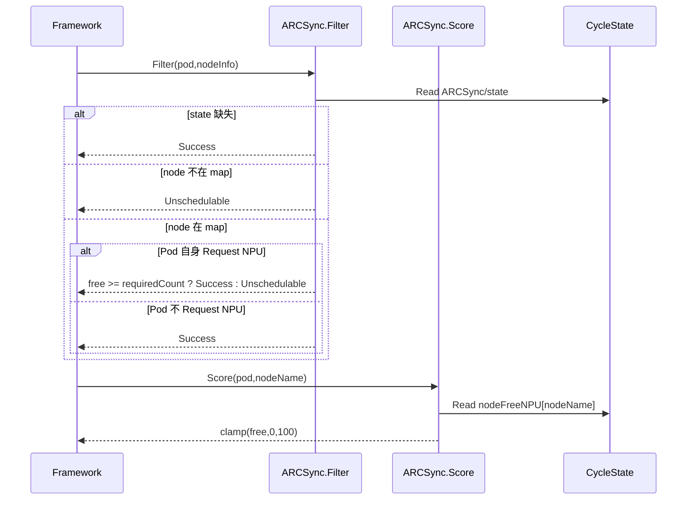

##### 5.9.4.2 SR-09 的 AR 原子实现分解

| AR | 已有实现动作 | 实现位置 | 已执行的处理逻辑 |
|---|---|---|---|
| **AR-09-01** | 计算可用节点 Map | ``PreFilter():365-377`` | 先排除 cordon / 不容忍污点 / nodeSelector / required affinity，得到 nodeName → free。 |
| **AR-09-02** | 节点过滤 | ``Filter():588-621`` | map 不包含节点就拒绝；无目标 NPU Request 的 Runner 不以该 Node 的 NPU free 判拒绝。 |
| **AR-09-03** | 节点评分 | ``Score():623-641`` | `score = clamp(free,0,MaxNodeScore)`；无独立 normalize，不能称之为 best-fit 评分。 |

**AR 与 SR 的关系**：上述 AR 都可以在 S-BASE/D-BASE 静态取证；对应验证只要求确认行为与源码一致，不把其风险修复当成 AR 已交付。

#### 5.9.5 用户接口设计

Pod nodeSelector、tolerations、nodeAffinity、container Requests；没有独立评分权重参数在 ARCSync 代码中。

#### 5.9.6 实现接口设计

##### 5.9.6.1 接口签名、契约和返回

`Filter(...nodeInfo *framework.NodeInfo) *framework.Status`、`Score(...nodeName string)(int64,*framework.Status)`；内置 NodeResourcesFit/NodeAffinity 等其它插件仍会运行。

本 SR 无独立 HTTP API，因而 Swagger/OpenAPI 路径 **N/A**；Kubernetes 资源结构及 Go Framework 扩展点是实际接口。

#### 5.9.7 领域对象与状态变更

相关对象：Pod nodeSelector、tolerations、nodeAffinity、container Requests；没有独立评分权重参数在 ARCSync 代码中。 状态由上表 AR 所列函数产生或消费；没有额外的持久化领域实体。

#### 5.9.8 验收与验证说明

- **TC-09-01**：TC-09A：Runner 仅标签要求 NPU，实际放在 CPU Node 时 Filter 返回 Success（`TestFilterRunnerPodPassesCPUNode`）。
- **TC-09-02**：TC-09B：NodeAffinity 禁止远端时不进入候选（`TestNodeMatchesPodSelection`）。
- **TC-09-03**：TC-09C：不在 nodeFreeNPU 的 Node 返回 `node not eligible...`（源码推导）。
- **TC-09-04**：TC-09D：free=8 分数为 8、free=150 截为 100、free<0 截为 0（源码推导）。

**判定规则**：现有测试函数只说明代码仓包含该测试，不能在本次未执行 Go Test 或没有集群访问的情况下声称测试已通过。对于风险复现用例，预期结果应保持与当前源码一致。

#### 5.9.9 DFX 分析（基于当前实现的 FMEA）

| FMEA 项 | 分析 |
|---|---|
| 失效模式/潜在影响 | Score 是 most-free 偏好，可能增加碎片；节点 `free` 未必是未来 Workflow 的可落地 NPU 集合；缺 CycleState 时 Filter fail-open。 |
| 安全/可靠/性能/服务性 | 安全：Kubernetes taints/affinity 补充过滤；可靠性：运行缓存中的 state 缺失导致插件不阻断；性能：Filter/Score 对单 Node O(1)；可服务性：无候选与不足余量返回不同原因。 |
| 当前控制措施与局限 | 该算法不是 NUMA/NPU 拓扑评分，也不是以最少碎片为目标的 best-fit。 |

**FMEA 检测性分析**：设置 NodeSelector、Affinity、污点、容器 NPU Request 并核对 Filter、Score。静态源码能够识别潜在故障与部分控制措施，但没有真实故障频率、恢复耗时和告警检出率，故本轮不虚构 S/O/D 数值或 RPN 排名。


**代码与配置证据**：[pkg/arcsync/arcsync.go#L129-L169](https://github.com/ascend-gha-runners/scheduler-plugins/blob/cc243f537e97ca4e34c6bd57030817a04ae204ec/pkg/arcsync/arcsync.go#L129-L169)；[pkg/arcsync/arcsync.go#L365-L377](https://github.com/ascend-gha-runners/scheduler-plugins/blob/cc243f537e97ca4e34c6bd57030817a04ae204ec/pkg/arcsync/arcsync.go#L365-L377)；[pkg/arcsync/arcsync.go#L588-L641](https://github.com/ascend-gha-runners/scheduler-plugins/blob/cc243f537e97ca4e34c6bd57030817a04ae204ec/pkg/arcsync/arcsync.go#L588-L641)。

### 5.10 SR-10：按命名空间和资源域执行严格 FIFO（IR-04）

#### 5.10.1 功能概述

**当前行为**：每次 PreFilter 聚合容量通过后才进入 `isOldestPendingRunner`；基于 CreationTimestamp/UID 检查更早未绑定的同类 Runner；存在更早任务时返回 Unschedulable。

**证据状态**：CODE + CONFIG（由主部署 PreFilter 激活）。

#### 5.10.2 用户故事与独立验收场景

**角色**：CI 开发者。

**用户故事**：作为同一 NPU 资源池的作业提交者，希望早提交且未绑定的 Runner 不因为调度重试被后来 Pod 越过。

**场景前置条件**：Pod 含 required-npu-count 标签；PodLister 可列出同 namespace Pod；容量门禁已通过。

#### 5.10.3 实现思路（实际源码）

1. 从 Pod Lister 列出全部 Pod；只筛选同 namespace、同 ResourceDomain、同 ResourceModel 和未绑定的有需求 Pod。
2. 依据 NamespaceOffloading 状态判断使用远端池 key，还是比较旧 Pod NodeSelector 约束。
3. 比较 CreationTimestamp 与 UID，发现更早者返回 false。
4. PreFilter 返回 `FIFO: waiting for older runner pods to be scheduled first`，否则继续写 state。

本轮不对尚未引入的算法或接口做开发选型；仅还原该代码基线真正采用的路径。

#### 5.10.4 实现设计

##### 5.10.4.1 SR-10 用例时序图

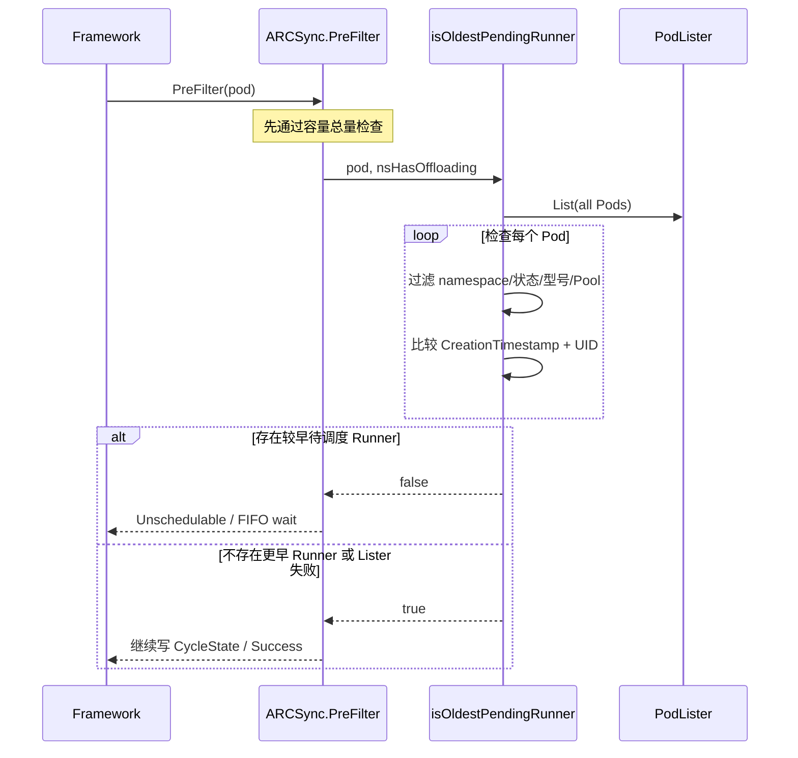

##### 5.10.4.2 SR-10 的 AR 原子实现分解

| AR | 已有实现动作 | 实现位置 | 已执行的处理逻辑 |
|---|---|---|---|
| **AR-10-01** | 枚举更早 Pod | ``isOldestPendingRunner():193-227`` | 过滤不同命名空间、终态、已绑定、无 NPU 标签或资源类型不同的 Pod。 |
| **AR-10-02** | 按当前规则形成公平域 | ``isOldestPendingRunner():228-243`、`npuFIFOPool():255-260`` | Liqo 模式按 nodeSelector 的 remote-cluster-id；否则对旧 Pod 的 NodeSelector 做非对称包含检查。 |
| **AR-10-03** | 顺序判定及失败策略 | ``isOldestPendingRunner():244-253`、`PreFilter():449-453`` | 创建时间早者优先，时间相同时 UID 字典序小者优先；PodLister 列表报错时 fail-open。 |

**AR 与 SR 的关系**：上述 AR 都可以在 S-BASE/D-BASE 静态取证；对应验证只要求确认行为与源码一致，不把其风险修复当成 AR 已交付。

#### 5.10.5 用户接口设计

Pod `metadata.creationTimestamp`、UID、namespace、ResourceDomain/ResourceModel、NodeSelector；用户无独立 FIFO 开关或权重配置。

#### 5.10.6 实现接口设计

##### 5.10.6.1 接口签名、契约和返回

`isOldestPendingRunner(pod *v1.Pod,nsHasOffloading bool) bool`、`npuFIFOPool(*v1.Pod) string`；调用方 `PreFilter` 转换为 Framework Status。

本 SR 无独立 HTTP API，因而 Swagger/OpenAPI 路径 **N/A**；Kubernetes 资源结构及 Go Framework 扩展点是实际接口。

#### 5.10.7 领域对象与状态变更

相关对象：Pod `metadata.creationTimestamp`、UID、namespace、ResourceDomain/ResourceModel、NodeSelector；用户无独立 FIFO 开关或权重配置。 状态由上表 AR 所列函数产生或消费；没有额外的持久化领域实体。

#### 5.10.8 验收与验证说明

- **TC-10-01**：TC-10A：同 namespace 同型号两个未绑定 Runner，较新的 Pod 应由 FIFO 阻止（源码规则，需独立单测）。
- **TC-10-02**：TC-10B：已绑定、终态、异型号、跨 namespace 不阻止当前 Pod（源码规则）。
- **TC-10-03**：TC-10C：同一时间戳以 UID 小者优先（源码规则）。
- **TC-10-04**：TC-10D：无法获得 Pod 列表时 fail-open（源码规则）。
- **TC-10-05**：TC-10E：大卡数头部资源暂缺造成后续小任务阻塞（已知行为，不作为优化已完成）。

**判定规则**：现有测试函数只说明代码仓包含该测试，不能在本次未执行 Go Test 或没有集群访问的情况下声称测试已通过。对于风险复现用例，预期结果应保持与当前源码一致。

#### 5.10.9 DFX 分析（基于当前实现的 FMEA）

| FMEA 项 | 分析 |
|---|---|
| 失效模式/潜在影响 | 严格 FIFO 队首阻塞、非对称 NodeSelector 比较带来边界公平误判、跨 namespace 不保序、Lister 失败直接放行。 |
| 安全/可靠/性能/服务性 | 安全：不涉及用户身份或付费优先级；可靠性：Lister 失败改变排序约束；性能：每次 PreFilter 全 Pod List + 线性扫描 O(all pods)；可服务性：阻塞日志包含较早 Pod 名称，未提供公平等待统计指标。 |
| 当前控制措施与局限 | 不是 QueueSort，也不是 Scheduler 级抢占公平，不包含 Backfill。 |

**FMEA 检测性分析**：构造同池的先大后小 Pod，比较 CreationTimestamp、UID 和 FIFO 日志。静态源码能够识别潜在故障与部分控制措施，但没有真实故障频率、恢复耗时和告警检出率，故本轮不虚构 S/O/D 数值或 RPN 排名。


**代码与配置证据**：[pkg/arcsync/arcsync.go#L180-L260](https://github.com/ascend-gha-runners/scheduler-plugins/blob/cc243f537e97ca4e34c6bd57030817a04ae204ec/pkg/arcsync/arcsync.go#L180-L260)；[pkg/arcsync/arcsync.go#L443-L461](https://github.com/ascend-gha-runners/scheduler-plugins/blob/cc243f537e97ca4e34c6bd57030817a04ae204ec/pkg/arcsync/arcsync.go#L443-L461)。

### 5.11 SR-11：订阅调度相关事件与初始化外围缓存（IR-05）

#### 5.11.1 功能概述

**当前行为**：`EventsToRegister` 声明 Pod Add/Update/Delete、Node Add/Update；`New()` 初始化 Pod Lister 与两个可选 DynamicInformer；等待同步在 goroutine 中进行，`New` 不会先阻塞确保缓存已同步。

**证据状态**：CODE；实际 requeue 调度时机取决于 Scheduler Framework 处理事件的实现与主配置。

#### 5.11.2 用户故事与独立验收场景

**角色**：Scheduler 平台 SRE。

**用户故事**：在 Pod 或 Node 状态发生变化时，希望原调度器能够对之前无法调度的 Pod 重新考虑，并在启动时读取 Liqo/Volcano 的可选 CRD。

**场景前置条件**：Framework Handle 具有 SharedInformerFactory 与 KubeConfig；API 可达；可选 CRD 可能不存在。

#### 5.11.3 实现思路（实际源码）

1. `New` 从 Framework 取得 Pod Lister，初始化 map。
2. 使用 KubeConfig 构造 Dynamic Client；失败时返回不带外部 Lister 的插件。
3. 探测 NamespaceOffloading 与 Queue 资源是否存在，并分别启动 informer。
4. 如果存在待同步 cache，启动后台 goroutine `WaitForCacheSync`。
5. 声明框架应关注的 Pod 和 Node 事件。

本轮不对尚未引入的算法或接口做开发选型；仅还原该代码基线真正采用的路径。

#### 5.11.4 实现设计

##### 5.11.4.1 SR-11 用例时序图

```mermaid
sequenceDiagram
  participant BOOT as kube-scheduler
  participant AR as ARCSync.New
  participant API as K8s API
  participant INF as DynamicInformers
  participant FW as Scheduling Framework
  BOOT->>AR: New(ctx,handle)
  AR->>API: 探测 NamespaceOffloading / Queue CRD
  opt 对应 CRD 可用
    AR->>INF: 启动 informer.Run(ctx.Done)
    AR->>INF: 后台 WaitForCacheSync
  end
  AR-->>BOOT: Plugin
  FW->>AR: EventsToRegister()
  AR-->>FW: Pod Add/Update/Delete; Node Add/Update
  Note over AR,FW: CRD 变化事件未直接列在该返回列表
```

##### 5.11.4.2 SR-11 的 AR 原子实现分解

| AR | 已有实现动作 | 实现位置 | 已执行的处理逻辑 |
|---|---|---|---|
| **AR-11-01** | 初始化插件 | ``New():68-104`` | 使用 DynamicSharedInformerFactory(30s resync)，但手工启动实际 informer；KubeConfig 不可用时仍返回非 nil 插件。 |
| **AR-11-02** | 检查 CRD 存在 | ``crdExists():107-117`` | List 成功视为存在；NotFound 视为不存在；其他错误仍可能视为存在。 |
| **AR-11-03** | 注册事件类型 | ``EventsToRegister():122-127`` | Pod Add/Update/Delete；Node Add/Update。没有独立注册 Queue/NamespaceOffloading 的 Enqueue 事件。 |

**AR 与 SR 的关系**：上述 AR 都可以在 S-BASE/D-BASE 静态取证；对应验证只要求确认行为与源码一致，不把其风险修复当成 AR 已交付。

#### 5.11.5 用户接口设计

无需新用户接口；监听依赖 K8s API；事件源是 Framework Pod/Node 事件。

#### 5.11.6 实现接口设计

##### 5.11.6.1 接口签名、契约和返回

`New(ctx,runtime.Object,h framework.Handle)(framework.Plugin,error)`、`EventsToRegister(ctx) ([]framework.ClusterEventWithHint,error)`。

本 SR 无独立 HTTP API，因而 Swagger/OpenAPI 路径 **N/A**；Kubernetes 资源结构及 Go Framework 扩展点是实际接口。

#### 5.11.7 领域对象与状态变更

相关对象：无需新用户接口；监听依赖 K8s API；事件源是 Framework Pod/Node 事件。 状态由上表 AR 所列函数产生或消费；没有额外的持久化领域实体。

#### 5.11.8 验收与验证说明

- **TC-11-01**：TC-11A：声明 Pod Add/Update/Delete 和 Node Add/Update（源码检查）。
- **TC-11-02**：TC-11B：Liqo CRD 不存在时 pl.nsOffloadingLister 为 nil（源码行为）。
- **TC-11-03**：TC-11C：CRD 缓存尚未同步时可能只有本地候选（行为复现）。
- **TC-11-04**：TC-11D：只更新 Queue/NamespaceOffloading CR 是否立刻使 Pending Runner 重排——不可从本代码保证，需要集成验证。

**判定规则**：现有测试函数只说明代码仓包含该测试，不能在本次未执行 Go Test 或没有集群访问的情况下声称测试已通过。对于风险复现用例，预期结果应保持与当前源码一致。

#### 5.11.9 DFX 分析（基于当前实现的 FMEA）

| FMEA 项 | 分析 |
|---|---|
| 失效模式/潜在影响 | 外部 CRD 改变未单独列为 Enqueue 事件；尚未同步 informer 可能导致错误回退或误判；按 Pod/Node 大量更新可能增加调度负载。 |
| 安全/可靠/性能/服务性 | 安全：使用与 Scheduler 相同 KubeConfig，ServiceAccount 权限较大；可靠性：外部缓存无 fail-close 门禁；性能：watch+resync 和每次 PreFilter 快照扫描；可服务性：没有缓存同步健康状态 API。 |
| 当前控制措施与局限 | 声明事件类型不等同于承诺精确重排时延；Queue/Offloading 对象变化缺少显式事件注册。 |

**FMEA 检测性分析**：执行 Pod/Node 变更与只变更外部 CRD 两组实验，观察重新入队时序。静态源码能够识别潜在故障与部分控制措施，但没有真实故障频率、恢复耗时和告警检出率，故本轮不虚构 S/O/D 数值或 RPN 排名。


**代码与配置证据**：[pkg/arcsync/arcsync.go#L68-L127](https://github.com/ascend-gha-runners/scheduler-plugins/blob/cc243f537e97ca4e34c6bd57030817a04ae204ec/pkg/arcsync/arcsync.go#L68-L127)；[pkg/arcsync/liqo.go#L18-L74](https://github.com/ascend-gha-runners/scheduler-plugins/blob/cc243f537e97ca4e34c6bd57030817a04ae204ec/pkg/arcsync/liqo.go#L18-L74)。

### 5.12 SR-12：按 GitOps 部署与配置专用 NPU Scheduler（IR-05）

#### 5.12.1 功能概述

**当前行为**：D-BASE 主清单：Deployment 单副本、ARM64、hostNetwork、镜像 `cc243f...`；ConfigMap 启用 ARCSync 的 PreFilter/Filter/Score/Reserve；`leaderElect=false`；ClusterRoleBinding 引用 cluster-admin。

**证据状态**：CONFIG + CODE；实际运行态未知。

#### 5.12.2 用户故事与独立验收场景

**角色**：集群平台管理员。

**用户故事**：当集群启用 NPU Runner 时，希望可以通过 GitOps 清单部署独立 kube-scheduler，并指定哪些 Pod 归该 scheduler 处理。

**场景前置条件**：集群配置好 Argo CD、Kube API、镜像拉取 Secret，且 Pod.spec.schedulerName=npu-scheduler。

#### 5.12.3 实现思路（实际源码）

1. Argo CD Application 指向 `manifests/scheduler-plugins-new`。
2. Kustomize 注入 ConfigMap/Deployment/ServiceAccount 与 ClusterRoleBinding。
3. Deployment 启动 `/bin/kube-scheduler --config=... --v=4`。
4. Kube Scheduler 按 profile 接管 schedulerName=npu-scheduler 的 Pod。
5. ARCSync 仅在显式配置的扩展点生效；由 Framework 与内置插件共同调度。

本轮不对尚未引入的算法或接口做开发选型；仅还原该代码基线真正采用的路径。

#### 5.12.4 实现设计

##### 5.12.4.1 SR-12 用例时序图

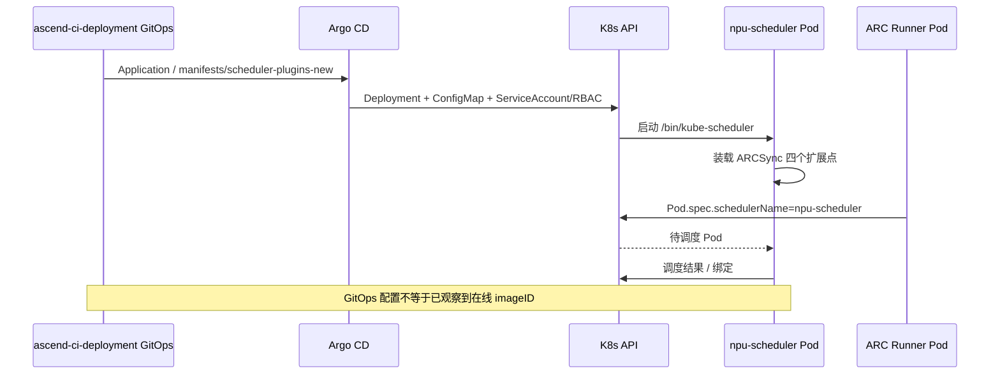

##### 5.12.4.2 SR-12 的 AR 原子实现分解

| AR | 已有实现动作 | 实现位置 | 已执行的处理逻辑 |
|---|---|---|---|
| **AR-12-01** | 定义调度器工作负载 | `D-BASE `manifests/scheduler-plugins-new/deployment.yaml`` | 单副本/ARM64/hostNetwork/专用 ConfigMap；imagePullPolicy Always。 |
| **AR-12-02** | 声明 Framework 扩展点 | `D-BASE `manifests/scheduler-plugins-new/configmap.yaml`` | PreFilter/Filter/Score/Reserve 显式启用；未显式列 PostBind。 |
| **AR-12-03** | 授予 API 权限 | `D-BASE `manifests/scheduler-plugins-new/serviceaccount.yaml`` | ServiceAccount npu-scheduler；ClusterRoleBinding 到 cluster-admin。 |
| **AR-12-04** | 指定 Runner 使用调度器 | `D-BASE `other/ascend-gha-runners/linux-aarch64-a5-2-sh001/values.yaml`` | Runner 模板定义 schedulerName=npu-scheduler 与 NPU 需求标签；属于一个已查阅配置样例。 |

**AR 与 SR 的关系**：上述 AR 都可以在 S-BASE/D-BASE 静态取证；对应验证只要求确认行为与源码一致，不把其风险修复当成 AR 已交付。

#### 5.12.5 用户接口设计

GitOps YAML；Runner Pod.spec.schedulerName；Pod labels。没有 ARCSync 自定义 UI 或 Swagger。

#### 5.12.6 实现接口设计

##### 5.12.6.1 接口签名、契约和返回

外部接口：KubeSchedulerConfiguration(v1)、Deployment(v1)、ServiceAccount、ClusterRoleBinding 和 Argo CD Application；运行命令为 `/bin/kube-scheduler --config=/etc/kubernetes/scheduler-config.yaml --v=4`。

本 SR 无独立 HTTP API，因而 Swagger/OpenAPI 路径 **N/A**；Kubernetes 资源结构及 Go Framework 扩展点是实际接口。

#### 5.12.7 领域对象与状态变更

相关对象：GitOps YAML；Runner Pod.spec.schedulerName；Pod labels。没有 ARCSync 自定义 UI 或 Swagger。 状态由上表 AR 所列函数产生或消费；没有额外的持久化领域实体。

#### 5.12.8 验收与验证说明

- **TC-12-01**：TC-12A：静态检查主配置启用四个扩展点且 schedulerName=npu-scheduler（已核对 YAML）。
- **TC-12-02**：TC-12B：实际 Pod spec.image 与 status.containerStatuses[].imageID 必须在目标集群核对（尚未执行）。
- **TC-12-03**：TC-12C：运行时是否触发 PostBind 需要实际 Scheduler 调用链验证。
- **TC-12-04**：TC-12D：单副本终止或重启期间 Pending 行为须在线观察（尚未执行）。

**判定规则**：现有测试函数只说明代码仓包含该测试，不能在本次未执行 Go Test 或没有集群访问的情况下声称测试已通过。对于风险复现用例，预期结果应保持与当前源码一致。

#### 5.12.9 DFX 分析（基于当前实现的 FMEA）

| FMEA 项 | 分析 |
|---|---|
| 失效模式/潜在影响 | Cluster-admin 过宽；单副本和关闭 Leader Election 形成可用性风险；静态 `:sha` 标签不是镜像 digest 固定证明；不同集群/旧版/测试版逻辑可能不一致。 |
| 安全/可靠/性能/服务性 | 安全：cluster-admin SA，需限制 Kubernetes 配置更改权限（现状风险）；可靠性：单副本无选主、内存预约重启丢失；性能：`--v=4` 日志量随事件增加；可服务性：应先以 Argo CD 及实际 Pod 状态做版本取证，本次未连接集群。 |
| 当前控制措施与局限 | 本功能不保证所有 Argo CD Application 已同步，也不保证多集群实际运行镜像一致。 |

**FMEA 检测性分析**：只读检查实际 Pod imageID、LeaderElection、重启及 RoleBinding 审计。静态源码能够识别潜在故障与部分控制措施，但没有真实故障频率、恢复耗时和告警检出率，故本轮不虚构 S/O/D 数值或 RPN 排名。


**代码与配置证据**：[cmd/scheduler/main.go#L33-L43](https://github.com/ascend-gha-runners/scheduler-plugins/blob/cc243f537e97ca4e34c6bd57030817a04ae204ec/cmd/scheduler/main.go#L33-L43)；[manifests/scheduler-plugins-new/deployment.yaml](https://github.com/opensourceways/ascend-ci-deployment/blob/3dd81ed95e0fe659d81b1cbf629fc62620bbfff8/manifests/scheduler-plugins-new/deployment.yaml)；[manifests/scheduler-plugins-new/configmap.yaml](https://github.com/opensourceways/ascend-ci-deployment/blob/3dd81ed95e0fe659d81b1cbf629fc62620bbfff8/manifests/scheduler-plugins-new/configmap.yaml)；[manifests/scheduler-plugins-new/serviceaccount.yaml](https://github.com/opensourceways/ascend-ci-deployment/blob/3dd81ed95e0fe659d81b1cbf629fc62620bbfff8/manifests/scheduler-plugins-new/serviceaccount.yaml)。

## 6 当前实现差距与证据闭环（非本次开发范围）

> 本章只是记录根据源码发现的业务目标风险，不给出现网中不存在的具体接口/算法作为“既有设计”。任何改造都需要后续独立立项、设计和实现，本次**不修改业务代码**。

| GAP | 对应 IR / SR | 当前代码事实 | 对 BG 的可能影响 | 如何补充证据（仅验证，不实施改造） |
|---|---|---|---|---|
| GAP-01 | IR-01 / SR-01 | `Atoi` 错误被忽略；缺少对资源域/型号格式的强校验 | 无效 Runner 资源声明可能绕过保护 | 构造非法标签 Pod，检查 Events 和调度结果 |
| GAP-02 | IR-01 / SR-03 | `totalNPUFree` 为节点剩余量求和，非单节点可行性 | 4+4 可能放行未来需要单节点 8 卡的 Runner | 造两个 4 卡节点、1 个 8 卡 Runner，记录其状态 |
| GAP-03 | IR-01 / SR-03/SR-09 | 聚合总量本地分支未重复校验 NodeSelector/affinity | 预检可能统计不满足 Pod placement 约束的本地 NPU | nodeSelector 定向无 NPU Node，其它 Node 有 NPU |
| GAP-04 | IR-02 / SR-04 | 预约仅存在进程内、生命周期依赖 Snapshot 与当前 scheduler | 重启或多实例造成预留丢失/不一致 | Scheduler 单副本重启前后比对 Pending/预留行为 |
| GAP-05 | IR-02 / SR-05 | `activeWorkflows` key 仅为 baseName，不带 namespace；`PostBind` 没有被主 YAML 显式启用 | 跨 namespace 同名干扰、交接不确定 | 构造双 namespace 同名 Workflow，确认计算结果；检查运行回调 |
| GAP-06 | IR-03 / SR-06 | `clusterSelector` 无 terms 时匹配所有虚拟 Node | 远端候选扩大，潜在违背授权意图 | 用无 selector terms 的 NamespaceOffloading 复现 |
| GAP-07 | IR-03 / SR-08 | 读取 Pod Queue annotation，且只在 NamespaceOffloading 分支应用 | 配额未生效/只限制本地 | 分别配 Pod 和 Namespace annotation；比较 No-Liqo 路径 |
| GAP-08 | IR-04 / SR-10 | FIFO 严格拦截，没有 Backfill；非 Liqo 的选择器比较非对称 | 队首阻塞、部分边界不符合“公平”直觉 | 构造同 pool 先 8 卡后 1 卡的压力情景 |
| GAP-09 | IR-05 / SR-11 | CRD 缓存同步异步、Queue/Offloading 事件未显式注册 | 配置刚变更时 Pending Pod 可能不能及时重新评估 | CRD 单独修改后观察重试触发源及时间 |
| GAP-10 | IR-05 / SR-12 | 单副本、leaderElect:false、ClusterRoleBinding 到 cluster-admin | 可用性和权限面风险 | 只读审计 Argo CD Live State、RBAC 和镜像 digest |
| GAP-11 | BG-01 / 系统外部 | 示例 Workflow 使用 `schedulerName: volcano`，不由 ARCSync 完整决定 | 无法凭 Runner 准入证明 Workflow 一定运行 | 联合观察 Runner、Workflow NodeName、GPU/NPU Request、排队与执行时序 |

### 6.1 ARCSYNC_GUIDE.md 与实现的不一致

| 指南叙述 | 真实源码 | 文档写法原则 |
|---|---|---|
| “至少一个节点满足未来 Workflow 需求” | `hasCandidate` 采用 `Σ node free >= requiredCount` | **以源码为准：聚合余量判定** |
| 先读取 `npu-count` 再 Requests | 本地占用为 `max(Requests之和,匹配的 npu-count)` | **以源码为准：取较大值** |
| NamespaceOffloading 示例 `clusterSelector.matchLabels` | `extractClusterSelectorTerms` 解析 `v1.NodeSelector.nodeSelectorTerms` | **以源码为准：不采纳 matchLabels 示例** |
| Queue 名称来自 Namespace annotation | `getQueueNpuLimit` 读取 `pod.Annotations[...]` | **以源码为准：Pod annotation** |
| 公平等待概述 | 有范围的严格 FIFO，Lister 失败 fail-open | **保留真实比较条件和失败规则** |
| PostBind 有函数即可工作 | GitOps 未显式启用 PostBind 阶段 | **区分 CODE 与 CONFIG / RUNTIME-UNKNOWN** |

### 6.2 “忠于代码”的复审清单

- [x] 源码按 S-BASE 固定提交，而不是引用最新 master。
- [x] 对应部署版本按 D-BASE 的 GitOps 声明取证，未冒充实时运行态。
- [x] 业务目标仅 BG-01、BG-02。
- [x] 章节为 2 功能域概述、3 总体方案、4 规格、5 功能实现设计。
- [x] 每个 IR 可追踪到独立 SR；每个 SR 有用户故事、AR、时序图、接口、DFX/FMEA 与 TC。
- [x] 所有 AR 都回指当前函数或 YAML 的实际动作，而非新方法、新 CRD 或待开发功能。
- [x] 尚未实现的需求和缺陷单列 GAP，不写成生产能力。
- [ ] 实际集群 `imageID`、各扩展点回调、Job 排队指标——本次未访问在线集群。
- [ ] Go test / Kubernetes e2e——本次只编制文档，**未修改或执行业务代码**。

## 7 源码索引与验收追踪总表

### 7.1 主仓库源码索引

- [注册入口：cmd/scheduler/main.go](https://github.com/ascend-gha-runners/scheduler-plugins/blob/cc243f537e97ca4e34c6bd57030817a04ae204ec/cmd/scheduler/main.go)
- [调度核心：pkg/arcsync/arcsync.go](https://github.com/ascend-gha-runners/scheduler-plugins/blob/cc243f537e97ca4e34c6bd57030817a04ae204ec/pkg/arcsync/arcsync.go)
- [Liqo 适配：pkg/arcsync/liqo.go](https://github.com/ascend-gha-runners/scheduler-plugins/blob/cc243f537e97ca4e34c6bd57030817a04ae204ec/pkg/arcsync/liqo.go)
- [Volcano 适配：pkg/arcsync/volcano.go](https://github.com/ascend-gha-runners/scheduler-plugins/blob/cc243f537e97ca4e34c6bd57030817a04ae204ec/pkg/arcsync/volcano.go)
- [现有 Go 单测：pkg/arcsync/arcsync_test.go](https://github.com/ascend-gha-runners/scheduler-plugins/blob/cc243f537e97ca4e34c6bd57030817a04ae204ec/pkg/arcsync/arcsync_test.go)
- [主部署 ConfigMap](https://github.com/opensourceways/ascend-ci-deployment/blob/3dd81ed95e0fe659d81b1cbf629fc62620bbfff8/manifests/scheduler-plugins-new/configmap.yaml)
- [主部署 Deployment](https://github.com/opensourceways/ascend-ci-deployment/blob/3dd81ed95e0fe659d81b1cbf629fc62620bbfff8/manifests/scheduler-plugins-new/deployment.yaml)
- [Argo CD Applications](https://github.com/opensourceways/ascend-ci-deployment/blob/3dd81ed95e0fe659d81b1cbf629fc62620bbfff8/argocd/clusters/scheduler-plugins.yaml)

### 7.2 SR → AR → TC 追踪

| IR | SR | AR（当前代码动作） | TC（本次提供的验收场景） |
|---|---|---|---|
| IR-01 | SR-01 基于 Runner NPU 标签激活调度插件 | AR-01-01, AR-01-02, AR-01-03 | TC-01-01, TC-01-02, TC-01-03 |
| IR-01 | SR-02 统计本地和虚拟节点 NPU 资源占用 | AR-02-01, AR-02-02, AR-02-03, AR-02-04 | TC-02-01, TC-02-02, TC-02-03 |
| IR-01 | SR-03 执行 NPU 聚合容量准入 | AR-03-01, AR-03-02, AR-03-03 | TC-03-01, TC-03-02, TC-03-03, TC-03-04 |
| IR-02 | SR-04 管理进程内 NPU 在途预留 | AR-04-01, AR-04-02, AR-04-03 | TC-04-01, TC-04-02, TC-04-03, TC-04-04 |
| IR-02 | SR-05 使用 Workflow 命名关系交接资源计量 | AR-05-01, AR-05-02, AR-05-03 | TC-05-01, TC-05-02, TC-05-03 |
| IR-03 | SR-06 识别并筛选 Liqo 虚拟节点 | AR-06-01, AR-06-02, AR-06-03, AR-06-04 | TC-06-01, TC-06-02, TC-06-03, TC-06-04 |
| IR-03 | SR-07 本地与远端资源池的比较及择优 | AR-07-01, AR-07-02, AR-07-03 | TC-07-01, TC-07-02, TC-07-03, TC-07-04 |
| IR-03 | SR-08 有条件读取 Volcano Queue 限额 | AR-08-01, AR-08-02, AR-08-03 | TC-08-01, TC-08-02, TC-08-03, TC-08-04 |
| IR-03 | SR-09 候选节点 Filter 和空闲量 Score | AR-09-01, AR-09-02, AR-09-03 | TC-09-01, TC-09-02, TC-09-03, TC-09-04 |
| IR-04 | SR-10 按命名空间和资源域执行严格 FIFO | AR-10-01, AR-10-02, AR-10-03 | TC-10-01, TC-10-02, TC-10-03, TC-10-04, TC-10-05 |
| IR-05 | SR-11 订阅调度相关事件与初始化外围缓存 | AR-11-01, AR-11-02, AR-11-03 | TC-11-01, TC-11-02, TC-11-03, TC-11-04 |
| IR-05 | SR-12 按 GitOps 部署与配置专用 NPU Scheduler | AR-12-01, AR-12-02, AR-12-03, AR-12-04 | TC-12-01, TC-12-02, TC-12-03, TC-12-04 |

> 编号状态：AR 表示**现存的实现动作**；TC 表示**建议核验当前行为的测试场景**，并不宣称本轮已运行全部 TC。后续如真实代码升级，应基于新的 commit 更新这一追踪表，再编制 TO-BE 变更设计，不得在 AS-IS 文档中先写新功能。
